# 数智人事 (HRM System)

> 基于 Spring Boot 3.4 与 Vue 2.6 构建的现代化全栈人力资源管理系统，深度集成 Flowable 工作流引擎、企业知识库（RAG）与智能问答。

## 🌐 在线体验

| 项目 | 地址 |
| :--- | :--- |
| 系统入口 | <https://hrm.qiujie.net.cn> |
| 接口文档（Swagger UI） | <https://hrm.qiujie.net.cn/api/swagger-ui.html> |
| 健康检查 | <https://hrm.qiujie.net.cn/api/actuator/health> |

**演示账号**：`admin` / `123456`

> 线上环境用于功能演示与验收，请勿录入真实员工信息与薪酬数据。

---

## 📖 项目介绍

**数智人事** 是一套面向现代企业的高效人力资源全流程管理系统，旨在提升组织人效与员工自主服务体验。系统采用前后端分离架构，融合企业业务管理规范与先进的生成式 AI 技术：

- **传统业务闭环**：覆盖组织架构、员工全生命周期档案、菜单与角色细粒度 RBAC 权限体系、Flowable 审批流转、灵活考勤与打卡统计、精细化加班与多维假期管理、薪资核算与五险一金配置。
- **智能化升级**：提供基于 RAG（检索增强生成）的企业知识库智能问答，具备员工上下文感知，覆盖政策制度等人事咨询场景。
- **数据批量处理**：考勤、加班、薪资等模块支持 Excel 异步导入导出，带进度推送、失败行明细与错误文件下载。

---

## ✨ 核心亮点

- **业务流程深度解耦与纯计算领域设计**：
  - 加班时长核算（`OvertimeUtil`）、薪资核算（`SalaryUtil`，含社保公积金扣减与考勤扣款）以及请假审批副作用处理（`ManagerApproveListener`）收敛为无框架依赖的纯函数领域模型，具备极高的单测覆盖与维护确定性。
- **Flowable 8.0 流程引擎原生适配**：
  - 深度整合 Spring Boot 3.4 与 Flowable 引擎，引擎表存放在同实例的 `hrm_flowable` 库，通过 `hrm_flowable.` 库名前缀复用 master 连接；业务状态与流程推进共享同一个本地事务，一侧失败时两边一起回滚。
- **双 Token 自动无感续期机制**：
  - 基于 httpOnly Cookie 的双 Token（Access Token + Refresh Token）鉴权体系，前端拦截器透明处理并发无感刷新，阻断 XSS 与 Token 劫持风险。
- **异步文件任务引擎与分片上传**：
  - `FileTaskService` → `FileTaskEngine` 流式读写 Excel（EasyExcel），按批次回调业务校验与入库，逐行记录失败原因；任务进度经 SSE 实时推送，结束后可下载错误明细文件。前端通过 `/file-upload/init` + `/file-upload/chunks` 分片上传，文件中心与业务导入共用同一套协议。
- **混合持久化与企业级 RAG 知识检索**：
  - 采用 MySQL（业务）+ Redis（验证码/缓存）+ PostgreSQL/pgvector（向量库）+ MinIO（对象存储）的多引擎存储架构；文档解析（PDF / DOCX / Markdown / TXT）、切块与向量化构成完整 ETL 流水线，检索侧用「向量召回 + 关键词召回 → RRF 融合 → DashScope 精排」提升语义命中率。
- **企业知识库与智能问答**：
  - 搭载兼容 DashScope / OpenAI 规范的智能问答服务，先经意图闸门（知识问答 / 闲聊 / 无关）分流，再结合知识库检索结果与员工静态上下文（部门、岗位等档案信息）生成回答；回答带证据充分度评估与引用编号，全程流式输出。
- **站内通知中心**：
  - 通知落库 + SSE 实时推送，支持未读数、标记已读与分页查询，审批结果与异步任务完成均通过同一通道触达。

---

## 🖼️ 页面展示

系统各主要功能模块页面效果如下：

### 1. 登录认证与首页仪表盘
| 登录界面 | 首页仪表盘（工作台与考勤日历） |
| :---: | :---: |
| 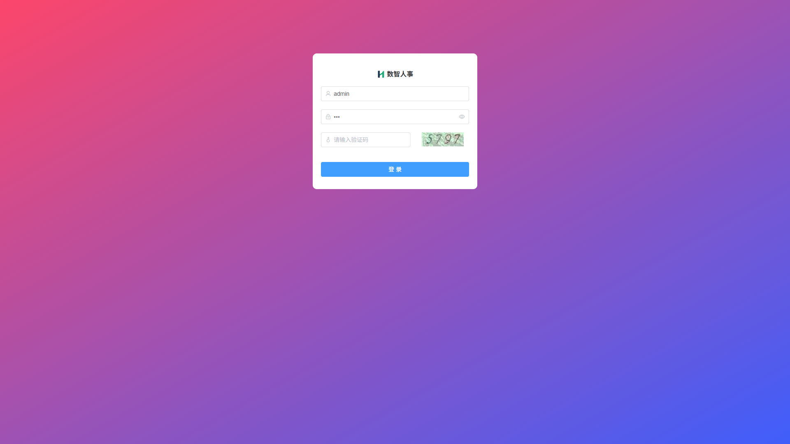 | 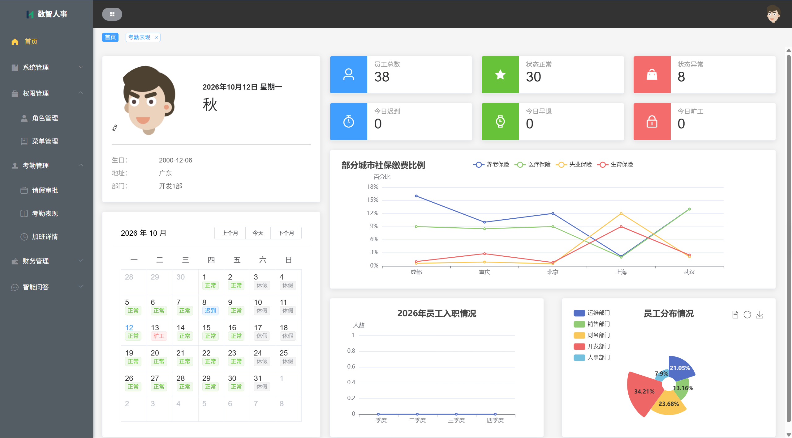 |

### 2. 系统管理
| 员工管理 | 部门管理 |
| :---: | :---: |
| 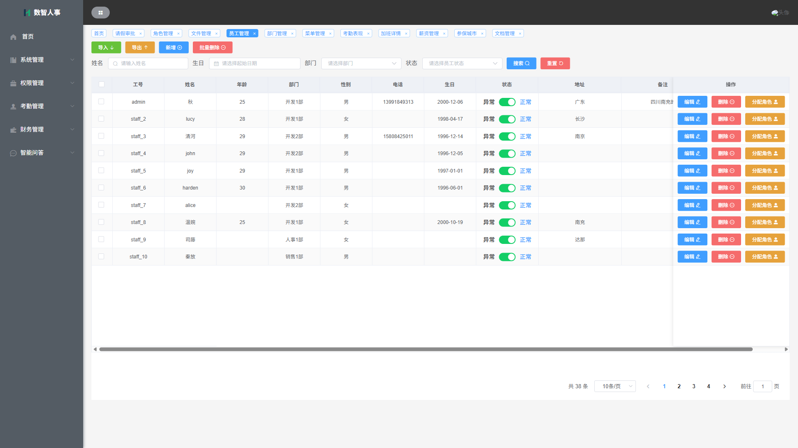 | 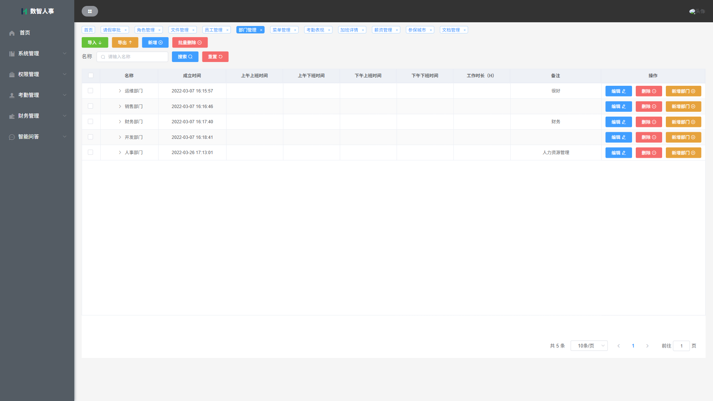 |
| **文件中心** | |
| 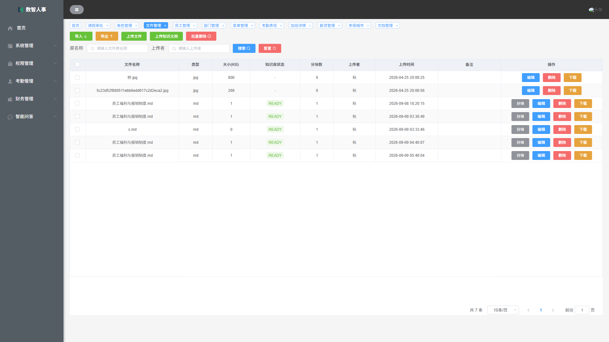 | |

### 3. 权限管理
| 角色权限分配 | 菜单权限配置 |
| :---: | :---: |
| 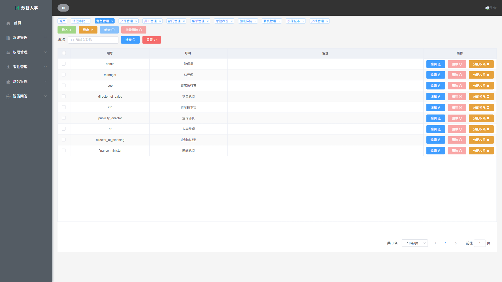 | 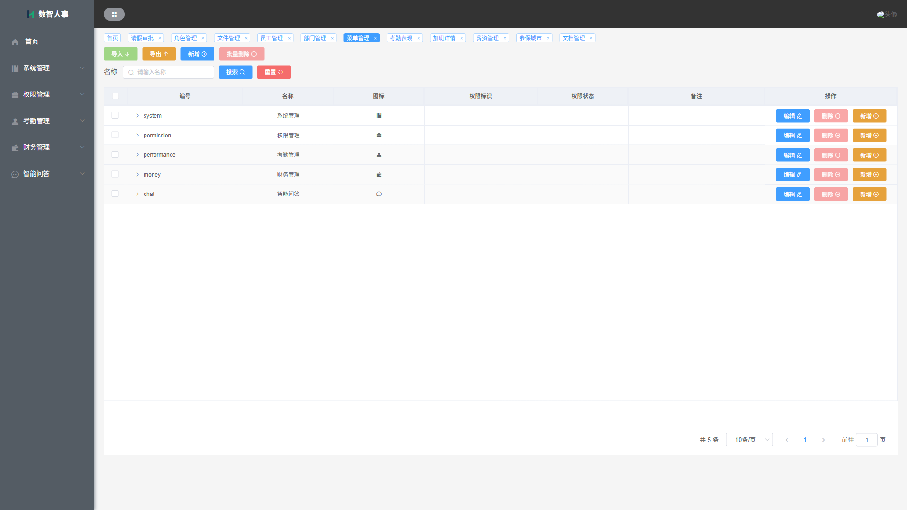 |

### 4. 考勤与审批管理
| 请假申请与审批 | 考勤表现分析 |
| :---: | :---: |
| 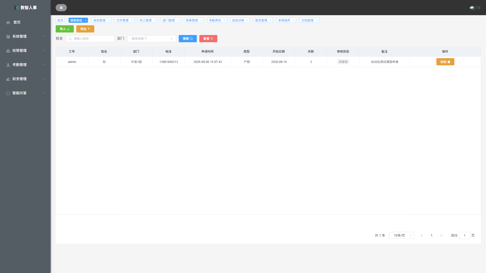 |  |
| **加班详情核算** | |
| 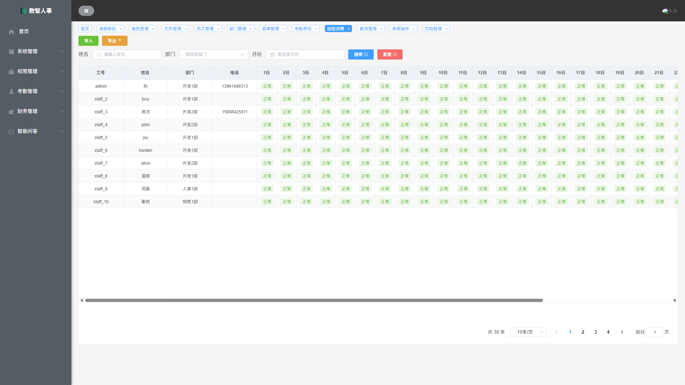 | |

### 5. 财务与社保管理
| 员工薪资管理 | 参保城市与五险一金比例 |
| :---: | :---: |
| 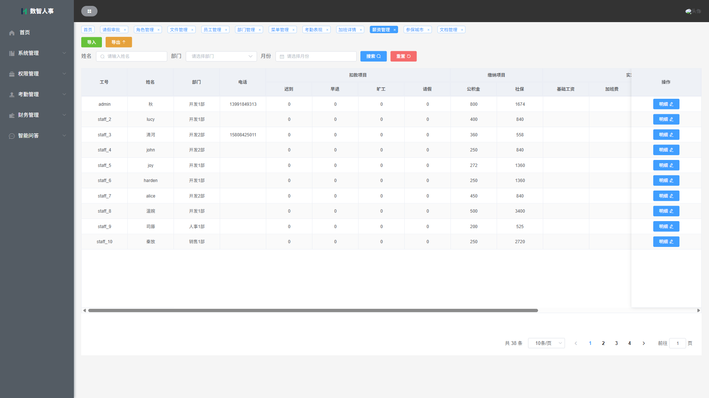 | 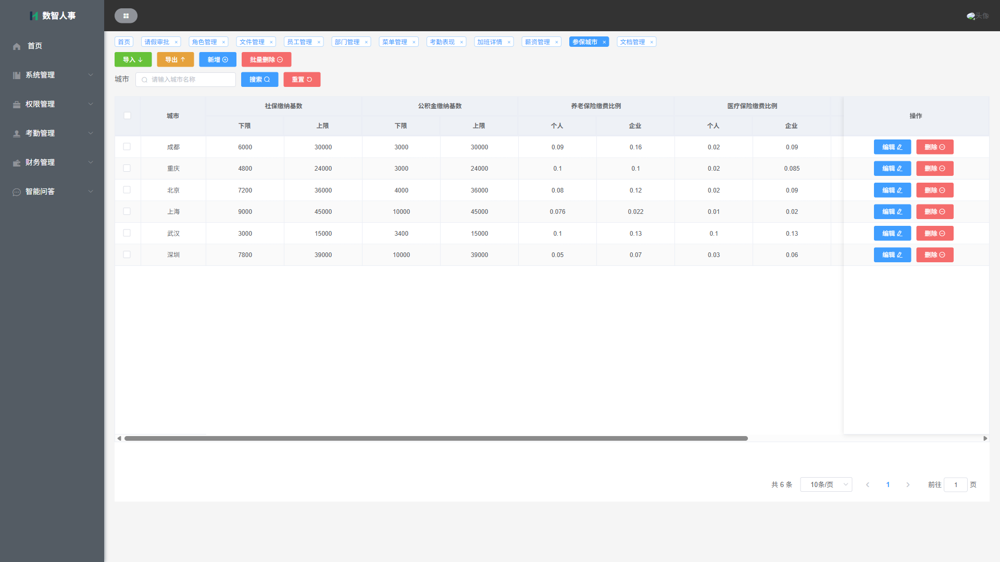 |

### 6. 智能问答
| 智能问答（会话与流式回答） |
| :---: |
| 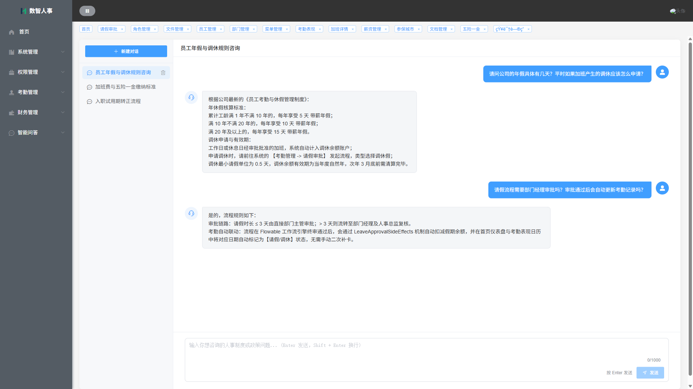 |

---

## 🔄 核心业务流程图

系统关键核心业务（请假审批流转链路 + 企业知识库智能问答闭环）如下所示：

```mermaid
flowchart TD
    subgraph ApprovalFlow["1. 请假审批流转链路"]
        A1[员工端发起申请] --> A2{是否满足申请校验}
        A2 -- 余额/天数合法 --> A3[写入业务申请表并启动 Flowable 流程]
        A2 -- 校验不通过 --> A1
        A3 --> A4[主管/审批人接收任务]
        A4 --> A5{审批决策}
        A5 -- 驳回 --> A6[更新业务单据状态为驳回]
        A5 -- 批准 --> A7[触发审批监听器副作用处理]
        A7 --> A8[扣减员工请假天数 / 增加调休时长]
        A8 --> A9[写入考勤状态记录与站内通知]
    end

    subgraph RagFlow["2. 企业知识库与智能问答链路"]
        B1[管理员上传制度文档] --> B2[MinIO 原始文件存储]
        B2 --> B3[ETL 管道: 文档解析与切块]
        B3 --> B4[DashScope Embedding 向量化]
        B4 --> B5[(PostgreSQL pgvector 向量库)]

        C1[员工发送人事咨询问题] --> C2[意图闸门: 分类 + 查询改写]
        C2 -- 知识问答 --> C3[向量召回 + 关键词召回]
        C3 --> B5
        B5 --> C4[RRF 融合候选集]
        C4 --> C5[DashScope 重排序精排]
        C5 --> C6[组合检索上下文、员工档案与证据充分度]
        C6 --> C7[大模型流式生成回答并标注引用]
        C7 --> C8[前端 Markdown 渲染与 SSE 输出]
        C2 -- 闲聊 / 无关 --> C9[直接应答或固定文案]
    end
```

---

## 🛠️ 技术栈

### 后端核心架构

| 技术组件 | 版本 | 用途与说明 |
| :--- | :--- | :--- |
| **Java** | 17 | 开发语言运行环境 |
| **Spring Boot** | 3.4.4 | 现代化微服务脚手架与依赖管理 |
| **MyBatis-Plus** | 3.5.10 | ORM 增强框架，支持多数据源隔离与灵活查询 |
| **Flowable** | 8.0.0 | 原生支持 Spring Boot 3 的企业级工作流引擎 |
| **Spring AI** | 1.0.0 | 大模型抽象层（`spring-ai-starter-model-openai`），对接 DashScope OpenAI 兼容端点 |
| **Spring Security** | 6.4.x | 细粒度 RBAC 安全认证与授权控制 |
| **JJWT** | 0.11.5 | 无状态的双 Token 签名、加解密与有效期校验 |
| **SpringDoc OpenAPI** | 2.8.10 | 遵循 OpenAPI 3.1 规范的接口交互文档（Swagger UI） |
| **EasyExcel** | 3.3.4 | 流式 Excel 读写，支撑异步导入导出与错误明细 |
| **PDFBox / POI** | 2.0.31 / 5.2.5 | 知识库 PDF 与 DOCX 文档文本抽取 |
| **Hutool** | 5.8.25 | 通用工具集（日期、字符串处理等） |
| **MinIO Client** | 8.5.7 | S3 兼容对象存储客户端，管理附件与制度文档 |
| **MySQL** | 8.1 | 主业务数据库（`hrm`）；Flowable 引擎表存于同实例的 `hrm_flowable` 库，由 master 数据源以 `hrm_flowable.` 库名前缀访问 |
| **PostgreSQL** | 16 (pgvector) | 知识库分块与 `vector(1024)` 高维向量存储（`hrm_kb`） |
| **Redis** | 5.0 | 图形验证码与缓存，key 统一带 `hrm:` 前缀 |
| **MinIO** | Latest | S3 兼容的高性能私有化对象存储服务 |

### 前端技术栈

| 技术组件 | 版本 | 用途与说明 |
| :--- | :--- | :--- |
| **Vue.js** | 2.6.14 | 核心渐进式前端渲染框架 |
| **Element UI** | 2.15.7 | 经典桌面端企业级 UI 组件库 |
| **Vue Router** | 3.5.3 | 前端路由管理，支持基于后端动态菜单的路由载入 |
| **Vuex** | 3.6.2 | 全局集中式状态管理（用户信息、权限点列表等） |
| **Axios** | 0.25.0 | 网络请求库，封装响应拦截器以支持 401 自动无感静默刷新 |
| **ECharts** | 5.3.0 | 首页仪表盘考勤分布与可视化图表分析 |
| **marked + DOMPurify** | 4.3.0 / 3.4.17 | 智能问答回答的 Markdown 渲染与 XSS 消毒 |
| **Moment.js** | 2.30.1 | 日期格式化与考勤日历计算 |

---

## 🏗️ 系统架构图

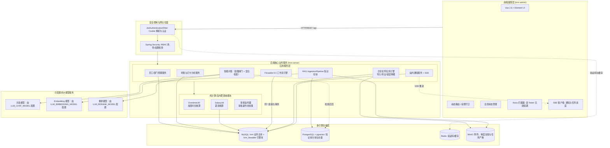

---

## 📂 项目目录结构

```text
hrm/
├── db/                             # 数据库初始化脚本（全量结构 + 种子数据）
│   ├── mysql/
│   │   ├── hrm.sql                 # 业务主库表结构
│   │   └── hrm_flowable.sql        # Flowable 引擎表结构（hrm_flowable 库）
│   └── postgresql/
│       └── hrm_kb.sql              # PostgreSQL + pgvector 知识库结构
├── img/
│   └── readme/                     # README 引用之核心页面截图
├── docker/
│   └── local/                      # 本地中间件一键启动编排（docker-compose.yml）
├── docs/
│   └── import/                     # 考勤、加班、薪资导入样例 Excel
├── hrm-admin/                      # 前端工程 (Vue 2.6 + Element UI)
│   ├── public/                     # 页面模板与图标资源
│   └── src/
│       ├── api/                    # 资源粒度划分的后端接口模块
│       ├── assets/                 # 静态样式与全局图标
│       ├── components/             # 通用业务组件（侧边栏/头部/通知/文件任务卡片）
│       ├── directive/              # v-permission 等自定义指令
│       ├── mixins/                 # 文件任务进度等复用逻辑
│       ├── router/                 # 路由定义与权限动态加载
│       ├── store/                  # Vuex 模块 (staff, menu, permission, token, tag)
│       ├── utils/                  # 请求封装、无感刷新、SSE、验证码与头像工具
│       └── views/                  # 业务功能页面
│           ├── home/               # 首页仪表盘与打卡日历
│           ├── system/             # 员工、部门、文件中心
│           ├── permission/         # 角色与菜单权限管理
│           ├── performance/        # 考勤表现、加班明细、请假审批
│           ├── money/              # 薪资明细、五险一金比例与参保城市
│           ├── kb/                 # 智能问答（chat）与知识库（knowledge）
│           └── login/              # 登录页
└── hrm-server/                     # 后端工程 (Spring Boot 3.4 + Java 17)
    ├── src/main/java/com/qiujie/
    │   ├── HrmApplication.java     # 后端主入口启动类
    │   ├── common/                 # 通用 DTO、枚举、切面、SSE 推送与对象存储抽象
    │   ├── config/                 # 多数据源、安全、Redis、线程池与 MyBatis 配置
    │   ├── security/               # JWT 过滤器与认证异常处理
    │   ├── util/                   # 通用工具（Excel、验证码、日期等）
    │   ├── auth/                   # 登录、验证码与令牌刷新
    │   ├── chat/                   # 智能问答：意图闸门、混合检索、证据评估与会话
    │   ├── knowledge/              # 知识库：文档 ETL、切块、向量化与生命周期
    │   ├── docs/                   # 文件中心接口与服务
    │   ├── filetask/               # 异步文件任务、分片上传、任务产物存储
    │   ├── notification/           # 站内通知（落库 + SSE 推送 + 过期清理）
    │   ├── attendance/             # 考勤与批量导入
    │   ├── leave/                  # 请假申请、审批与 Flowable 监听器
    │   ├── overtime/               # 加班申请与纯计算模块
    │   ├── salary/                 # 薪资、扣款与纯计算模块
    │   ├── insurance/、city/        # 五险一金比例与参保城市
    │   ├── staff/                  # 员工档案与当前用户上下文
    │   ├── dept/、role/、menu/      # 组织与 RBAC 权限模块
    │   └── home/                   # 首页工作台聚合接口
    └── src/main/resources/
        ├── application.yml        # 唯一配置文件（本地默认值写字面值）
        ├── processes/             # Flowable BPMN 流程定义
        ├── prompts/               # 问答 Prompt 模板
        └── templates/             # MyBatis-Plus 代码生成模板
```

后端业务模块内部按职责划分 `controller`、`service`、`mapper`、`entity`、`dto`、`vo` 等子包，例如：

```text
com.qiujie.chat/
├── controller/
├── service/
├── mapper/
├── entity/
└── dto/
```

---

## 🚀 本地快速启动指南

### 1. 启动本地依赖容器
项目本地所需的中间件（MySQL 8.1、Redis 5.0、PostgreSQL/pgvector 16、MinIO）由 `docker/local/docker-compose.yml` 统一编排，所有值直接写在 compose 文件里，无需 `.env`：

```bash
# 在项目根目录下执行
docker compose -f docker/local/docker-compose.yml up -d
```

容器就绪后，本地默认连接信息：
- **MySQL**：`localhost:3306`，`root/123456`
- **Redis**：`localhost:6379`（无密码）
- **PostgreSQL (pgvector)**：`localhost:5432`，`root/123456`，数据库 `hrm_kb`
- **MinIO**：API `9000`，控制台 `9001`，`minioadmin/minioadmin`

---

### 2. 初始化本地数据库
首次启动容器后，按项目实际数据库配置导入初始化脚本：

```bash
# MySQL：先建库，再导入业务库与 Flowable 流程引擎库
mysql -h 127.0.0.1 -P 3306 -uroot -p123456 -e "CREATE DATABASE IF NOT EXISTS hrm DEFAULT CHARSET utf8mb4; CREATE DATABASE IF NOT EXISTS hrm_flowable DEFAULT CHARSET utf8mb4;"
mysql -h 127.0.0.1 -P 3306 -uroot -p123456 hrm < db/mysql/hrm.sql
mysql -h 127.0.0.1 -P 3306 -uroot -p123456 hrm_flowable < db/mysql/hrm_flowable.sql

# PostgreSQL：导入知识库模式
psql -h 127.0.0.1 -p 5432 -U root -d hrm_kb -f db/postgresql/hrm_kb.sql

# 初始化脚本已包含全部表的最终结构，无需额外执行增量迁移
```

---

### 3. 配置本地开发环境参数
`.env` 只放真正敏感的项；本地中间件凭据、端口、运行参数都已字面值写在 `application.yml` / `docker/local/docker-compose.yml`。需要启用智能问答或知识库时，在 `hrm-server/` 目录创建 `.env`（可参考 `hrm-server/.env.example`），至少配置：

```bash
cp hrm-server/.env.example hrm-server/.env
```

然后在 `hrm-server/.env` 中填写实际值：

```properties
LLM_API_KEY=<API密钥>
JWT_SECRET=<JWT_SECRET>

# 换 LLM 服务商/模型时再改这几项
LLM_BASE_URL=https://dashscope.aliyuncs.com/compatible-mode
LLM_CHAT_MODEL=qwen3.7-flash
LLM_EMBEDDING_MODEL=qwen3.7-text-embedding-flash
LLM_RERANK_MODEL=qwen3.7-text-rerank
```

后端通过 `application.yml` 中的 `spring.config.import: optional:file:.env[.properties]` 读取 `.env`，无需手动 export。

---

### 4. 启动后端服务
```bash
cd hrm-server

# 启动 Spring Boot 后端服务（默认端口 8888）
mvn spring-boot:run
```
- 后端服务启动成功后，可在浏览器访问 OpenAPI 接口文档：`http://localhost:8888/swagger-ui.html`
- 健康检查：`http://localhost:8888/actuator/health`

---

### 5. 启动前端服务
前端通过 `hrm-admin/.env` 指定后端地址（该文件不入库，需本地创建）：

```ini
# hrm-admin/.env
VUE_APP_BASE_API=http://localhost:8888
VUE_APP_BACKEND_TARGET=http://localhost:8888
```

然后安装依赖并启动：

```bash
cd hrm-admin

# 安装依赖
npm ci

# 启动前端开发服务器 (默认端口 8080，/api 代理到后端 8888)
npm run serve
```

---

### 6. 访问系统与默认凭据

- **本地访问地址**：<http://localhost:8080>
- **默认管理员账号**：`admin`
- **默认登录密码**：`123456`（配置文件中 `staff.default-password: 123456` 为系统后台“新建员工”时的初始重置密码）
- 本地登录验证码存于 Redis（key 前缀 `hrm:`，如 `hrm:validate:code`），开发调试时可直接从 Redis 读取。

---

## ⚙️ 关键配置项

| 配置键 | 说明 |
| :--- | :--- |
| `llm.*` | 对话 / Embedding / 重排模型的凭据、端点与模型名，来自 `.env` 的 `LLM_*` 变量 |
| `knowledge.enabled` | 知识库模块总开关 |
| `knowledge.chunk.*` | 文档切块长度与重叠字符数 |
| `chat.retrieval.*` | 向量/关键词召回条数、RRF 融合参数、重排开关与候选池大小 |
| `chat.qa.*` | 问答证据充分度分级阈值 |
| `chat.window-max-chars` / `chat.max-context-chars` | 会话窗口与检索上下文长度预算 |
| `notification.retention-days` | 站内通知保留天数（默认 30，定时清理） |
| `file-task.retention-days` | 异步任务产物与相关通知保留天数（默认 30） |
| `storage.minio.*` | 对象存储端点、凭据与桶名 |
| `flowable.table-prefix` | 固定为 `hrm_flowable.`，复用主数据源且关闭引擎建表 |

> 检索重排（`chat.retrieval.rerank.enabled`）关闭或重排接口异常时，检索结果会静默回退到 RRF 顺序，问答链路不中断。

---

## 💬 交流与反馈

| 渠道 | 信息 |
| :--- | :--- |
| **QQ 交流群** | `967925576` |

使用过程中遇到问题、发现 Bug，或者想讨论功能设计，欢迎加群交流。

---

## 📄 许可证

本项目基于 [GNU General Public License v3.0](LICENSE) 开源。
