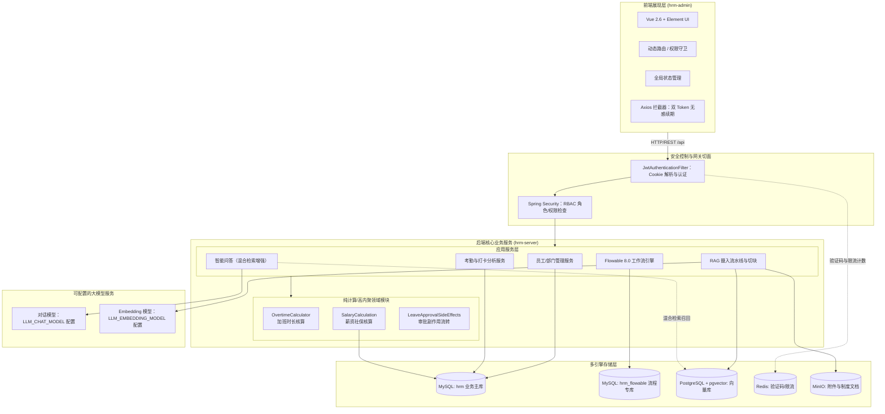

# 数智人事系统（一）：项目介绍与技术选型

**数智人事**是一套前后端分离的人力资源管理系统，覆盖传统人事业务闭环的同时，接入了生成式 AI 能力：

- **业务闭环**：组织架构、员工全生命周期档案、菜单与角色细粒度 RBAC 权限体系、Flowable 审批流转、考勤与打卡统计、加班与多维假期管理、薪资核算与五险一金配置。
- **智能化服务**：基于 RAG（检索增强生成）的企业知识库智能问答，带员工上下文感知，覆盖政策咨询场景。

系统运行界面如下：

### 登录与首页

**登录界面**

**首页仪表盘（工作台与考勤日历）**

### 系统管理

**员工管理**

**部门管理**

**文件管理**

### 权限管理

**角色权限分配**

**菜单权限配置**

### 考勤与审批

**请假申请与审批**

**考勤表现分析**

**加班详情核算**

### 财务与社保

**员工薪资管理**

**参保城市与五险一金比例**

### 智能问答

**智能问答（会话与逐字输出）**

## 核心业务流程

系统包含两条核心业务链路：**请假审批**（通过 Flowable 引擎驱动，加班由纯计算类直接核算）与**知识库问答**。

```mermaid
flowchart TD
    subgraph ApprovalFlow["1. 请假审批流转链路"]
        A1["员工端发起请假申请"] --> A2{"余额与天数校验"}
        A2 -- "校验通过" --> A3["写入业务申请表并启动 Flowable 流程"]
        A2 -- "校验不通过" --> A1
        A3 --> A4["HR / 主管依次接收审批任务"]
        A4 --> A5{"审批决策"}
        A5 -- "驳回" --> A6["更新业务单据状态为已驳回"]
        A5 -- "批准" --> A7["触发 LeaveApprovalSideEffects 副作用链"]
        A7 --> A8["扣减假期余额 / 增加调休时长"]
        A8 --> A9["写入考勤状态记录并推送站内通知"]
    end

    subgraph RagFlow["2. 知识库与智能问答链路"]
        B1["管理员上传制度文档"] --> B2["MinIO 原始文件存储"]
        B2 --> B3["ETL 管道：文档解析与切块"]
        B3 --> B4["Embedding 模型向量化"]
        B4 --> B5[("PostgreSQL pgvector 向量库")]

        C1["员工发起人事咨询"] --> C2["意图识别与问题改写"]
        C2 --> C4["混合检索：向量召回 + 关键词召回 RRF 融合"]
        C4 --> B5
        B5 --> C5["命中切块 ±1 邻窗扩展为上下文"]
        C5 --> C6["组合检索上下文与员工档案 Prompt"]
        C6 --> C7["大模型生成回答"]
        C7 --> C8["伪流式逐字推送给员工前端"]
    end
```

链路设计说明：审批链路中**仅请假接入 Flowable**，加班由 `OvertimeCalculator` 直接计算；问答链路检索采用**向量与关键词 RRF 混合召回**，输出方式采用 LLM 完整响应后的**伪流式**推送。

## 技术选型

### 系统架构图

### 选型清单

| 组件 | 选型 | 说明 |
| :--- | :--- | :--- |
| 后端框架 | Spring Boot 3.4.4 + Java 17 | 核心基础框架，Flowable 8 原生支持 Boot 3 |
| ORM | MyBatis-Plus 3.5.10 | 单表 CRUD 无 XML，复杂查询采用注解 SQL |
| 工作流 | Flowable 8.0 | 原生适配 Spring Boot 3，负责请假审批流程驱动 |
| 鉴权 | JWT 双 Token + HttpOnly Cookie | 规避 XSS 风险，支持无感续期 |
| 权限 | Spring Security @PreAuthorize | 权限点持久化，登录时装入 JWT Claim，避免逐次查库 |
| 业务库 | MySQL 8.1（两库分离） | 业务主库与 Flowable 流程库独立，物理隔离 |
| 向量库 | PostgreSQL 16 + pgvector | 基于 pgvector 扩展实现向量近邻检索，无需独立向量库 |
| 缓存 | Redis 5.0 | 仅用于验证码与接口限流计数，登录态由 JWT 承载 |
| 对象存储 | MinIO | S3 兼容，支持 `composeObject` 零拷贝分片合并 |
| 大模型 | OpenAI 兼容协议（DashScope） | 统一对话与 Embedding 接口协议，通过配置切换服务商 |
| 前端 | Vue 2.6 + Element UI 2.15 | 稳定基础库，实现动态路由与按钮级权限指令 |

## 系列规划

系列分为 28 期，按工程演进推进：

- **阶段一 · 起手（1–4 期）**：项目介绍 → docker 中间件编排 → 后端工程骨架 → 前端工程骨架
- **阶段二 · 地基（5–7 期）**：统一响应与枚举 → 三库 84 张表设计 → 双 Token 认证
- **阶段三 · 权限（8–10 期）**：前端无感续期 → RBAC 校验 → 动态路由
- **阶段四 · 基础模块（11–13 期）**：CRUD 规范 → 组织与权限维护 → 考勤打卡
- **阶段五 · 工作流与计算（14–18 期）**：请假建模 → Flowable 落地 → 审批副作用 → 加班核算 → 薪资核算
- **阶段六 · 文件与异步（19–21 期）**：MinIO 集成 → 分片上传与秒传 → 异步任务引擎
- **阶段七 · AI（22–25 期）**：知识库建模 → 摄入流水线 → 混合检索 → 智能问答
- **阶段八 · 收尾（26–28 期）**：典型故障复盘 → 架构设计复盘 → 部署上线

每期聚焦一个具体目标，结合关键代码片段与验证命令说明实现细节。

## 项目地址

**GitHub**：https://github.com/quuuuj/hrm

下一期将介绍运行环境搭建：通过 `docker/local/docker-compose.yml` 启动四套中间件，并完成三库初始化脚本导入。
