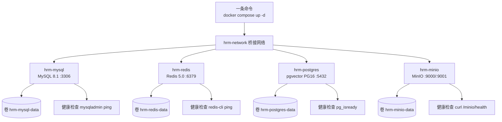

# 数智人事系统（二）：一条命令起齐四个中间件

第 1 期介绍了系统架构与业务链路，本期搭建本地运行环境。HRM 依赖四套中间件：MySQL（业务主库与 Flowable 流程库）、PostgreSQL（带 pgvector 扩展的知识库）、Redis 与 MinIO。四套中间件通过 docker compose 编排，一条命令即可完成起停。

## 动手前提

完成第 1 期阅读。本期无需编写代码，机器需安装 Docker Desktop，无需在本机安装数据库。

## 本期目标

执行 `docker compose up -d` 启动四套中间件，导入三库共 84 张表，并完成服务状态与表结构验证。

## 为什么用 Docker 编排，而不是本机安装

相比本机逐个安装，容器编排在以下方面满足本项目需求：

- **版本对齐**：使用 MySQL 8.1、Redis 5.0 与 PostgreSQL 16。官方 PostgreSQL 镜像不含 pgvector 扩展，本机安装需自行编译；镜像 `pgvector/pgvector:pg16` 已内置该扩展。
- **环境一致**：换机或重装系统后，执行单条命令即可拉起相同环境。
- **快速重置**：数据持久化于命名卷，执行 `docker compose down -v` 可连同数据卷一并销毁重建。

本地编排中的端口、用户名与密码均直接写字面值，不依赖 `.env`。这些配置仅绑定 localhost，属于本地公开默认值。JWT 密钥、大模型 API Key 等敏感配置将在第 3 期通过后端 `.env` 说明。

## 完整配置：docker/local/docker-compose.yml

本地编排文件位于 `docker/local/docker-compose.yml`。

`docker/local/docker-compose.yml:1`：

```yaml
# 本地中间件：所有值直接写字面值，不依赖 .env
# 启动命令：docker compose -f docker/local/docker-compose.yml up -d

services:
  mysql:
    image: mysql:8.1.0
    container_name: hrm-mysql
    environment:
      MYSQL_ROOT_PASSWORD: 123456
    ports:
      - "3306:3306"
    volumes:
      - hrm-mysql-data:/var/lib/mysql
    networks:
      - hrm-network
    healthcheck:
      test: ["CMD", "mysqladmin", "ping", "-h", "localhost"]
      interval: 10s
      timeout: 5s
      retries: 5
    restart: unless-stopped

  redis:
    image: redis:5.0
    container_name: hrm-redis
    command: redis-server
    ports:
      - "6379:6379"
    volumes:
      - hrm-redis-data:/data
    networks:
      - hrm-network
    healthcheck:
      test: ["CMD", "redis-cli", "ping"]
      interval: 10s
      timeout: 5s
      retries: 5
    restart: unless-stopped

  postgres:
    image: pgvector/pgvector:pg16
    container_name: hrm-postgres
    environment:
      POSTGRES_USER: hrm
      POSTGRES_PASSWORD: 123456
      POSTGRES_DB: hrm_kb
    ports:
      - "5432:5432"
    volumes:
      - hrm-postgres-data:/var/lib/postgresql/data
    networks:
      - hrm-network
    healthcheck:
      test: ["CMD-SHELL", "pg_isready -U hrm -d hrm_kb"]
      interval: 10s
      timeout: 5s
      retries: 5
    restart: unless-stopped

  minio:
    image: minio/minio:latest
    container_name: hrm-minio
    command: server /data --console-address ":9001"
    environment:
      MINIO_ROOT_USER: minioadmin
      MINIO_ROOT_PASSWORD: minioadmin
    ports:
      - "9000:9000"
      - "9001:9001"
    volumes:
      - hrm-minio-data:/data
    networks:
      - hrm-network
    healthcheck:
      test: ["CMD", "curl", "-f", "http://localhost:9000/minio/health/live"]
      interval: 10s
      timeout: 5s
      retries: 5
    restart: unless-stopped

volumes:
  hrm-mysql-data:
  hrm-redis-data:
  hrm-postgres-data:
  hrm-minio-data:

networks:
  hrm-network:
    driver: bridge
```

四个服务要点说明：

- **MySQL 8.1**（`docker/local/docker-compose.yml:5`）：root 密码 `123456`；挂载命名卷 `hrm-mysql-data`；健康检查使用 `mysqladmin ping`。
- **Redis 5.0**（`docker/local/docker-compose.yml:23`）：无密码配置，与后端 `application.yml` 保持一致；健康检查使用 `redis-cli ping`。
- **PostgreSQL + pgvector**（`docker/local/docker-compose.yml:40`）：使用内置 pgvector 扩展的 `pgvector/pgvector:pg16` 镜像；初始化用户 `hrm`、密码 `123456`、数据库 `hrm_kb`；健康检查使用 `pg_isready`。
- **MinIO**（`docker/local/docker-compose.yml:60`）：启动参数指定 `--console-address ":9001"`；9000 端口提供 S3 API，9001 端口提供 Web 控制台；默认账号密码为 `minioadmin/minioadmin`。

服务共用桥接网络 `hrm-network` 与四个命名卷，均配置 `restart: unless-stopped`。拓扑结构如下：



在项目根目录启动服务：

```bash
docker compose -f docker/local/docker-compose.yml up -d
```

等待容器健康检查通过后（`docker ps` 状态显示 healthy），环境就绪。

## 导入三库：两份 MySQL 与一份 PostgreSQL

容器初次启动后仅包含空数据库，表结构由 `db/` 下的三个脚本提供：

| 脚本 | 目标库 | 内容 |
| :--- | :--- | :--- |
| `db/mysql/hrm.sql` | MySQL `hrm` | 业务主库，25 张表，结构与种子数据一体 |
| `db/mysql/hrm_flowable.sql` | MySQL `hrm_flowable` | Flowable 流程库，55 张引擎表（`ACT_`/`FLW_` 前缀） |
| `db/postgresql/knowledge_base.sql` | PostgreSQL `hrm_kb` | 知识库向量库，4 张表 |

分库考量：

- **Flowable 独立分库**：Flowable 包含 55 张流程状态表，而业务表具备逻辑删除、员工关联等业务属性。两者生命周期差异较大，分库避免框架升级或表清理影响核心业务。
- **知识库采用 PostgreSQL + pgvector**：知识库依赖向量近邻检索，MySQL 无法原生支持。通过 pgvector 扩展创建 `vector_store` 表与 `vector(1024)` 字段，直接满足向量存储与检索需求，无需额外部署独立向量数据库。

业务库 25 张表按业务域前缀划分：`att_`（考勤与请假 5 张）、`per_`（权限与菜单 4 张）、`sal_`（薪资 2 张）、`soc_`（社保 2 张）、`sys_`（基础数据 3 张）、`chat_`（问答记录 2 张）、`file_`（异步文件任务 2 张）、`kb_`（知识库元数据 4 张）以及任务表 `ingestion_jobs`。表结构设计将在第 6 期展开。

`hrm.sql` 包含组织架构、考勤预设与默认管理员账号（`admin` / `123`），第 3 期启动后端服务后可直接登录验证。

通过 `docker exec` 执行导入（无需本机安装客户端）：

```bash
# 1. 创建数据库（SQL 脚本本身不含建库语句）
docker exec -i hrm-mysql mysql -uroot -p123456 -e \
  "CREATE DATABASE IF NOT EXISTS hrm DEFAULT CHARACTER SET utf8mb4;
   CREATE DATABASE IF NOT EXISTS hrm_flowable DEFAULT CHARACTER SET utf8mb4;"

# 2. 导入业务库与流程库
docker exec -i hrm-mysql mysql -uroot -p123456 hrm < db/mysql/hrm.sql
docker exec -i hrm-mysql mysql -uroot -p123456 hrm_flowable < db/mysql/hrm_flowable.sql

# 3. 导入知识库
docker exec -i hrm-postgres psql -U hrm -d hrm_kb < db/postgresql/knowledge_base.sql
```

脚本未挂载至容器的 `/docker-entrypoint-initdb.d/` 自动执行，原因是该机制仅在数据卷初次创建时运行一次。全量 SQL 采用 `DROP TABLE IF EXISTS` 结构，手动导入支持随结构调整反复重跑覆盖。

## 日常操作速查

```bash
# 启动与停止
docker compose -f docker/local/docker-compose.yml up -d     # 启动
docker compose -f docker/local/docker-compose.yml stop      # 停止容器，保留数据卷
docker compose -f docker/local/docker-compose.yml down      # 删除容器，保留数据卷
docker compose -f docker/local/docker-compose.yml down -v   # 删除容器及数据卷

# 状态与日志
docker ps                                                    # 查看容器健康状态
docker logs -f hrm-mysql                                     # 查看指定容器日志

# 重启单个服务
docker compose -f docker/local/docker-compose.yml restart postgres

# 进入容器终端
docker exec -it hrm-mysql mysql -uroot -p123456
```

日常非开发状态可执行 `stop` 释放内存资源，再次使用时执行 `up -d` 恢复。

## 验证

执行以下命令验证环境状态与数据完整性：

```bash
# 检查容器健康状态（STATUS 列均需为 healthy）
docker ps

# 验证 MySQL 表数量（hrm 应为 25，hrm_flowable 应为 55）
docker exec hrm-mysql mysql -uroot -p123456 -N -e \
  "SELECT table_schema, COUNT(*) FROM information_schema.tables
   WHERE table_schema IN ('hrm','hrm_flowable') GROUP BY table_schema;"

# 验证 PostgreSQL 知识库表与 pgvector 扩展
docker exec hrm-postgres psql -U hrm -d hrm_kb -c "\dt"
docker exec hrm-postgres psql -U hrm -d hrm_kb -c "SELECT extname FROM pg_extension;"

# 验证管理员种子数据
docker exec hrm-mysql mysql -uroot -p123456 -N -e "SELECT COUNT(*) FROM hrm.sys_staff;"
```

访问 MinIO 控制台 `http://localhost:9001`（账号密码 `minioadmin` / `minioadmin`），可查看存储桶管理界面。

## 小坑提醒

- 两个 MySQL 脚本不包含 `CREATE DATABASE` 语句，导入前需显式创建对应数据库，否则报错 `Unknown database`。
- PowerShell 的 `<` 重定向语法与 Linux shell 存在差异，建议在 Git Bash 环境下执行导入命令。
- 若执行过程报错中断，直接重新执行导入命令即可，`hrm.sql` 内置删表重建逻辑，支持幂等执行。
- `docker compose down -v` 会清除全部持久化数据卷，执行前需确认数据无需保留。

## 小结

至此，四个中间件已在 `hrm-network` 桥接网络中启动运行，84 张数据表与初始账号已完成导入。第 3 期将基于该环境搭建 Spring Boot 3.4 后端工程骨架，配置三个数据源并完成接口文档验证。

**GitHub**：https://github.com/quuuuj/hrm

