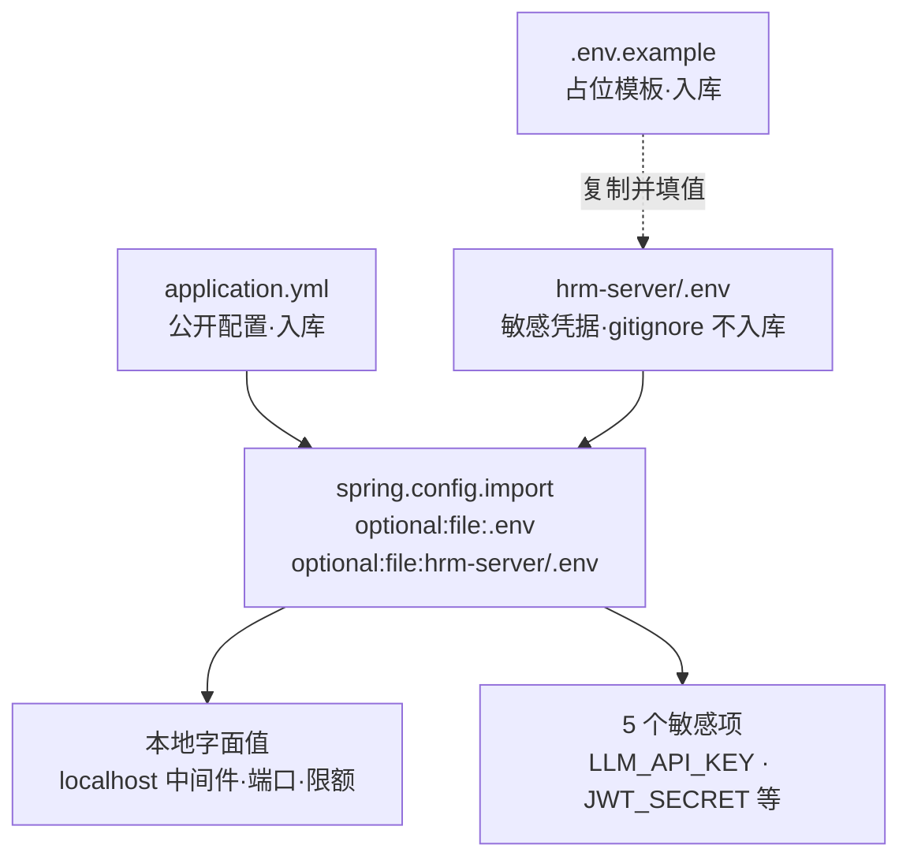

# 数智人事系统（三）：Spring Boot 3.4 骨架与配置分层

第 2 期通过 docker compose 启动了四套中间件并导入了三库 84 张表，本期开始搭建后端工程骨架。

本项目后端涉及多数据源、工作流引擎、AI 向量库与安全框架，若缺乏统一的依赖版本锁定与配置治理，极易出现类库冲突与凭据泄露。本期完成核心工程脚手架搭建与配置分层设计。

## 动手前提

完成第 2 期阅读与实践：中间件已在后台运行（`docker ps` 状态为 healthy），且三库表结构已导入。本机环境需安装 JDK 17 与 Maven 3.8+。

## 本期目标

搭建 `hrm-server` 后端工程骨架，建立清晰的依赖与多环境配置分层，启动 Spring Boot 3.4 服务，并访问 `http://localhost:8888/swagger-ui.html` 验证接口文档连通性。

## 依赖治理：父 POM、BOM 与插件分工

为了避免依赖版本冲突，项目采用「父 POM + BOM」两级依赖管理机制。

**BOM（Bill of Materials，物料清单）** 是集中声明第三方组件及其所有子模块兼容版本的 POM 文件，用于版本锁定，自身不引入具体 jar 包。

`hrm-server/pom.xml:7` 声明顶层父工程：

```xml
    <parent>
        <groupId>org.springframework.boot</groupId>
        <artifactId>spring-boot-starter-parent</artifactId>
        <version>3.4.4</version>
        <relativePath/>
    </parent>
```

Spring Boot 3.4.4 锁定了 Spring 全家桶、Tomcat、Jackson 等基础组件版本。针对独立演进的 Spring AI 与集成测试容器，在 `hrm-server/pom.xml:31` 中通过 `<dependencyManagement>` 导入对应的 BOM：

```xml
    <dependencyManagement>
        <dependencies>
            <dependency>
                <groupId>com.alibaba.cloud.ai</groupId>
                <artifactId>spring-ai-alibaba-bom</artifactId>
                <version>${spring-ai-alibaba.version}</version>
                <type>pom</type>
                <scope>import</scope>
            </dependency>
            <dependency>
                <groupId>org.testcontainers</groupId>
                <artifactId>testcontainers-bom</artifactId>
                <version>1.21.3</version>
                <type>pom</type>
                <scope>import</scope>
            </dependency>
        </dependencies>
    </dependencyManagement>
```

核心组件选型说明：

- **Spring AI OpenAI Starter**（`hrm-server/pom.xml:115`）：
  ```xml
  <dependency>
      <groupId>org.springframework.ai</groupId>
      <artifactId>spring-ai-starter-model-openai</artifactId>
      <version>1.0.0</version>
  </dependency>
  ```
  项目选用标准的 `spring-ai-starter-model-openai` 接入通义千问兼容端点（`/compatible-mode`），避免引入 `spring-ai-alibaba-starter-dashscope`。后者会自动注册 `DashScopeChatModel` 并产生双 Bean 竞争，且其默认模型策略在额度耗尽时易引发阻塞重试。采用标准客户端便于统一管控并支持后续自由切换大模型提供商。

- **Flowable 8.0.0 依赖排除**（`hrm-server/pom.xml:315`）：
  ```xml
  <dependency>
      <groupId>org.flowable</groupId>
      <artifactId>flowable-spring-boot-starter</artifactId>
      <version>8.0.0</version>
      <exclusions>
          <exclusion>
              <artifactId>mybatis</artifactId>
              <groupId>org.mybatis</groupId>
          </exclusion>
          <exclusion>
              <artifactId>commons-io</artifactId>
              <groupId>commons-io</groupId>
          </exclusion>
      </exclusions>
  </dependency>
  ```
  Flowable 8 原生支持 Spring Boot 3。由于 Flowable 内部自带原生 MyBatis 依赖，必须显式排除，交由外部的 `mybatis-plus-spring-boot3-starter:3.5.10` 统一管理，防止 `SqlSessionFactory` 冲突。

- **双测试插件隔离**（`hrm-server/pom.xml:349`）：
  ```xml
  <plugin>
      <groupId>org.apache.maven.plugins</groupId>
      <artifactId>maven-surefire-plugin</artifactId>
      <version>3.5.3</version>
      <configuration>
          <includes><include>**/*UnitTest.java</include></includes>
      </configuration>
  </plugin>
  <plugin>
      <groupId>org.apache.maven.plugins</groupId>
      <artifactId>maven-failsafe-plugin</artifactId>
      <version>3.5.3</version>
      <configuration>
          <includes><include>**/*IntegrationTest.java</include></includes>
      </configuration>
  </plugin>
  ```
  区分单元测试（`*UnitTest.java`，不加载 Spring 容器）与集成测试（`*IntegrationTest.java`，通过 Testcontainers 启动真实容器）。通过 surefire 与 failsafe 两个插件物理隔离，日常可通过 `mvn test -Dtest=*UnitTest` 快速运行纯计算测试。

## 配置分层：本地字面值与 .env 敏感项隔离

配置采用统一规范：**本地默认值采用字面值直写，仅敏感配置收敛至 .env 文件。**

**`.env 敏感项`** 指 API 密钥、JWT 签名私钥等一旦泄露存在外部安全风险的凭据。绑定至 `localhost:3306` 的本地数据库密码（`123456`）、端口号等无外部利用价值的信息，直接作为字面值维护在入库的 `application.yml` 中。

### spring.config.import 双路径注入

`hrm-server/src/main/resources/application.yml:5`：

```yaml
spring:
  config:
    import: optional:file:.env[.properties],optional:file:hrm-server/.env[.properties]
```

利用 Spring Boot 的 `spring.config.import` 特性，应用启动时按 Properties 格式解析 `.env` 文件。双路径声明确保在根目录执行 Maven 命令、在子目录执行命令或在 IDE 中直接启动均可准确定位配置文件。`optional:` 前缀保证缺失 `.env` 时不发生致命崩溃。

分层关系示意：



### 收敛后的 .env 配置

`hrm-server/.env.example:1` 定义了系统所需的外部变量：

```properties
# LLM（chat 与知识库 embedding 共用；OpenAI 兼容模式）
LLM_API_KEY=<API密钥>
LLM_BASE_URL=https://dashscope.aliyuncs.com/compatible-mode
LLM_CHAT_MODEL=qwen3.7-flash
LLM_EMBEDDING_MODEL=qwen3.7-text-embedding

# JWT 签名密钥
JWT_SECRET=REPLACE_WITH_BASE64_JWT_SECRET
```

本地开发时，将 `.env.example` 复制为 `hrm-server/.env`，填写实际的大模型 Key 与随机 JWT 密钥即可，数据库等中间件均采用默认配置。

## 多数据源配置与 Flowable 表前缀

系统定义了两个数据源连接池（`hrm-server/src/main/resources/application.yml:8`），流程引擎不单独配置连接，通过表前缀复用主数据源：

```yaml
  datasource:
    master:
      jdbc-url: jdbc:mysql://localhost:3306/hrm?useUnicode=true&characterEncoding=utf-8&serverTimezone=Asia/Shanghai
      username: root
      password: 123456
      driver-class-name: com.mysql.cj.jdbc.Driver
      type: com.zaxxer.hikari.HikariDataSource
    kb:
      jdbc-url: jdbc:postgresql://localhost:5432/hrm_kb
      username: hrm
      password: 123456
      driver-class-name: org.postgresql.Driver
      type: com.zaxxer.hikari.HikariDataSource
```

在 Java 代码中完成数据源装配（`hrm-server/src/main/java/com/qiujie/config/DataSourceConfig.java:28`）：

```java
@Configuration
public class DataSourceConfig {

    @Primary
    @Bean
    @ConfigurationProperties(prefix = "spring.datasource.master")
    public DataSource masterDataSource() {
        return DataSourceBuilder.create().build();
    }

    /**
     * 为主数据源显式配置事务管理器，确保 @Transactional 正确提交。
     * 多数据源场景下 Spring Boot 可能不确定用哪个 TransactionManager。
     */
    @Primary
    @Bean
    public PlatformTransactionManager transactionManager(
            @Qualifier("masterDataSource") DataSource dataSource) {
        return new DataSourceTransactionManager(dataSource);
    }

    @Bean
    @ConfigurationProperties(prefix = "spring.datasource.kb")
    public DataSource kbDataSource() {
        return DataSourceBuilder.create().build();
    }

    /**
     * Flowable 表仍存放在 hrm_flowable：运行时 SQL 通过表前缀生成 hrm_flowable.ACT_*，
     * 与业务表共用 master 数据源和同一个本地事务。
     */
    @Bean
    public EngineConfigurationConfigurer<SpringProcessEngineConfiguration> engineConfigurationConfigurer(
            @Value("${flowable.table-prefix}") String tablePrefix) {
        return config -> config.setDatabaseTablePrefix(tablePrefix);
    }
}
```

关键实现要点：

- **显式声明 `@Primary PlatformTransactionManager`**：存在多个数据源时，需显式声明主事务管理器，保证业务逻辑上的 `@Transactional` 正常生效；Flowable 复用该管理器，业务表与引擎表因此落在同一个本地事务里。
- **`EngineConfigurationConfigurer` 定制表前缀**：Flowable 默认用无前缀表名访问引擎表，注册配置器后，引擎 SQL 统一带上 `hrm_flowable.` 前缀，表落在 `hrm_flowable` 库，连接仍走主数据源。

## application.yml 分块说明

`application.yml` 整体按模块划分为：`spring`、`server`、`flowable`、`mybatis-plus`、`management`、`jwt` 与 `logging`。

- **Flowable 表前缀与子引擎裁剪**（`hrm-server/src/main/resources/application.yml:53`）：
  ```yaml
  flowable:
    # 表前缀即库名（hrm_flowable.ACT_*），复用 master 数据源
    table-prefix: hrm_flowable.
    database-schema-update: false
    dmn:
      enabled: false
    form:
      enabled: false
    app:
      enabled: false
    content:
      enabled: false
  ```
  显式关闭 DMN、Form、App 与 Content 子引擎，仅保留流程引擎核心，减少无用表生成并提升启动速度。`table-prefix` 让引擎 SQL 以 `hrm_flowable.ACT_*` 的形式访问引擎表，连接仍复用主数据源；`database-schema-update` 必须关闭，因为引擎的建表脚本不会套用表前缀，表结构统一由 `db/mysql/hrm_flowable.sql` 初始化。

- **MyBatis-Plus 配置**（`hrm-server/src/main/resources/application.yml:70`）：
  ```yaml
  mybatis-plus:
    configuration:
      log-impl: org.apache.ibatis.logging.nologging.NoLoggingImpl
    type-enums-package: com.qiujie.*.enums
  ```
  `type-enums-package` 自动扫描业务包下的 `enums/` 目录并注册枚举转换器，使实体类字段可直接声明枚举类型。

- **管理端点安全收敛**（`hrm-server/src/main/resources/application.yml:76`）：
  ```yaml
  management:
    endpoints:
      web:
        exposure:
          include: health
    endpoint:
      health:
        show-details: never
        probes:
          enabled: true
  ```
  Actuator 仅暴露 `health` 端点，设置 `show-details: never` 避免泄露连接池与内部路径信息，开启 `probes` 以支持存活探针检查。

- **开发日志级别**（`hrm-server/src/main/resources/application.yml:88`）：
  ```yaml
  logging:
    level:
      com.qiujie: debug
      org.springframework.ai.openai: TRACE
      org.springframework.web.client.RestClient: DEBUG
  ```
  本地开启业务包 debug 以及 Spring AI 请求细节日志，便于大模型交互时观测完整请求体与响应流。

## 启动类与 SpringDoc 资源放行

入口启动类声明包扫描路径（`hrm-server/src/main/java/com/qiujie/HrmApplication.java:12`）：

```java
@MapperScan({"com.qiujie.*.mapper"})
@SpringBootApplication
@EnableTransactionManagement(proxyTargetClass = true)
@EnableScheduling
@EnableAsync
@EnableRetry
public class HrmApplication {
    public static void main(String[] args) {
        SpringApplication.run(HrmApplication.class, args);
    }
}
```

`@MapperScan` 覆盖所有特性包下的 Mapper 接口。在 `SecurityConfig.java:74` 中对 OpenAPI 文档资源进行免密放行：

```java
.authorizeHttpRequests(auth -> auth
    .requestMatchers("/login/**", "/validate/code", "/refresh", "/logout", "/actuator/health/**").permitAll()
    .requestMatchers("/swagger-ui/**", "/v3/api-docs/**", "/webjars/**").permitAll()
    .anyRequest().authenticated()
)
```

## 验证

按以下步骤验证工程骨架：

- **创建本地配置**：
  ```bash
  cp hrm-server/.env.example hrm-server/.env
  ```
  填入有效长度的 JWT 密钥（例如 Base64 编码的 256 位随机字符串）。

- **编译与启动服务**：
  ```bash
  mvn -f hrm-server/pom.xml spring-boot:run
  ```
  启动成功后终端打印：
  ```text
  INFO --- [main] o.f.s.b.ProcessEngineAutoConfiguration   : Starting Flowable Engine...
  INFO --- [main] o.s.b.w.embedded.tomcat.TomcatWebServer  : Tomcat started on port 8888 (http) with context path '/'
  INFO --- [main] com.qiujie.HrmApplication                : Started HrmApplication in ... seconds
  ```

- **验证端点连通性**：
  ```bash
  curl -s http://localhost:8888/actuator/health
  # 应返回 {"status":"UP"}
  ```
  访问 `http://localhost:8888/swagger-ui.html`，页面可正常渲染 OpenAPI 3.0 文档交互界面。

## 小坑提醒

- **swagger-annotations 版本传递问题**：`spring-ai-alibaba` 传递较旧版本的 swagger-annotations，可能导致 springdoc 运行时缺失方法。若报错 `NoSuchMethodError`，需在 `pom.xml` 中显式指定 `swagger-annotations: 2.2.28`。
- **.env 文件格式规范**：Windows 环境下编辑 `.env` 时，需避免密钥末尾包含回车换行符或多余空格，否则可能导致 Base64 解码异常。
- **Flowable 初始化顺序**：确保第 2 期的 `hrm_flowable` 数据库与初始化脚本已导入完毕。`database-schema-update` 关闭后引擎不会自动建表，缺表会在启动或首次流程查询时报错。

## 小结

本期完成了后端工程骨架的搭建：通过 BOM 规范化依赖版本，划分为业务主数据源与向量库两个连接池，流程引擎经表前缀复用主数据源，并通过 `spring.config.import` 实现了公开配置与敏感凭据的分离。

下一期将搭建前端工程骨架，基于 Vue 2.6 与 Element UI 启动 `hrm-admin`，并配置代理调通与 8888 端口的跨域通信。

**GitHub**：https://github.com/quuuuj/hrm
