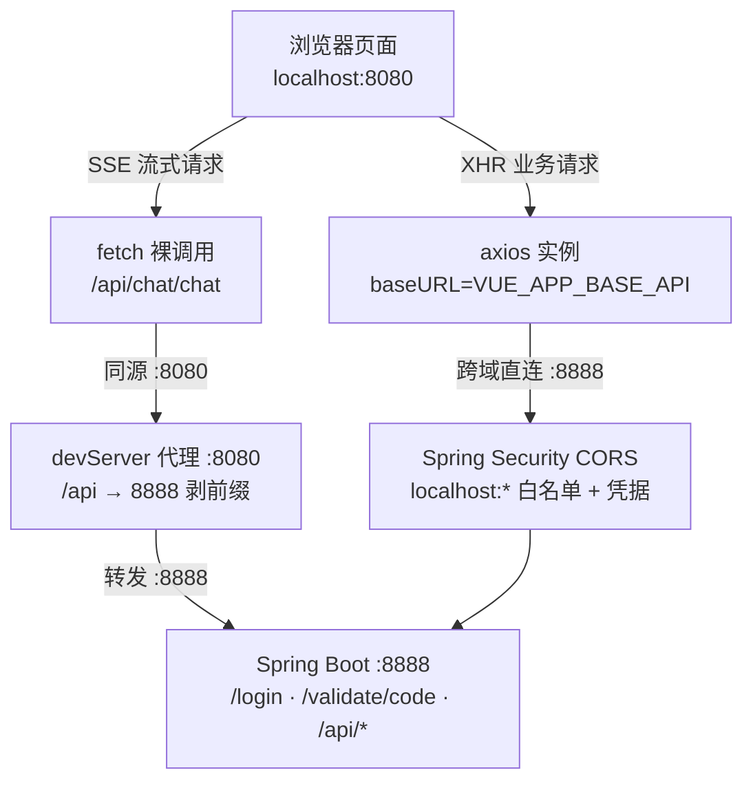

# 数智人事系统（四）：Vue 2.6 前端骨架与开发代理调通

第 3 期后端已在 `8888` 端口运行，本期搭建 `hrm-admin` 前端工程，打通前后端调用链路。

前后端分离架构下，浏览器位于 `8080`、后端位于 `8888`，需要解决跨域请求与 Cookie 携带两个问题。本项目通过 devServer 代理与 Axios 实例配置解决，不额外堆叠 CORS 复杂配置。

## 动手前提

完成第 3 期：后端已在 `http://localhost:8888` 运行，`/actuator/health` 返回 UP。本机需安装 Node.js（本项目在 Node 18+ 下验证）与 npm。

## 本期目标

`npm run serve` 成功启动前端开发服务器（默认 8080 端口），通过代理调通后端：打开 `http://localhost:8080/login`，验证码图片正常加载，输入默认账号 `admin` / `123` 能完成登录、拿到后端写入的 Cookie。

## 为什么是 Vue 2.6 + Element UI

本项目前端采用 **Vue 2.6 + Element UI 2.15 + Vue CLI 4.5**。项目主体写于 2022 年，这是当时中后台管理系统成熟稳定的搭配。本系列如实还原该技术栈；骨架、代理与状态管理的组织方式与框架版本无关，迁移到 Vue 3 + Element Plus 思路相同。

## 一个变量管住两条路：.env 与 devServer 代理

本期第一个新术语：**代理（Proxy）**，指开发服务器充当请求中转——浏览器把请求发给同源的 devServer（8080），由 devServer 在服务器侧转发给真正的后端（8888），浏览器不产生跨域。

前端到后端存在两条通路：

- **通路一（XHR 请求）**：axios 以 `baseURL + url` 发出请求，目标地址是 `http://localhost:8888`——跨域请求，由后端第 3 期配置的 CORS 白名单放行；
- **通路二（devServer 代理）**：浏览器发出 `http://localhost:8080/api/xxx` 的同源请求，由 devServer 转发到 8888——不经过浏览器跨域检查，Cookie 在第一方上下文中自然携带。

两条通路指向同一个后端，各需一份“后端地址”配置。为避免改端口时修改两处，项目将两者收敛到同一个 `.env` 变量族。

`hrm-admin/.env`（不入库，仅本地）只有两行有效内容：

```properties
# 后端项目地址（devServer 代理与 API 请求共用的唯一变量）
VUE_APP_BASE_API=http://localhost:8888
# devServer 代理目标（与 VUE_APP_BASE_API 保持一致）
VUE_APP_BACKEND_TARGET=http://localhost:8888
```

以 `VUE_APP_` 开头的变量由 Vue CLI 在构建/启动时注入 `process.env`，业务代码读取 `process.env.VUE_APP_BASE_API` 即可。注入发生在**启动期而非运行期**——修改 `.env` 后必须重启 `npm run serve` 才生效。

代理规则写在 `hrm-admin/vue.config.js:7`：

```js
devServer: {
  headers: {
    'Permissions-Policy': 'unload=*' // Chrome 新版禁止 unload 事件，SockJS 需要此权限
  },
  proxy: {
    '/api': {
      target: process.env.VUE_APP_BACKEND_TARGET,
      pathRewrite: { '^/api': '' },
      changeOrigin: true
    }
  }
}
```

三个字段各自的作用：`target` 为转发目的地；`pathRewrite` 剥离 `/api` 前缀后再转发（`/api/login` → `8888/login`），后端接口因此无需统一加 `/api` 前缀；`changeOrigin: true` 将转发请求的 `Host` 头改写为目标地址，适配校验 Host 的服务。`Permissions-Policy` 头用于 Chrome 新版禁用 `unload` 事件后 devServer 热更新依赖的 SockJS 权限放行，删除后热更新会报权限警告。

两条通路的分工是：**XHR 走直连（CORS），SSE 走代理**。因为 EventSource/fetch 流式接口在同源代理下 Cookie 行为最稳定，项目里智能问答的 SSE 请求写死 `fetch('/api/chat/chat', ...)`（`hrm-admin/src/api/chat.js:28`），其余常规接口走 axios 的 `baseURL` 直连。整条调用链如下：



## Axios 实例：拦截器雏形

通路之上还需要统一的请求出口。项目在 `hrm-admin/src/utils/request.js:7` 建立共享实例，页面不直接使用 axios：

```js
const BASE_API = process.env.VUE_APP_BASE_API

const instance = axios.create({
  baseURL: BASE_API,
  timeout: 10000,
  withCredentials: true // 浏览器自动携带 httpOnly Cookie，无需手动加 token
})
```

`withCredentials: true` 是 httpOnly Cookie 认证的前提：它告知浏览器跨域请求携带目标域的 Cookie。后端登录成功后写入的 `token` Cookie 为 **httpOnly** 属性——JavaScript 不可读写，避免 XSS 窃取 Token，代价是前端只能依赖浏览器自动携带凭证，该配置即为开关。

请求拦截器仅处理一项（`hrm-admin/src/utils/request.js:32`）：非 `FormData` 的请求统一补上 `Content-Type: application/json`。`FormData` 需跳过——浏览器会自动生成带 `boundary` 的 multipart 头，手动覆盖会破坏文件上传。

响应拦截器（`hrm-admin/src/utils/request.js:45`）处理三类情况：

- **blob/arraybuffer 响应原样放行**：验证码图片、文件下载；
- **401/1200 触发静默刷新**：并发请求排队去重，仅刷新一次，该“并发去重刷新”逻辑为第 8 期内容，本期确认雏形已就位；
- **400/500/1300 统一弹出错误提示**：页面无需各自处理错误码。

## API 层：一个资源一个文件

`src/api/` 下一个后端资源对应一个文件，页面只 `import` 函数，不接触 URL 细节。典型示例 `hrm-admin/src/api/login.js`：

```js
import request from '../utils/request'

// 登录
export const login = (data) => {
  return request({
    url: '/login/' + data.validateCode,
    method: 'post',
    data
  })
}

export const getValidateCode = () => {
  return request({
    url: '/validate/code',
    method: 'get',
    responseType: 'blob'
  })
}
```

`url` 为相对路径——拼接到实例 `baseURL` 后，最终请求发往 8888。验证码接口的特殊性在于 `responseType: 'blob'`：后端返回 PNG 图片流，前端通过 `URL.createObjectURL` 转成 `` 可显示的地址（`hrm-admin/src/utils/validateCode.js:5`）。

## Vuex 五模块：状态按职责划分

本期第二个新术语：**Vuex 模块（Module）**。Vuex 支持将 store 切分为带命名空间（`namespaced: true`）的模块，每个模块管理自己的 state/mutation，外部以 `模块名/方法名` 调用，避免所有状态集中在一个 store 中。

`hrm-admin/src/store/index.js:13` 注册了五个模块：

| 模块 | 管什么 | 持久化到哪 |
|---|---|---|
| `token` | 登录态标志 `isAuth` | sessionStorage |
| `staff` | 当前登录人信息 | sessionStorage 存 staffId |
| `menu` | 左侧菜单树 + 折叠态 | 后端动态下发 |
| `permission` | 权限点字符串列表 | 后端动态下发 |
| `tag` | 顶部多页签 | localStorage |

`token` 模块（`hrm-admin/src/store/modules/token.js:1`）中不存放 token 本身：

```js
// token 存储在 httpOnly Cookie 中（JS 不可读），
// 前端只保留一个 isAuth 标志用于判断登录状态
const AUTH_KEY = 'isAuth'

export default {
  namespaced: true,
  state: {
    isAuth: sessionStorage.getItem(AUTH_KEY) === '1'
  },
  mutations: {
    SET_AUTH (state, val) {
      state.isAuth = val
      if (val) {
        sessionStorage.setItem(AUTH_KEY, '1')
      } else {
        sessionStorage.removeItem(AUTH_KEY)
      }
    }
  }
}
```

httpOnly Cookie 无法被 JS 读取，前端判断登录状态依赖自维护的信标：登录成功写入 `isAuth=1`，路由守卫与请求拦截器读取该标志；凭证保存在 Cookie 中由浏览器自动携带。使用 `sessionStorage` 而非 `localStorage` 的原因：关闭标签页后需重新登录，会话边界更清晰。

## 入口装配与路由骨架

`hrm-admin/src/main.js:13` 完成 Element UI 全局注册（`size: 'mini'` 为中后台紧凑密度）、自定义指令挂载与 store/router 注入。

路由部分为第 10 期埋下伏笔：`hrm-admin/src/router/index.js:17` 的静态路由仅有 `/login` 一条。业务页面均非写死——登录成功后由后端菜单数据驱动 `setDynamicRoute(menuList)` 动态生成（`hrm-admin/src/router/index.js:33`），菜单内容决定路由表。本期确认路由骨架形态，动态加载细节在第 10 期展开。

## 动手验证：从 serve 到登录成功

### 1. 安装依赖并启动

```bash
cd hrm-admin
npm ci          # 按 package-lock.json 精确安装
npm run serve   # 启动 devServer，默认 :8080
```

看到 `App running at: - Local: http://localhost:8080/` 即启动成功。

### 2. 验证代理通路

后端运行时可直接验证代理链路，无需打开页面：

```bash
# 经 8080 代理拿验证码，应返回 PNG 图片流而非 404
curl -s -o /dev/null -w "%{http_code} %{content_type}" http://localhost:8080/api/validate/code
# 预期: 200 image/png
```

返回 `200 image/png` 证明三件事：devServer 代理生效、`/api` 前缀正确剥离、后端 `/validate/code` 在 Security 白名单内。

### 3. 浏览器登录

打开 `http://localhost:8080/login`：验证码图片正常显示（blob 通路工作）、输入默认账号 `admin` / `123` 与验证码提交，跳转到 `/home` 即全链路打通。此时在 DevTools → Application → Cookies 里能看到 `localhost:8888` 域下的 `token` 与 `refreshToken` 两个 httpOnly Cookie——前端读不到它们的值，但后续每个请求都会自动带上。

验证码无法加载时按 `F12` 查看 Network：请求打到 `8888` 被标红（CORS 错误）说明后端未启动或白名单未配置；打到 `8080/api` 返回 404 说明代理未生效，通常为 `.env` 未创建或未重启。

## 小坑提醒

- **`npm run serve` 报 `ERR_OSSL_EVP_UNSUPPORTED`**：Node 17+ 使用 OpenSSL 3，Vue CLI 4.5 的 webpack 4 仍依赖旧哈希算法。项目在 `hrm-admin/package.json:6` 的启动命令中显式加入 `--openssl-legacy-provider`，无须降级 Node。
- **修改 `.env` 未生效**：`VUE_APP_*` 变量为启动时注入，热更新不重读环境变量，修改后必须重启 devServer。
- **`baseURL` 与代理不要混用**：`request.js` 的 `baseURL` 为后端真实地址（走 CORS 直连）；仅 SSE 等需要同源上下文的请求走 `/api` 代理。不要在 axios 的 `url` 里手动拼 `/api` 前缀，否则形成 8888 直连加一段后端不认识的前缀。
- **验证码 `responseType: 'blob'` 不可省略**：省略后 axios 按文本解析 PNG 二进制，图片无法加载。`validate/code` 每次调用都会在 Redis 中覆盖验证码，多次刷新后旧图失效属正常现象。

## 小结

前后端调用链路至此打通：

- `.env` 变量族统一“后端地址”，devServer 代理与 axios `baseURL` 同源取值；
- axios 实例与双层拦截器作为统一请求出口，`withCredentials` 使 httpOnly Cookie 自动携带；
- Vuex 按职责划分为五个模块，`token` 模块仅保存登录状态信标，不存放凭证；
- 登录页验证了验证码（blob）、登录（Cookie 写入）、路由跳转三个环节。

下一期回到后端补齐公共层：`ResponseDTO` 统一响应、`BaseExceptionHandler` 全局异常收口、`BaseEnum` 枚举序列化约定，为后续业务模块提供统一基础。

**GitHub**：https://github.com/quuuuj/hrm
