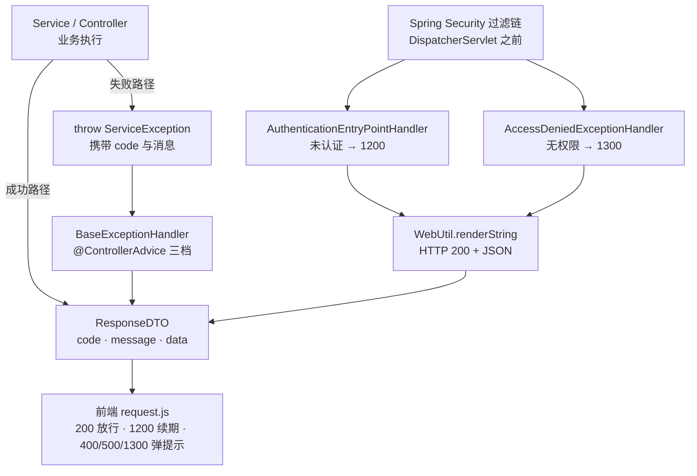

# 数智人事系统（五）：统一响应、异常收口与枚举约定

第 4 期前端 `hrm-admin/src/utils/request.js` 中已写入三条错误码规则：`1200` 触发静默续期、`400/500/1300` 统一弹提示、只有 `code === 200` 才算成功。彼时后端尚无任何接口返回这些数字——它们只是前端单方面的约定。

公共层的作用是在业务模块开发之前，先确定接口的统一约定。本期完成三件事：所有接口以同一结构返回、所有异常在同一处收口、所有枚举在落库和序列化时行为一致。

## 动手前提

需完成第 3 期：`hrm-server` 能正常启动，`http://localhost:8888/actuator/health` 返回 UP，Swagger UI 能打开。本期纯后端，不需要前端与登录态。

## 本期目标

三个公共件落地并可验证：任何接口返回的 JSON 都是 `{code, message, data}` 形状；业务异常、权限异常、未知异常各有确定且不重复的响应；枚举类型在 MySQL 里存数字、在 JSON 里出中文。用 `curl` 打三个接口即可看出区别。

## 统一响应：定义响应结构

本期第一个新术语：**统一响应**指后端所有接口——无论成功还是失败——都返回同一个结构的 JSON，前端只需一套判断逻辑即可处理全部接口。

若不统一约定，常见情况是：一个接口返回数组、另一个返回对象、出错时直接返回 500 由 Spring 渲染 HTML 堆栈。前端被迫在每个 `.then` 中判断返回结构。

本项目的响应体只有四个字段（`hrm-server/src/main/java/com/qiujie/common/dto/ResponseDTO.java:13`）：

```java
@Data
@AllArgsConstructor
@NoArgsConstructor
public class ResponseDTO {
    private int code;       // 状态码
    private String message; // 响应消息
    private Object data;    // 响应数据
    private String token;   // 历史遗留字段，见下文
}
```

业务代码使用的不是这个类，而是它的静态工厂 `Response`（`hrm-server/src/main/java/com/qiujie/common/dto/Response.java:11`）。全项目 **163 处** `Response.success(...)`、**147 处** `Response.error(...)`；`new ResponseDTO(...)` 只出现在 `Response` 自身和 Security 的两个 Handler 中，业务代码中没有直接构造：

```java
public static ResponseDTO success()                               // 成功，无数据
public static ResponseDTO success(Object data)                    // 成功，带数据
public static ResponseDTO success(String message, Object data)     // 成功，自定义消息 + 数据
public static ResponseDTO error(String message)                    // 失败，自定义消息
public static ResponseDTO error(BaseEnum<?> e)                     // 失败，直接接收枚举
public static ResponseDTO error(Integer code, String message)      // 失败，自定义码
```

业务代码只 `import Response`，不接触 DTO 的构造细节。这层包装使调用点更易读：`return Response.error("员工姓名不能为空")` 无需关心 code 与构造参数的对应关系。

`token` 字段为历史遗留：项目早期将 Access Token 放入响应体交给前端存储，后改为 **httpOnly Cookie**（第 7 期内容），该字段不再被读取——`LoginService` 现在传入的是 `Response.success(staffDeptVO, null)`（`hrm-server/src/main/java/com/qiujie/auth/service/LoginService.java:84`）。保留该字段仅为兼容，新项目不建议沿用。

### 状态码分段

前端的三条规则对应后端的固定分段，定义在 `hrm-server/src/main/java/com/qiujie/common/enums/BusinessStatusEnum.java:9`：

| 码段 | 含义 | 典型值 |
|---|---|---|
| 200 | 成功 | `SUCCESS` |
| 300 | 通用失败 | `ERROR`（兜底） |
| 400–1100 | 具体业务失败 | `400` 员工不存在、`900` 文件上传失败、`1000` 数据导入失败 |
| 1200 | 认证失败 | `UNAUTHORIZED` |
| 1300 | 无权限 | `FORBIDDEN` |

两个细节：

- **`ERROR` 为 300 而非 500**：项目将 HTTP 状态码与业务状态码分离——HTTP 层面请求成功送达（200），业务层面失败（300）。`if (removeById(id)) { ... } return Response.error();` 这类“删除影响行数为 0”的情形返回的都是 300。
- **`1200` 与 `1300` 从业务码段中单独留出**：前端拦截器对这两个码有专门处理（`hrm-admin/src/utils/request.js:53`）——1200 触发静默续期、1300 弹权限提示。若这两个码被业务占用，续期逻辑会误触发。

## 异常收口：三层，两套机制

仅有统一的成功响应不够。若失败路径逐处手写 `return Response.error(...)`，业务代码会混入大量错误处理；且部分错误不会到达 `return`——它们从方法中间抛出。

本期第二个术语：**全局异常收口**指用一个集中的处理器捕获所有抛出的异常，统一翻译成响应体，业务代码只负责 `throw`。

### 第一层：ServiceException，带码的业务中断

`hrm-server/src/main/java/com/qiujie/security/ServiceException.java:12` 只有二十来行，两个构造器是其核心：

```java
public class ServiceException extends RuntimeException {
    private final int code;

    public ServiceException(int code, String message) {
        super(message);
        this.code = code;
    }

    public ServiceException(BaseEnum<?> e) {
        super(e.getMessage());
        this.code = e.getCode();
    }
}
```

第二个构造器可直接接收枚举——`throw new ServiceException(BusinessStatusEnum.STAFF_NOT_EXIST)`，码与消息一次到位。项目中现有 5 处使用，典型场景是“员工禁用/离职后不允许登录”（`hrm-server/src/main/java/com/qiujie/staff/service/StaffDetailsService.java:36`）。

### 第二层：@ControllerAdvice 三档兜底

`hrm-server/src/main/java/com/qiujie/security/BaseExceptionHandler.java:13` 使用 Spring MVC 的 `@ControllerAdvice`——标注它的类会成为应用中所有 Controller 的公共异常出口：

```java
@ControllerAdvice
public class BaseExceptionHandler {
    @ExceptionHandler(ServiceException.class)   // 业务异常：info 日志 + 原样透出 code/message
    @ExceptionHandler(AccessDeniedException.class) // 权限异常：warn 日志 + 固定 1300
    @ExceptionHandler(Exception.class)          // 兜底：error 日志带堆栈 + "Request failed: ..."
}
```

三档处理力度递进，体现分层设计：

- `ServiceException` 是**预期内**的失败，只记 `info` 一行消息，不打印堆栈，`code` 原样透出；
- `AccessDeniedException` 单独一档，因为 `@PreAuthorize` 抛出的就是它。若不单列，它会进入第三档被包装成 `"Request failed: Access Denied"`——既丢失 1300 语义，可读性又差；代码注释中写明了这一原因；
- `Exception` 是**意料外**的，记 `error` 且带堆栈，便于排查；对外只返回 `"Request failed: " + message`。

Spring 按“最具体优先”自动匹配，书写顺序不影响结果，但三档需在同一类中，以保证匹配同一套优先级。

### 第三层：过滤链上的两个 Handler

需要注意：`@ControllerAdvice` 只覆盖 **DispatcherServlet 之后**的执行链路，而 Spring Security 的过滤器在这之前执行——Token 缺失、Token 过期、权限不足三种情况的异常不会到达 Controller，`BaseExceptionHandler` 不会执行。

因此 Security 侧需要自己的出口（`hrm-server/src/main/java/com/qiujie/config/SecurityConfig.java:82`）：

```java
.exceptionHandling(eh -> eh
        .authenticationEntryPoint(authenticationEntryPointHandler)   // 未认证 → 1200
        .accessDeniedHandler(accessDeniedExceptionHandler)           // 无权限 → 1300
)
```

两个类都只做一件事：序列化一个 `ResponseDTO`，交给 `WebUtil.renderString` 写回响应（`hrm-server/src/main/java/com/qiujie/util/WebUtil.java:14`）。

**关键在 `WebUtil` 中的 `response.setStatus(200)`**：刻意将 HTTP 状态码维持在 200，而非 401/403，把“成功与否”完全交给响应体中的 `code`。这是前端拦截器工作的前提——若这里返回 401，axios 会走 `error` 分支，`request.js` 中“读 `res.code === 1200` 然后静默续期”的逻辑永远不会执行。

整条链路如下：



## BaseEnum：一个接口，双注解约定

本期第三个术语：**BaseEnum** 是项目所有业务枚举实现的公共接口，统一“每个枚举都有一对 `code`（落库值）和 `message`（展示值）”的约定（`hrm-server/src/main/java/com/qiujie/common/enums/BaseEnum.java:13`）：

```java
public interface BaseEnum<T> extends Serializable {
    Integer getCode();
    String getMessage();
}
```

泛型 `T` 在该定义中未被使用，`getCode()` 直接返回 `Integer`——属历史遗留，不影响使用，所有实现均写 `implements BaseEnum<Integer>`。

目前有 8 个枚举实现它，覆盖性别、请假类型、审核状态、考勤状态、加班类型、扣款类型和业务状态。最简洁的一例是 `hrm-server/src/main/java/com/qiujie/staff/enums/GenderEnum.java:11`：

```java
@Getter
@AllArgsConstructor
public enum GenderEnum implements BaseEnum<Integer> {

    MALE(0, "男"),
    FEMALE(1, "女");

    @EnumValue
    private final Integer code;
    @JsonValue
    private final String message;
}
```

两个注解各管一条链路：

- **`@EnumValue` 管数据库**：MyBatis-Plus 写库时取 `code`，所以 `sys_staff.gender` 列存的是 `0/1` 数字，不是枚举名也不是中文。注解能被自动识别，依赖第 3 期配置的 `type-enums-package: com.qiujie.*.enums`（`application.yml:73`）。
- **`@JsonValue` 管 JSON**：Jackson 序列化时取 `message`，所以接口返回的 `gender` 是 `"男"` 而非 `"MALE"`。前端 `<el-table-column prop="gender">` 可直接显示。

### 实测：反序列化行为

序列化行为直观，反序列化（前端提交 → 后端接收）更容易出错。以项目所用 Jackson 2.18.3 做最小实验，`GenderEnum` 的各种入参结果：

| 入参 | 结果 |
|---|---|
| `"男"` / `"女"` | 正常映射到 MALE / FEMALE |
| `"0"` / `"1"` | 能过，但走的是**序号**而非业务 code |
| `"FEMALE"`（枚举名） | **失败**，抛 InvalidFormatException |
| `2`（越界的数字） | **失败** |

两条结论：

- **前端提交枚举字段时必须提交中文 message**——这解释了员工表单的性别下拉框写的是 `<el-option value="男"/>`（`hrm-admin/src/views/system/staff/index.vue:45`），而非 `value="MALE"`。
- **数字入参按序号（下标）解析，不按 code**：在 `code` 恰好等于序号的枚举（如 `GenderEnum` 的 0/1）上表现正常，一旦枚举的 `code` 与顺序不一致就会静默错位。项目所有枚举字段的入口均由前端传中文，因此未出现该问题；新增枚举时需注意此行为。

### EnumUtil：枚举转前端下拉框数据

前端需要用枚举渲染下拉框。`hrm-server/src/main/java/com/qiujie/util/EnumUtil.java:61` 提供 `getEnumList`，把任意 `BaseEnum` 实现转成 `[{code, message}, ...]`：

```java
public static <T extends BaseEnum<?>> List<Map<String, Object>> getEnumList(Class<T> enumType)
```

以请假类型字典为例（`hrm-server/src/main/java/com/qiujie/leave/service/LeaveService.java:99`）：

```java
public ResponseDTO queryAll() {
    return Response.success(EnumUtil.getEnumList(LeaveEnum.class));
}
```

前端一个 `queryAll()` 拿到 `[{code:0,message:"事假"}, ...]`，直接作为 `el-select` 的选项数据。新增请假类型只需增加后端枚举常量，前端下拉框自动新增选项。

部分枚举还附带一个字段，如 `AuditStatusEnum` 的 `tagType`（`hrm-server/src/main/java/com/qiujie/leave/enums/AuditStatusEnum.java:30`）。它存的是 Element UI 的颜色名——`"success"`、`"danger"`、`"info"`，前端 `<el-tag :type="tagType">` 可直接使用。业务状态与视觉表现因此收敛进枚举，前端无需写 `if (status === '审核通过')` 一类的字符串判断。

## 动手验证：三个 curl 看形状

后端启动后（`mvn spring-boot:run`），依次执行三条命令，对比响应形状。

### 1. 成功响应

```bash
curl -s http://localhost:8888/leave/all
# 预期: {"code":200,"message":"成功","data":[{"code":0,"message":"事假"}, ...],"token":null}
```

该条同时验证三件事：统一响应形状、`EnumUtil` 字典接口、枚举的 `code/message` 拆解。

### 2. 未认证响应（走过滤链）

```bash
curl -s -w "\nHTTP %{http_code}\n" http://localhost:8888/staff/1
# 预期: {"code":1200,"message":"认证失败，请重新登录","data":null,"token":null}
#       HTTP 200
```

响应的 HTTP 状态为 **200** 而非 401——对应上述设计：认证结果放在 `code` 中，HTTP 层保持 200，前端才能在同一分支处理“续期”。

### 3. 未知异常响应（走 @ControllerAdvice 兜底）

将某个接口临时改为 `throw new RuntimeException("test")`（验证后还原），再请求它：

```bash
# 预期: {"code":300,"message":"Request failed: test","data":null}，HTTP 200
```

若返回的是 Spring 默认错误页或 HTML 堆栈，说明 `@ControllerAdvice` 未生效——先检查 `BaseExceptionHandler` 是否在所扫描的包路径下。

## 小坑提醒

- **`@ControllerAdvice` 抓不到过滤链异常**：Token 无效这类错误不会到达 Controller，必须靠 `authenticationEntryPoint` / `accessDeniedHandler` 兜底。配置了 `@ControllerAdvice` 但 401 仍是原始响应，通常由该原因导致。
- **两个“状态码”不要混用**：`response.setStatus(200)` 是 HTTP 状态码，响应体中的 `code` 是业务状态码。项目刻意将两者解耦，修改 `WebUtil` 时不要改为 401。
- **枚举字段的入参格式**：前端提交枚举时必须给中文 message（`"男"`），给枚举名 `"MALE"` 会反序列化失败；数字入参按序号解析而非 code，`code` 与顺序不一致的枚举会错位。
- **`AccessDeniedException` 需要单独一档**：缺少该档时，`@PreAuthorize` 拦截会被兜底处理器包装成 `"Request failed: Access Denied"`，前端拿到的不再是 1300，权限提示逻辑失效。
- **日志级别的设定有明确依据**：`ServiceException` 用 `info`（预期内，不打印堆栈）、未知异常用 `error`（带堆栈）。线上排障时，两档的区别决定日志中是否有噪音。

## 小结

后端公共层至此完成：

- **`ResponseDTO` + `Response`** 定义响应结构，全项目 310 处返回点共用一套工厂方法，前端拦截器的三条规则从此有后端保证；
- **异常收口分两套机制三层**——`ServiceException` 走 `@ControllerAdvice` 三档，过滤链上的认证/授权异常走 Security 的两个 Handler，最后统一由 `WebUtil` 以 HTTP 200 + 业务码写回；
- **`BaseEnum` + `@EnumValue` + `@JsonValue`** 使枚举在 MySQL 存数字、在 JSON 出中文，`EnumUtil` 将枚举直接转为下拉框数据源。

公共层完成后，下一期进入表结构设计——三套数据库、84 张表，`sys_`/`per_`/`att_`/`sal_`/`soc_`/`kb_`/`file_`/`chat_` 前缀的划分依据、无物理外键而分三库的原因、PG 侧 `vector(1024)` 的设计。表结构理清后，业务模块开发无需返工。

**GitHub**：https://github.com/quuuuj/hrm
