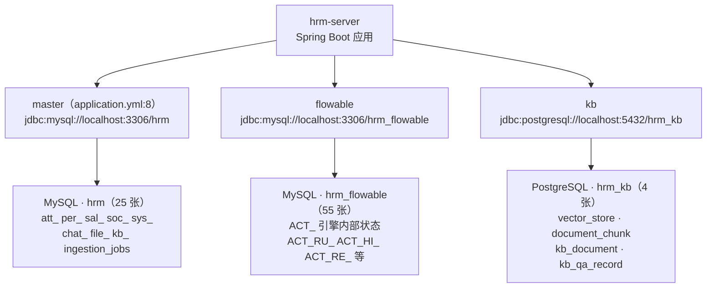
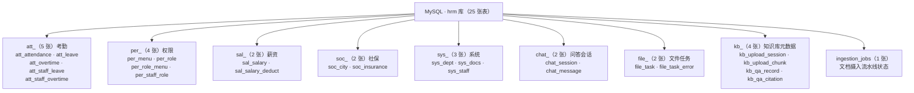

# 数智人事系统（六）：84 张表怎么分——三库分工与命名前缀

第 5 期完成了公共层，本期进入数据库层。系统共有 **84 张表**，分布在三套数据库中：MySQL `hrm` 25 张、MySQL `hrm_flowable` 55 张、PostgreSQL `hrm_kb` 4 张。

`hrm.sql` 有三个显著特点：没有外键、没有 Flyway 迁移记录、表名全带前缀。这些设计围绕三个问题展开：表放哪个库？约束谁来管？结构变更怎么进仓库？

## 动手前提

需完成第 2 期：三套数据库已通过 `docker compose` 起好，三个 SQL 文件已导入。本期不需后端启动，用 `docker exec` 进库看结构。

## 本期目标

读懂 `db/mysql/hrm.sql` 的 25 张表分成哪八组、为什么没有物理外键、唯二的联合唯一索引在防什么；看清 PG 侧 `vector(1024)` + HNSW 的用途；理解“直接改全量 SQL”的取舍。

## 三库分工：按生命周期划分

本期第一个术语：**三库分工**指按数据的生命周期和存储能力，把表分散到三个数据库实例，每个库只装一类数据。

常见的多库拆分动机是读写分离或分库分表——本项目都不是。三库的划分标准：谁产生、谁消费、谁管理数据。



**Flowable 为什么单独一库？** 原因是数据所有权，而非性能。`ACT_RU_*`（运行时）、`ACT_HI_*`（历史）、`ACT_RE_*`（定义）这 55 张表由引擎自建、自写、自清，与业务单据的生命周期不同：业务表有 `is_deleted` 逻辑删除、需关联 `sys_staff`；引擎表是框架内部状态，不应被业务代码修改，备份策略也与业务表不同。同库时一次误操作的 `TRUNCATE` 就会使流程引擎不可用。分库后，`DataSourceConfig` 用 `EngineConfigurationConfigurer` 给引擎 SQL 加上 `hrm_flowable.` 表前缀（`hrm-server/src/main/java/com/qiujie/config/DataSourceConfig.java:53`），连接仍复用主数据源：表的所有权、备份与升级边界留在库这一层，事务范围则同时覆盖业务表与引擎表。

**知识库为什么必须是 PostgreSQL？** 向量检索需要 pgvector 扩展，MySQL 至 8.4 才引入向量类型，生态弱于 pgvector。`hrm_kb` 的 4 张表只服务一个用途：`vector_store` 存 embedding，`document_chunk` 存切块元数据，`kb_document` 是 MySQL 侧 `sys_docs` 的镜像投影（第 21 期展开），`kb_qa_record` 记录问答日志。业务主数据不放进来。

**业务库为什么是 MySQL？** 属于技术演进的延续：业务主库选型早于知识库需求出现，基于团队熟悉度与生态成熟度选定 MySQL；pgvector 只为向量检索提供了不可替代的理由，不足以推翻整个业务库选型——两个 MySQL 加一个 PG 的“2+1”格局由此形成。

## 表名前缀：八组前缀对应八个业务模块

`db/mysql/hrm.sql` 中 25 张表的前缀直接对应业务模块：



前缀分组承担三个作用：

- **将物理隔离转为逻辑分组**：同一前缀的表在同一业务边界内，`att_*` 只被考勤模块读写，`per_*` 只被权限模块读写。表名即标明归属。
- **分组即验收清单**：新增模块时先回答“要不要新前缀？”第 19 期的 `kb_upload_session` 与 `kb_upload_chunk` 管理文件二进制元数据，但归属“知识库文档摄入”业务域，用 `kb_` 而非 `file_`（`file_` 的两张表服务通用异步任务引擎，第 20 期展开）。前缀使“这个表归谁管”成为显式决策，避免默认堆积进 `sys_`。
- **`ingestion_jobs` 是有意的例外**：唯一不带前缀的表，因不属于任何单一业务模块——文件摄入（知识库）与批量导入（员工/薪资）都写入这张跨模块流水线状态表，不带前缀即声明其跨域属性。

## 零物理外键：约束在索引里，不在 FK 里

`hrm.sql` 没有**任何 `FOREIGN KEY`**（Flowable 的 `ACT_*` 表内部约束除外）。`sys_staff.dept_id` 关联 `sys_dept`、`per_staff_role.staff_id` 关联 `sys_staff`，但都只是普通列，没有 `FOREIGN KEY (dept_id) REFERENCES sys_dept(id)` 这类声明。

本期第二个术语：**逻辑外键**指在代码层（Service/Mapper）通过 `JOIN` 查询或 `QueryWrapper` 条件保证数据关联性，不依赖数据库外键约束。

不使用物理外键的原因有三：

- **逻辑删除使外键失效**：项目所有表都有 `is_deleted` 字段（第 11 期），删除是 `UPDATE is_deleted=1` 而非 `DELETE`，物理外键的 `ON DELETE CASCADE/SET NULL` 不起作用——员工“删除”后，其考勤记录、请假单、薪资单仍保留，`is_deleted` 是唯一判定依据。
- **导入导出场景外键是负担**：批量导入员工时（第 20 期），若 `sys_staff` 对 `sys_dept` 有外键，导入顺序必须先部门后员工，回滚更复杂。逻辑外键下可先插员工再补部门校验。
- **无迁移工具下的连锁反应**：没有 Flyway/Liquibase（下文说明），表结构变更靠改全量 SQL；物理外键会把“改表”变成“先删约束再改再加”的多步操作，降低可读性与幂等性。

`staff_id` 不指向不存在员工的保证来自**应用层**：`StaffService` 删除员工时先检查其有无未审批的请假单（`hrm-server/src/main/java/com/qiujie/staff/service/StaffService.java:189`），`LeaveService` 创建请假单时校验 `staff_id` 在 `sys_staff` 中存在且 `is_deleted=0`——以 `QueryWrapper.eq("staff_id", staffId).eq("is_deleted", 0).exists()` 一类的查询兜底。

代价是各 Service 需自行实现校验；收益是灵活性——跨库关联（如 `att_leave.process_instance_id` 指向 `hrm_flowable` 库的 `ACT_RU_EXECUTION`）本就无法用物理外键，逻辑外键使跨库与单库约束策略统一。

## 联合唯一索引：唯二的 UNIQUE KEY 在防什么

没有外键不代表没有约束。`hrm.sql` 只有两个 `UNIQUE KEY`，每个对应一条不可违反的业务规则。

**第一个：`uk_attendance_staff_date`（`db/mysql/hrm.sql:38`）**

```sql
CREATE TABLE `att_attendance`  (
  `id` int UNSIGNED NOT NULL AUTO_INCREMENT,
  `staff_id` int UNSIGNED NOT NULL COMMENT '员工id',
  `attendance_date` date NOT NULL COMMENT '考勤日期',
  ...
  UNIQUE KEY `uk_attendance_staff_date` (`staff_id`, `attendance_date`)
) COMMENT = '考勤表';
```

**一个员工一天只能有一条考勤记录**：早晚打卡写入同一行（`check_in_time`、`check_out_time` 两列）。若允许两条记录，“当天出勤时长”就需要 `GROUP BY` 求和，统计逻辑随之复杂。联合唯一索引使重复写入在数据库层直接报错 `Duplicate entry`，Service 层捕获后提示“今日已打卡”，不产生脏数据。

**第二个：`uk_session_chunk`（`db/mysql/hrm.sql:1367`）**

```sql
CREATE TABLE `kb_upload_chunk` (
  `id` bigint NOT NULL AUTO_INCREMENT,
  `upload_id` varchar(64) NOT NULL COMMENT '上传会话ID',
  `chunk_index` int NOT NULL COMMENT '分片序号',
  ...
  UNIQUE KEY `uk_session_chunk` (`upload_id`, `chunk_index`)
) COMMENT = '分片上传块表';
```

**一个上传会话里同一分片序号只能写入一次**。第 19 期展开：前端把大文件切成 10MB 一块上传，网络重试时同一分片可能发送两次。唯一索引保证第二次写入直接失败，后端返回“分片已存在”，前端跳过即可——无需在应用层写 `SELECT ... FOR UPDATE` 防重逻辑。

其他表不加唯一索引：唯一性约束只用于“违背即数据错误”的规则。员工姓名、角色名（`per_role.role_name`）、请假单号（`att_staff_leave.leave_no` 仅作展示）均允许重复；需要数据库兜底的只有上述两种物理上不可能重复的场景。

## PG 侧：vector(1024) + HNSW 的最小可用集

`db/postgresql/knowledge_base.sql` 只有 80 行，核心设计如下：

```sql
CREATE EXTENSION IF NOT EXISTS vector;                          -- 行 7

CREATE TABLE IF NOT EXISTS vector_store (
    id        uuid DEFAULT gen_random_uuid() PRIMARY KEY,
    content   text,
    metadata  jsonb,
    embedding vector(1024) NOT NULL                              -- 行 15
);
CREATE INDEX IF NOT EXISTS vector_store_embedding_idx
    ON vector_store USING hnsw (embedding vector_cosine_ops);   -- 行 17-18
```

**`vector(1024)` 对应 `qwen3.7-text-embedding`**：该 embedding 模型输出固定 1024 维向量，列类型必须精确匹配，第 22 期摄入流水线写入向量时维度不符会直接报错。

**HNSW（Hierarchical Navigable Small World）**是 pgvector 提供的近似最近邻索引，显著快于暴力扫描。`vector_cosine_ops` 指定余弦相似度——文本向量通常不归一化，余弦距离比欧氏距离更合理。两者组合使 `SELECT * FROM vector_store ORDER BY embedding <=> '[0.1, 0.2, ...]' LIMIT 5` 一类的向量检索在毫秒级返回。

`document_chunk` 表（行 21-34）存**切块的元数据**——所属文档、第几块、起止字符位置、token 数。它也有 `UNIQUE (document_id, chunk_index)`（行 32），与 MySQL 侧 `uk_session_chunk` 同一思路：同一文档的第 3 块只能存在一次。`char_start`/`char_end` 与 `chunk_text` 中的原文存在冗余，但支撑“邻窗扩展”——第 23 期混合检索召回第 5 块后，可直接取出第 4、6 块作为 LLM 上下文。

## 种子数据：导入完成就能登录

`hrm.sql` 每张表后面都跟着 `INSERT INTO` 语句——这些不是测试数据，而是**种子数据**（本期第三个术语）：系统从零启动时的最小必备数据集。

几个关键项：

- `sys_staff`：38 行，包含默认管理员 `admin`（密码 bcrypt 哈希对应 `123`）与各部门示例员工。
- `sys_dept`：20 行，预设的部门树（总经办、技术部、人事部等）。
- `per_menu`：90 行，所有菜单和权限点——“员工管理”、“请假审批”、“数据导入”按钮的权限标识都在其中。
- `per_role` + `per_role_menu` + `per_staff_role`：预设“超级管理员”、“人事专员”等角色，以及它们可见的菜单和员工与角色的绑定关系。

**种子数据入库而非代码生成的原因**：它们属于结构的一部分。`per_menu` 的 `permission` 列值（如 `system:staff:add`）与后端 `@PreAuthorize("hasAuthority('system:staff:add')")` 是硬编码关联，菜单 ID 还决定前端路由的 `parent_id` 与层级。写成 SQL 而非代码常量，改菜单无需改代码。

**不使用 Flyway/Liquibase 的原因**：`hrm.sql` 每张表都是 `DROP TABLE IF EXISTS` + `CREATE TABLE` + `INSERT INTO` 三段式，**全量重跑永远得到最终结构**。表结构变更直接改这三段式，改完重导即可。引入 Flyway 则要维护一套按版本号递增的增量迁移脚本，而本项目只收全量 SQL、不做增量脚本——与其维护一套会被 gitignore 的迁移系统，不如让全量 SQL 成为唯一真相。

代价是生产环境升级时不能直接重跑 `DROP TABLE`。本项目定位为教学项目，部署时初始化一次即可，不需要在线 schema 演进——第 27 期部署时会再次说明。

## 动手验证：三条 SQL 看结构

```bash
# 1. 看三库的表数量（应为 25 / 55 / 4）
docker exec hrm-mysql mysql -uroot -p123456 -N -e \
  "SELECT table_schema, COUNT(*) FROM information_schema.tables
   WHERE table_schema IN ('hrm','hrm_flowable') GROUP BY table_schema;"
docker exec hrm-postgres psql -U hrm -d hrm_kb -c "\dt"

# 2. 看前缀分组（应输出 att_/per_/sal_/soc_/sys_/chat_/file_/kb_ 八组）
docker exec hrm-mysql mysql -uroot -p123456 -N -e \
  "SELECT SUBSTRING_INDEX(table_name, '_', 1) AS prefix, COUNT(*)
   FROM information_schema.tables WHERE table_schema='hrm'
   GROUP BY prefix ORDER BY COUNT(*) DESC;"

# 3. 看唯一索引（应只看到 uk_attendance_staff_date 和 uk_session_chunk）
docker exec hrm-mysql mysql -uroot -p123456 -N -e \
  "SELECT table_name, index_name FROM information_schema.statistics
   WHERE table_schema='hrm' AND non_unique=0 AND index_name != 'PRIMARY';"
```

第三条若输出了其他索引，说明本地 `hrm.sql` 已被修改——对照 Git 历史确认。

## 小坑提醒

- **改表结构必须改全量 SQL**：新增列改 `CREATE TABLE` 段，新增数据改 `INSERT INTO` 段，不写 `ALTER TABLE` 脚本——入库的只有全量文件。
- **`is_deleted` 是逻辑删除的唯一标志**：所有表的删除都是 `UPDATE is_deleted=1`，物理外键级联删除在此模式下失效，关联数据清理必须在 Service 层显式完成。
- **`ingestion_jobs` 不带前缀是刻意的**：跨模块流水线状态表，不归任何单一业务域管，非命名疏漏。
- **PG 侧 `kb_document` 是镜像不是主表**：`sys_docs` 才是文档生命周期的真相源，PG 这张表只供本地 JOIN（第 21 期展开），不写入。

## 小结

84 张表的分工逻辑如下：

- **三库按生命周期划分**：业务主数据（MySQL `hrm`）、引擎内部状态（MySQL `hrm_flowable`）、向量存储（PG `hrm_kb`）；`DataSourceConfig` 装配 master 与 kb 两个连接池，Flowable 通过 `hrm_flowable.` 表前缀复用 master 连接；
- **表名前缀即模块边界**：`att_`/`per_`/`sal_`/`soc_`/`sys_`/`chat_`/`file_`/`kb_` 八组前缀把 25 张表划为八个业务域，`ingestion_jobs` 以无前缀声明跨模块属性；
- **约束策略是“索引 + 逻辑外键”**：零物理外键换取逻辑删除与跨库关联的灵活性，唯二的联合唯一索引（`uk_attendance_staff_date`、`uk_session_chunk`）只在物理上不可能重复的场景兜底；
- **schema 即最终文档**：没有 Flyway，`hrm.sql` 的三段式（DROP + CREATE + INSERT）本身即完整真相，种子数据直接入库保证导入即可登录。

表结构理清后，下一期进入认证：两套 Token 的配合方式、`httpOnly Cookie` 相比 `localStorage` 的安全性、`JwtAuthenticationFilter` 三层降级取 token 的逻辑。

**GitHub**：https://github.com/quuuuj/hrm
