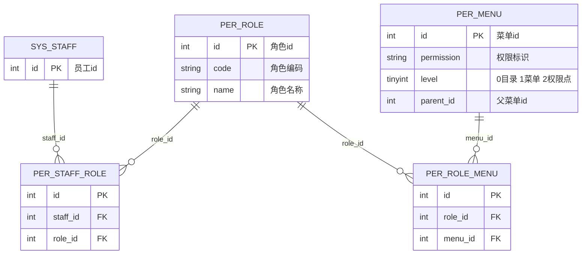

# 数智人事系统（九）：RBAC 四张表与 @PreAuthorize 校验链

前两期解决了认证：登录签发 token、过期自动续期。本期处理 token 所承载的权限——权限数据如何组织、登录时如何装进 JWT、接口如何用 `@PreAuthorize` 拦截越权请求。

先定义两个术语。**RBAC**（Role-Based Access Control，基于角色的访问控制）是经典权限模型：权限不直接绑定到人，而是“人 → 角色 → 权限”三层间接关联——员工换岗只改角色绑定，权限项不动。**权限点**是最小授权单位，一个字符串对应一个可执行操作，例如 `system:staff:export` 对应“导出员工数据”这一动作。

## 动手前提

需完成第 7 期：能登录拿到双 Cookie。第 8 期的自动续期可用但非必需。本期用 `curl` 验证，不需要前端。

## 本期目标

读懂 `per_menu`/`per_role`/`per_role_menu`/`per_staff_role` 四张表如何表达“admin 能导出员工”；看懂权限从登录到接口拦截的完整链路；用一个没有权限的账号实测 `code=1300` 的拒绝响应。

## 四张表：一张表装树，三张表连关系

权限数据只使用四张表，都在 MySQL `hrm` 库（第 6 期讲过 `per_` 前缀分组）：



两条竖线加一个鸦爪符号表示“一对多”：`SYS_STAFF ||--o{ PER_STAFF_ROLE` 读作“一个员工可以出现在 `per_staff_role` 的零到多行里”。关系线上标的是连接用的外键列名——`per_role` 与 `per_staff_role`、`per_role` 与 `per_role_menu` 之间隔着员工和菜单，等式两端的角色 id 相同才建立联系。

**`per_menu` 一张表装两样东西。** 关键在 `level` 列（`db/mysql/hrm.sql:367`）：`0` 是一级目录（“系统管理”、“考勤管理”这类只分组不可点的），`1` 是二级菜单（对应前端一个页面），`2` 是权限点（对应页面里的一个按钮或一个接口）。种子数据示例（`hrm.sql:394`）：

```sql
INSERT INTO `per_menu` VALUES (23, 'staff_add', '新增员工', 'circle-plus-outline', 'system:staff:add', 1, 2, 1, ...);
--                                                              ^^^^^^^^^^^^^^^^^   ^  ^
--                                                              权限点字符串          |  level=2 是权限点
--                                                                                parent_id=1 挂在"员工管理"下
```

`system:staff:add` 这个字符串就是权限点本身——它同时出现在三个位置：`per_menu.permission` 列、后端 `@PreAuthorize` 注解、前端 `v-permission` 指令（下一期）。三处使用同一字符串，构成本系统的权限协议。

**两张关系表结构最简。** `per_staff_role`（`hrm.sql:857`）只有 `staff_id` 和 `role_id` 两列，`per_role_menu`（`hrm.sql:527`）只有 `role_id` 和 `menu_id`。没有 `is_deleted`、没有审计列——关系表要么存在要么不存在，不需要逻辑删除。给角色分配权限是往 `per_role_menu` 插行，撤销是删行。

**为什么没有 `per_permission` 表？** 与多数 RBAC 教程不同，权限点不是独立实体，而是 `per_menu` 的一行。理由：本系统的权限始终跟着页面走，“能不能导出员工”只在员工管理页存在，不存在脱离菜单的孤立权限。权限点放进菜单表后，`per_role_menu` 一张表同时表达“这个角色能看到哪些页面”和“这个角色能点哪些按钮”——第 10 期前端动态路由用到前者，本期的 `@PreAuthorize` 用到后者。

## 一次 JOIN 查出全部权限

从“员工 id”到“权限字符串列表”只需一条 SQL，`MenuMapper.java:32-37`：

```java
@Select("""
        select distinct pm.* from per_menu pm
        left join per_role_menu prm on pm.id = prm.menu_id
        left join per_role pr on prm.role_id = pr.id
        left join per_staff_role psr on pr.id = psr.role_id
        where psr.staff_id = #{id} and pm.status = 1 and pm.level > 0 and pm.is_deleted = 0""")
List<Menu> queryPermission(@Param("id") Integer id);
```

四张表 JOIN 一圈，`level > 0` 过滤掉纯目录，`status = 1` 只取启用的项。返回的每行 `Menu` 对象中，使用的是 `permission` 列。

同文件中的另一条 SQL `queryByStaffId`（`MenuMapper.java:20-25`）几乎相同，差别只在 `level < 2`——**它查的是菜单（给前端导航用），`queryPermission` 查的是权限点（给鉴权用）**。一张表两种查法，`level` 列即开关。

## 权限装进 JWT：登录时查一次，请求时零查库

权限查出后写入 JWT。`LoginService.java:61-63` 将其拼成逗号分隔的字符串放进 claims：

```java
String permissions = staffDetails.getAuthorities().stream()
        .map(Object::toString)
        .collect(Collectors.joining(","));
// → "system:staff:list,system:staff:add,system:staff:export,..."

String accessToken = JwtUtil.generateAccessToken(
        JwtUtil.buildClaims(staffDeptVO.getId(), permissions),  // staffId + permissions 一起进 token
        staffDetails);
```

这一步是鉴权性能的关键决策：**权限在登录时查一次库，之后 15 分钟内每个请求直接从 token 读取**——`JwtAuthenticationFilter.java:88-90` 即此逻辑：

```java
List<SimpleGrantedAuthority> authorities = JwtUtil.extractPermissions(token).stream()
        .map(SimpleGrantedAuthority::new)
        .collect(Collectors.toList());
StaffDetails staffDetails = new StaffDetails(username, "", authorities, ...);
SecurityContextHolder.getContext().setAuthentication(authToken);
```

过滤器中的注释（`JwtAuthenticationFilter.java:25-26`）说明了该变更：旧实现每请求调用 `loadUserByUsername` 查库，改为从 claims 直构后每请求省 2~3 次 DB 查询。代价是权限最长有 15 分钟滞后——第 8 期的续期机制补偿了这一点：`LoginController.refresh`（`LoginController.java:87-91`）每次刷 token 都重新执行 `queryPermission`，新 token 携带最新权限。管理员修改角色权限后，最迟 15 分钟（一次续期周期）生效，无需用户重新登录。

## @PreAuthorize：一个注解完成接口级拦截

SecurityContext 中的 authorities 就位后，校验只需一行注解。全项目 100+ 处用法均为同一模式，`StaffController.java:86-88`：

```java
@Operation(summary = "数据导出接口")
@GetMapping("/export/{filename}")
@PreAuthorize("hasAnyAuthority('system:staff:export')")
public void export(HttpServletResponse response, @PathVariable String filename) { ... }
```

`@PreAuthorize` 在方法被调用**之前**执行 SpEL 表达式：`hasAnyAuthority('system:staff:export')` 检查 SecurityContext 的 authorities 中是否存在该字符串。存在则放行，不存在则抛 `AccessDeniedException`。

该注解能生效依赖 `SecurityConfig.java:27` 的 `@EnableMethodSecurity`——它为 Controller 方法织入 AOP 代理，缺少该配置时所有 `@PreAuthorize` 均不生效。

**一处宽容设计值得注意**：`StaffController.java:60` 的 `edit` 方法写的是 `hasAnyAuthority('system:staff:edit','system:staff:enable')`——两个权限点满足其一即可调用。对应场景：“启用/禁用员工”复用同一个 `edit` 接口，两个权限点并列使“只有启停权限没有编辑权限”的角色也能正常工作。权限点拆分时，操作粒度按页面按钮划分、接口粒度可以复用，注解中的 OR 关系负责衔接两者的差异。

**校验失败返回什么？** `AccessDeniedException` 被 `AccessDeniedExceptionHandler`（`security/AccessDeniedExceptionHandler.java:21`）接住，渲染成 `BusinessStatusEnum.FORBIDDEN`——响应为 `{"code":1300,"message":"不好意思，你没有此权限"}`。这就是业务码表中 `1300` 与 `1200` 分开的原因（`BusinessStatusEnum.java:21-22`）：1200 是“未登录/token 过期”（前端静默续期），1300 是“已登录但无权限”（前端弹提示）——两个数字对应前端两种不同的处理动作。

## 动手验证：造一个没有权限的请求

用 admin 登录后，在 MySQL 里造一个“只有查询权限”的员工：

```sql
-- 1. 新建一个最小角色
INSERT INTO per_role (code, name) VALUES ('viewer', '只读');

-- 2. 只给它"员工列表"这一个权限点（menu_id=1 的 permission 是 system:staff:list）
INSERT INTO per_role_menu (role_id, menu_id) VALUES (10, 1);

-- 3. 把它绑给一个测试员工（staff_id=9 是种子数据里的示例员工）
INSERT INTO per_staff_role (staff_id, role_id) VALUES (9, 10);
```

用该员工账号登录，打两个接口对比：

```bash
# 有权限的接口 → 正常返回
curl -b cookies.txt http://localhost:8888/staff?current=1&size=10

# 没权限的导出接口 → code=1300
curl -b cookies.txt http://localhost:8888/staff/export/staff.xlsx
# {"code":1300,"message":"不好意思，你没有此权限","data":null}
```

admin 调同一导出接口能拿到文件流——同一个接口、同一套代码，区别只在 JWT 中的 `permissions` 字符串集合。

**权限热更新验证**：删掉 `per_role_menu` 里 `role_id=10` 那行，等 Access Token 过期触发一次 `/refresh`（或手动调），新 token 的权限中少了 `system:staff:list`——再查列表返回 1300。整条“改授权 → 最迟 15 分钟生效”的链路不需要重启服务、不需要清缓存。

## 小坑提醒

- **permission 列可为空，空值必须过滤**：一级目录的 `permission` 是 `NULL` 或 `''`，`StaffDetailsService.java:45-47` 和 `LoginController.java:90` 各自过滤了一遍——不过滤时 `SimpleGrantedAuthority("")` 会混进 authorities，虽然不会误放行（没有接口校验空串），但会污染 JWT。
- **`level` 两个查询方向不要弄反**：`queryByStaffId` 用 `level < 2` 查菜单、`queryPermission` 用 `level > 0` 查权限点，中间地带 `level = 1` 的菜单项两边都查得到——这是刻意的，菜单项自身的 `permission`（如 `system:staff:list`）既控制页面可见性、也对应列表接口。
- **Refresh Token 不能当 Access Token 用**：`JwtAuthenticationFilter.java:80-82` 检查 `type` claim，refresh token 用于 API 请求会被直接跳过（视为未认证返回 1200）。两个 token 的 claims 形状相同，靠 `type` 字段区分用途。

## 小结

后端权限链路的完整图景：

- **四张表表达“谁能干什么”**：`per_menu` 用 `level` 区分菜单和权限点，两张关系表把员工和权限点连起来，授权即增删 `per_role_menu` 的行；
- **登录时一次 JOIN 查全权限**，拼进 JWT claims；`JwtAuthenticationFilter` 从 claims 直构 SecurityContext，每个请求零查库；
- **`@PreAuthorize` + `hasAnyAuthority` 做接口级拦截**，失败的 `AccessDeniedException` 统一渲染成 `code=1300`，与 `1200` 的“重新登录”在前端分流；
- **权限变更靠续期生效**：`/refresh` 重查 `queryPermission` 重发 token，15 分钟为权限生效的最坏延迟。

后端拦截已完成，但用户还看不到这套权限——菜单是全量渲染的、按钮点击后才报错。下一期处理前端对接：登录后按权限动态生成路由、`v-permission` 指令使无权限的按钮不渲染。权限点字符串的三处协议（表、注解、指令）届时对齐。

**GitHub**：https://github.com/quuuuj/hrm
