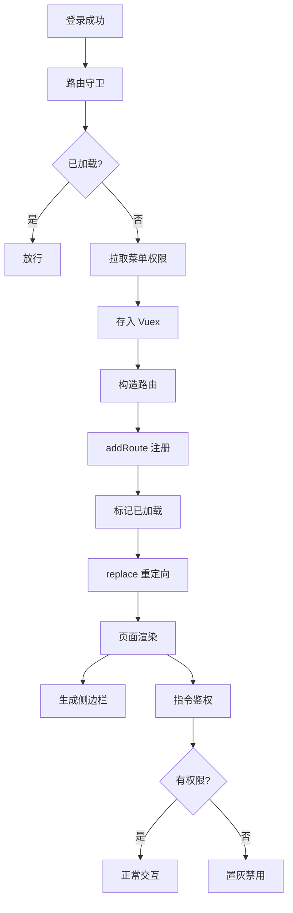

# 数智人事系统（十）：动态路由与 v-permission 按钮鉴权

上一期完成了后端权限校验：四张表表达权限关系，接口通过 `@PreAuthorize` 拦截未授权请求。本期处理前端界面对权限数据的呈现——未授权菜单不在导航栏显示，未授权按钮在页面中置灰禁用，直接输入 URL 时由路由守卫拦截。

先定义本期术语。**动态路由**指前端不将业务页面的路由规则全部静态写死在配置文件中，而是在用户登录后，依据后端返回的菜单列表在运行期动态构造并注入路由表。

## 动手前提

需完成第 8 期（前端请求拦截器与续期机制）和第 9 期（RBAC 表结构与权限数据）。验证需要前端运行（`npm run serve`），配合不同角色的测试账号。

## 本期目标

- 读懂 `hrm-admin/src/router/index.js` 中的导航守卫执行流程与 `router.addRoute` 动态注入机制；
- 理解 `hasLoadedRoutes` 标志与 `next({ ...to, replace: true })` 避免白屏和死循环的作用；
- 掌握 `v-permission` 自定义指令的工作原理，以及按钮鉴权采用“置灰禁用”而非“移除 DOM”的设计依据。

## 权限流转链路：从登录到界面



菜单数据同时决定两件事：左侧导航栏的 DOM 渲染，以及 Vue Router 中可匹配的有效路由。

## 动态路由的核心实现

### 静态路由只保留白名单

打开 `hrm-admin/src/router/index.js:16`：

```javascript
// 静态路由
const routes = [{
  path: '/login', name: 'login', component: () => import('../views/login')
}]

const router = new VueRouter({
  mode: 'history',
  routes
})
```

初始注册的静态路由只有 `/login` 登录页，员工管理、部门管理、考勤审批等业务页面均不在初始路由表中。未登录用户或无权访问对应菜单的账号，其路由表中不存在该路径，手动输入 URL 无法加载到业务组件。

### 映射菜单树为 Vue 路由规则

登录成功后，前端获取后端返回的菜单树结构，通过 `setDynamicRoute` 方法转化为路由定义（`hrm-admin/src/router/index.js:33-58`）：

```javascript
// 设置动态路由
export const setDynamicRoute = (menuList) => {
  const dynamicRoute = {
    path: '/', component: () => import('../views/Main'), children: []
  }
  menuList.forEach((menu) => {
    const route = {
      name: menu.code, path: menu.code, component: () => import('../views/' + menu.code), children: []
    }
    if (menu.children.length > 0) {
      menu.children.forEach((subMenu) => {
        route.children.push({
          name: subMenu.code,
          path: subMenu.code,
          component: () => import('../views/' + menu.code + '/' + subMenu.code),
          children: []
        })
      })
    }
    dynamicRoute.children.push(route)
  })
  dynamicRoute.children.push(
    { path: '/', component: () => import('../views/home') },
    { path: '*', component: () => import('../views/error') }
  )
  router.addRoute(dynamicRoute)
}
```

三处工程细节：

- **统一挂载到布局容器**：所有动态路由作为子路由注册在根路径 `/` 下，由布局组件 `Main.vue` 统一承载。`Main.vue` 提供顶部导航、侧边栏和内容渲染区 `<router-view>`；
- **约定优于配置**：后端菜单的 `code` 字段同时充当路由路径和前端组件的目录结构。一级目录 `system`、二级菜单 `staff` 对应的组件路径自动推导为 `../views/system/staff`，新增页面遵循该命名规范即可，无需维护路由导入映射表；
- **404 路由置于动态路由末尾**：`{ path: '*', component: () => import('../views/error') }` 必须在动态路由最后注入。若放在初始静态路由中，刷新页面时动态路由尚未完成注入，通配符优先匹配会导致误跳 404 页面。

## 路由守卫：加载时机与导航重定向

`router.beforeEach` 负责路由拦截与动态注入（`hrm-admin/src/router/index.js:63-215`）：

```javascript
// 白名单路由——无需权限即可访问
const whiteList = ['/login']
// 动态路由是否已加载（页面刷新后重新拉取，但只拉一次）
let hasLoadedRoutes = false

router.beforeEach(async (to, from, next) => {
  // 白名单直接放行
  if (whiteList.includes(to.path)) {
    return next()
  }

  const isAuth = store.state.token.isAuth

  if (isAuth) {
    if (to.path === '/login') {
      return next('/')
    }

    // 动态路由只加载一次
    if (!hasLoadedRoutes) {
      const staffId = store.getters.staffId
      if (!staffId) {
        store.dispatch('staff/logout')
        return next('/login')
      }

      try {
        // 并行请求菜单、权限和员工信息
        const [menuRes, permRes, staffRes] = await Promise.all([
          queryByStaffId(staffId),
          queryPermission(staffId),
          queryInfo(staffId)
        ])

        if (staffRes.code === 200) {
          store.commit('staff/SET_STAFF', staffRes.data)
        }
        if (menuRes.code === 200) {
          const menuList = menuRes.data
          // 任何人可访问首页
          menuList.push({
            id: 0, code: 'home', name: '首页', icon: 's-home', path: '/home', children: []
          })
          setDynamicRoute(menuList)
          store.commit('menu/SET_MENU', menuList)
        }
        if (permRes.code === 200) {
          store.commit('permission/SET_PERMISSION', permRes.data)
        }

        hasLoadedRoutes = true
        // 关键点：替换导航，确保动态路由被正确匹配
        next({ ...to, replace: true })
      } catch (err) {
        store.dispatch('staff/logout')
        next('/login')
      }
    } else {
      next()
    }
  } else {
    next(`/login?redirect=${to.path}`)
  }
})
```

两处设计依据：

- **`Promise.all` 并行拉取**：进入守卫时需要菜单树（构建路由与侧边栏）、权限点列表（供指令使用）以及员工信息（展示头像姓名）。三者通过 `Promise.all` 并行请求，总耗时取决于最慢的一项，缩短首屏等待时间；
- **`next({ ...to, replace: true })` 解决白屏**：调用 `router.addRoute` 后，新路由已注册生效，但当前导航依然基于旧路由表进行匹配（通常匹配到 404 或空白）。传入 `{ ...to, replace: true }` 会中断当前导航，针对目标路径重新发起跳转并替换历史记录栈，命中新注入的路由组件。

## 侧边栏联动：从菜单树到 Aside 渲染

动态路由加载后，菜单数据通过 `store.commit('menu/SET_MENU', menuList)` 存入 Vuex 的 `menu` 模块（`hrm-admin/src/store/modules/menu.js`）。

左侧菜单组件 `Aside.vue` 通过计算属性区分一级目录与二级菜单并进行渲染（`hrm-admin/src/components/Aside.vue:20-44`）：

```html
<!-- 无子菜单项（如首页） -->
<el-menu-item
  v-for="item in noChildren"
  :key="item.id"
  :index="item.name"
  @click="clickMenu(item, '/' + item.code)"
>
  <i :class="'el-icon-' + item.icon"></i>
  <span slot="title">{{ item.name }}</span>
</el-menu-item>

<!-- 包含子菜单项的目录分组 -->
<el-submenu v-for="item in hasChildren" :key="item.id" :index="item.name">
  <template slot="title">
    <i :class="'el-icon-' + item.icon"></i>
    <span>{{ item.name }}</span>
  </template>
  <el-menu-item
    v-for="subItem in item.children"
    @click="clickMenu(subItem, '/' + item.code + '/' + subItem.code)"
    :key="subItem.id"
    :index="subItem.name"
  >
    <i :class="'el-icon-' + subItem.icon"></i>
    <span>{{ subItem.name }}</span>
  </el-menu-item>
</el-submenu>
```

不同角色登录后，菜单数据不同，侧边栏据此渲染对应的可用模块。

## 按钮级鉴权：v-permission 自定义指令

第 9 期在 `per_menu` 表中把 `level=2` 的行定义为权限点（如 `system:staff:add`、`system:staff:delete`）。登录初始化时，`queryPermission` 接口返回用户角色的所有权限标识并存入 Vuex（`hrm-admin/src/store/modules/permission.js:7-10`）：

```javascript
SET_PERMISSION (state, list) {
  state.permissionList = list.map(item => item.permission)
}
```

自定义指令 `v-permission` 用于模板中的按钮鉴权（`hrm-admin/src/directive/permission/permission.js`）：

```javascript
import store from '@/store'

function checkPermission (el, binding) {
  const { value } = binding
  const hasPermission = store.getters && store.getters.permissionList
  if (value && value instanceof Array) {
    if (value.length > 0) {
      const requiredPermission = value
      const flag = hasPermission.some(item => {
        return requiredPermission.includes(item)
      })
      if (!flag) {
        // 无权限时的交互表现：置灰禁用
        // el.parentNode && el.parentNode.removeChild(el)
        el.disabled = true
        el.style.opacity = 0.6
        el.style['pointer-events'] = 'none'
      }
    }
  } else {
    throw new Error('请指定权限字符串！')
  }
}

export default {
  inserted (el, binding) {
    checkPermission(el, binding)
  }
}
```

业务组件用法示例（`hrm-admin/src/views/system/staff/index.vue:106-126`）：

```html
<el-button 
  v-permission="['system:staff:export']" 
  type="warning" 
  size="mini" 
  @click="handleExport"
>导出员工</el-button>

<el-button 
  v-permission="['system:staff:add']" 
  type="primary" 
  size="mini" 
  @click="handleAdd"
>新增员工</el-button>
```

### 禁用置灰与移除 DOM 的取舍

指令源码中注释掉了 `removeChild`，选择**置灰禁用（opacity 0.6 + pointer-events: none）**。原因包括：

- **表格与栅格布局稳定**：表格操作列通常包含多个操作按钮，若某角色缺少某项权限导致 DOM 节点被直接移除，容易造成操作列列宽塌陷或对齐错乱；
- **功能可见性**：界面展示按钮但处于禁用状态，明确告知用户系统具备该功能但当前账号未获授权，便于权限申请与沟通。

通过 CSS `pointer-events: none` 阻断鼠标事件，避免点击触发操作。若通过控制台修改样式强行触发，后端的 `@PreAuthorize` 仍在接口层兜底拦截。

## 效果验证

切换不同角色的账号验证权限表现：

- **管理员账号（拥有完整权限）**：侧边栏展示全部一级与二级菜单；员工管理页面中，“新增员工”、“导出员工”等按钮均为高亮可用状态；
- **受限角色账号**：侧边栏仅展示被授权的基础模块，系统管理目录不可见；直接在地址栏输入 `http://localhost:8080/system/staff` 访问，因未匹配到动态路由而落入 404 页面；在有权访问的页面中，未授权的按钮呈现半透明置灰状态且不可点击。

## 小坑提醒

- **页面刷新与状态恢复**：Vuex 存储在内存中，页面刷新后数据重置。路由守卫通过 `hasLoadedRoutes = false` 结合 Cookie 中的认证状态，在首次拦截时重新拉取菜单树并补齐 `addRoute`，保证刷新后路由不丢失；
- **登出时必须重置路由**：切换账号登录前必须调用 `resetRouter()`（`hrm-admin/src/router/index.js:26`）清空 matcher，避免上一个账号注册的动态路由残留在路由实例中。

## 小结

前端权限控制落地要点：

- **动态路由按需注入**：静态路由仅保留 `/login`，业务路由由菜单列表通过 `router.addRoute` 动态生成，末尾注入通配符 404；
- **路由守卫配合重定向**：`hasLoadedRoutes` 防重复拉取，`Promise.all` 并行加载初始数据，`next({ ...to, replace: true })` 解决动态路由首次匹配白屏；
- **按钮级置灰鉴权**：`v-permission` 指令读取 Vuex 权限点列表，无权限时采用 `pointer-events: none` 置灰禁用，兼顾布局稳定性与后端接口拦截兜底。

前端权限与后端认证、RBAC 校验至此形成完整闭环。下一期进入业务模块，以员工管理为例解析单表与多表查询、逻辑删除和批量操作的 CRUD 实现模式。

**GitHub**：https://github.com/quuuuj/hrm
