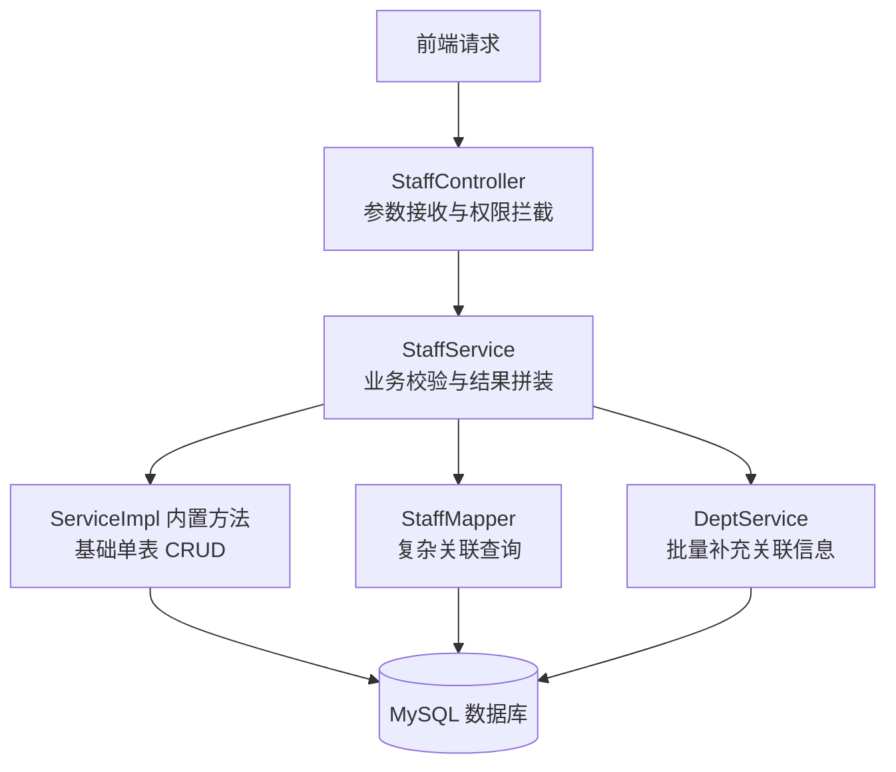

# 数智人事系统（十一）：Spring Boot + MyBatis-Plus 的 CRUD 落地

人事系统的员工、部门、岗位等基础功能围绕数据的增删改查展开。本期以核心业务模块**员工管理（Staff）**为例，介绍代码组织与实现方式：单实现场景下直接继承 `ServiceImpl` 减少样板代码、使用 `@TableLogic` 实现逻辑删除、通过单表分页结合应用层批量组装避免 N+1 查询与敏感字段暴露。

先定义本期术语。**逻辑删除**指不从数据库中执行物理 `DELETE` 语句，而是通过状态标志位将数据标记为失效，应用层查询与操作时自动将其排除。

## 动手前提

需完成第 9 期（RBAC 表结构与后端权限校验）。

## 本期目标

- 了解 Service 直接继承 `ServiceImpl` 的写法，减少单实现场景下的样板代码；
- 理解 MyBatis-Plus 中 `@TableLogic` 逻辑删除的底层运行机制；
- 掌握单表分页结合视图对象（VO）的组装方案，实现防 N+1 查询、敏感字段隔离与动态字段计算；
- 掌握轻量级 `@Select` 注解在多表关联投影中的使用方式。

## 架构分层与数据流向

员工模块遵循 package-by-feature 的特性包组织方式（位于 `com.qiujie.staff`）。请求在各层间的流转如下图所示：



三层职责划分：

- **Controller 层**：负责路由映射、权限注解拦截（如 `@PreAuthorize("hasAnyAuthority('system:staff:list')")`）以及接收和响应 HTTP 请求；
- **Service 层**：承载业务校验、跨模块数据组装以及事务管理；
- **Mapper 层**：处理持久层操作，单表方法由 MyBatis-Plus 提供，复杂场景使用原生注解 SQL。

## 实体建模与字段控制

打开实体类 `hrm-server/src/main/java/com/qiujie/staff/entity/Staff.java:37`：

```java
@Data
@Accessors(chain = true)
@TableName("sys_staff")
@Schema(description = "Staff对象")
public class Staff implements Serializable {

    private static final long serialVersionUID = 1L;

    @TableId(value = "id", type = IdType.AUTO)
    private Integer id;

    @TableField("code")
    private String code;

    @TableField("name")
    private String name;

    @TableField("gender")
    private GenderEnum gender;

    @TableField("pwd")
    @JsonProperty(access = JsonProperty.Access.WRITE_ONLY)
    private String password;

    @TableField("dept_id")
    private Integer deptId;

    @TableField("status")
    private Integer status;

    @TableField("is_deleted")
    @TableLogic
    private Integer deleteFlag;
}
```

三处字段控制细节：

- **通用枚举自动映射**：`gender` 字段类型为 `GenderEnum`。枚举实现 `BaseEnum` 并配合包扫描后，MyBatis-Plus 写库时写入枚举 code，读库时转换回枚举对象；
- **密码字段写单向控制**：实体包含登录密码 `pwd`。通过声明 `@JsonProperty(access = JsonProperty.Access.WRITE_ONLY)`，Jackson 序列化输出 JSON 时跳过该字段，仅允许前端写入，避免散列值通过接口响应外泄；
- **`@TableLogic` 逻辑删除**：员工数据关联请假单、考勤记录、薪资单和审批流，物理删除会破坏历史数据完整性。声明 `@TableLogic` 后，调用 `removeById(id)` 自动转换为 `UPDATE sys_staff SET is_deleted = 1 WHERE id = ? AND is_deleted = 0`；MyBatis-Plus 内置的基础查询（如 `getById`、`page`、`selectList`）自动追加 `AND is_deleted = 0` 条件。

## Service 层实现：继承 ServiceImpl

在单业务实现场景下，为每个 Service 定义接口会导致接口与实现类方法签名重复维护。本项目中，`StaffService` 直接继承 MyBatis-Plus 提供的 `ServiceImpl<StaffMapper, Staff>`（`hrm-server/src/main/java/com/qiujie/staff/service/StaffService.java:44`）：

```java
@Service
public class StaffService extends ServiceImpl<StaffMapper, Staff> {

    @Value("${staff.default-password}")
    private String defaultPassword;

    @Autowired
    private DeptService deptService;

    @Autowired
    private StaffMapper staffMapper;

    @Autowired
    private PasswordEncoder passwordEncoder;
    
    // ...
}
```

该方式的特点：

- **获取通用 CRUD 方法**：继承 `ServiceImpl` 后直接具备父类封装的 30 多个持久层方法（`save`、`saveBatch`、`removeById`、`updateById`、`getById`、`page` 等）；
- **省去单实现接口**：单实现前提下免去接口与实现类之间的同步成本，结构直接；后续若需多态实现可按需抽取接口。

基础增删改操作直接调用父类方法：

```java
// 逻辑删除
public ResponseDTO delete(Integer id) {
    if (removeById(id)) {
        return Response.success();
    }
    return Response.error();
}

// 批量逻辑删除
@Transactional(rollbackFor = Exception.class)
public ResponseDTO deleteBatch(List<Integer> ids) {
    if (removeBatchByIds(ids)) {
        return Response.success();
    }
    return Response.error();
}

// 修改
public ResponseDTO edit(Staff staff) {
    if (updateById(staff)) {
        return Response.success();
    }
    return Response.error();
}
```

## 单表分页与关联组装

员工列表需支持多条件筛选并展示关联的部门名称。常见做法有两类：

- **数据库层多表联查**：手写 `LEFT JOIN sys_dept` SQL 一次性分页返回；
- **单表分页 + 应用层批量组装**：先对主表进行单表分页查询，再在应用层批量查询部门数据，组装成视图对象（VO）返回。

单表分页后在 `for` 循环中逐条查部门会产生 N+1 查询问题。本项目采用“单表分页 + 批量查部门（`listByIds`）+ 组装 `StaffDeptVO`”的方案（`StaffService.java:134`）：

```java
public ResponseDTO list(Integer current, Integer size, String name, String birthday, Integer deptId, Integer status) {
    // 1. 构造分页与动态条件
    IPage<Staff> pageConfig = new Page<>(current, size);
    QueryWrapper<Staff> wrapper = new QueryWrapper<>();
    if (StringUtils.hasText(name)) {
        wrapper.like("name", name);
    }
    if (birthday != null) {
        wrapper.ge("birthday", birthday);
    }
    if (deptId != null) {
        wrapper.eq("dept_id", deptId);
    }
    if (status != null) {
        wrapper.eq("status", status);
    }
    
    // 2. 执行单表分页
    IPage<Staff> page = page(pageConfig, wrapper);
    List<Staff> records = page.getRecords();

    // 3. 提取当前页涉及的所有部门 ID 并去重
    List<Integer> deptIds = records.stream()
            .map(Staff::getDeptId)
            .filter(id -> id != null)
            .distinct()
            .collect(Collectors.toList());

    // 4. 一次批量查询查出部门，构造成 Map 缓存
    Map<Integer, Dept> deptMap = new HashMap<>();
    if (!deptIds.isEmpty()) {
        List<Dept> depts = this.deptService.listByIds(deptIds);
        deptMap = depts.stream()
                .collect(Collectors.toMap(Dept::getId, dept -> dept));
    }

    // 5. 组装展示对象 StaffDeptVO，完成敏感字段隔离与动态字段计算
    List<StaffDeptVO> staffDeptVOList = new ArrayList<>();
    for (Staff record : records) {
        StaffDeptVO staffDeptVO = new StaffDeptVO();
        Dept dept = deptMap.get(record.getDeptId());
        if (dept != null) {
            staffDeptVO.setDeptName(dept.getName());
        }
        if (record.getBirthday() != null) {
            staffDeptVO.setAge(DateUtil.ageOfNow(record.getBirthday()));
        }
        BeanUtil.copyProperties(record, staffDeptVO);
        staffDeptVOList.add(staffDeptVO);
    }

    Map<String, Object> map = new HashMap<>();
    map.put("pages", page.getPages());
    map.put("total", page.getTotal());
    map.put("list", staffDeptVOList);
    return Response.success(map);
}
```

该模式的特点：

- **查询次数固定为 2 次**：无论分页大小为多少，执行 1 次单表分页 + 1 次 `deptService.listByIds(deptIds)` 的 `IN` 查询，避免 N+1 问题；
- **单表动态条件索引命中更直接**：筛选条件集中在 `sys_staff` 单表上，无需跨表协同索引；
- **敏感信息物理隔离**：通过 `StaffDeptVO` 约束返回字段，避免 `pwd` 等敏感列进入响应体；
- **动态派生字段在应用层计算**：年龄随时间变化，不适合持久化在数据库中，由应用层通过 `DateUtil.ageOfNow(...)` 基于出生日期动态推算。

## 关联投影查询：@Select 注解

获取单条员工详情或全量导出包含部门信息时，在 Mapper 接口直接使用 `@Select` 注解声明 SQL，不使用 XML 映射文件（`hrm-server/src/main/java/com/qiujie/staff/mapper/StaffMapper.java:21`）：

```java
public interface StaffMapper extends BaseMapper<Staff> {

    @Select("select ss.id, ss.code, ss.name, ss.gender, ss.avatar, ss.birthday, " +
            "ss.phone, ss.address, ss.remark, ss.status, ss.dept_id, sd.name dept_name " +
            "from sys_staff ss left join sys_dept sd on ss.dept_id = sd.id " +
            "where ss.is_deleted = 0 and ss.id = #{id}")
    StaffDeptVO queryInfo(@Param("id") Integer id);

    @Select("select ss.id, ss.code, ss.name, ss.gender, ss.pwd password, ss.avatar, " +
            "ss.birthday, ss.phone, ss.address, ss.remark, ss.status, ss.dept_id, sd.name dept_name " +
            "from sys_staff ss left join sys_dept sd on ss.dept_id = sd.id " +
            "where ss.is_deleted = 0")
    List<StaffDeptVO> queryStaffDeptVO();

    @Select("select ss.* from sys_staff ss " +
            "inner join per_staff_role psr on ss.id = psr.staff_id " +
            "inner join per_role pr on psr.role_id = pr.id " +
            "where ss.is_deleted = 0 and pr.code = #{code}")
    List<Staff> queryByRole(@Param("code") String code);
}
```

细节说明：

- **SQL 集中在接口方法上**：无需在 Java 与 XML 间跳转，方法与 SQL 集中维护；
- **手写 SQL 需显式声明逻辑删除过滤**：MyBatis-Plus 不会为自定义 `@Select` 自动追加逻辑删除条件，多表关联条件中需显式包含 `ss.is_deleted = 0`；
- **精确投影字段**：直接映射到 `StaffDeptVO`，仅查询业务需要的列。

## 动手验证

启动后端服务后通过接口发起验证：

- **验证多条件分页与关联装配**：
  ```bash
  curl -s -b cookies.txt "http://localhost:8888/staff?current=1&size=2&status=1"
  ```
  预期返回包含 `total`、`pages` 及拼装好的 `deptName` 和 `age` 字段，且不包含 `pwd`。

- **验证 @TableLogic 逻辑删除**：
  ```bash
  curl -s -b cookies.txt -X DELETE "http://localhost:8888/staff/2"
  ```
  在数据库中查看记录：
  ```sql
  SELECT id, name, is_deleted FROM sys_staff WHERE id = 2;
  ```
  结果显示 `is_deleted = 1`，数据未被物理删除；再次调用 `/staff` 列表接口，该员工已不在结果中返回。

## 小坑提醒

- **手写 `@Select` 不会自动追加逻辑删除条件**：MyBatis-Plus 的 `@TableLogic` 仅对内置 API（如 `selectList`、`page`、`selectById`）生效。自定义 `@Select` 必须在 WHERE 子句中显式写明 `is_deleted = 0`，否则已删除数据会被查出；
- **唯一索引与逻辑删除的冲突**：若业务字段（如工号 `code`）要求唯一且启用了逻辑删除，数据库单一 UNIQUE 约束会导致删除后无法再次录入同名工号。本项目中工号采用规则绑定自增 ID（如 `staff_${id}`），避免软删除记录阻塞新建。

## 小结

员工模块 CRUD 实现要点：

- **单实现直接继承 `ServiceImpl`**：省去单实现场景下的接口空转，获得父类封装的持久层方法；
- **`@JsonProperty` 与专用 VO 隔离敏感信息**：密码字段写单向控制，列表返回使用 `StaffDeptVO` 进行结构约束与动态年龄计算；
- **单表分页 + 批量组装防 N+1**：单表动态条件分页结合 `deptService.listByIds` 批量查询，将查询次数固定为 2 次；
- **Mapper 注解式 SQL**：自定义多表投影通过 `@Select` 维护在接口中，显式声明 `is_deleted = 0` 保证逻辑删除生效。

下一期进入组织架构与权限维护模块：递归构建部门树结构，以及角色与菜单权限的批量分配与数据流转。

**GitHub**：https://github.com/quuuuj/hrm
