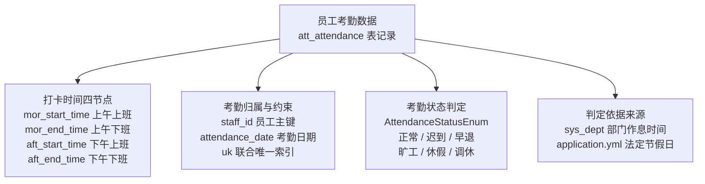

# 数智人事系统（十三）：考勤打卡与出勤日历

本期主要实现员工考勤相关功能：考勤记录存储、出勤状态判定、出勤日历，以及员工打卡数据展示。

## 动手前提

需完成第 11 期（CRUD 范式与员工模块落地），部门作息时间依赖第 12 期（组织与权限维护）。

## 本期目标

- **考勤记录存储**：熟悉 `att_attendance` 表字段设计
- **状态判定逻辑**：理解基于部门作息的迟到、早退、旷工比对规则
- **逐日状态补全**：实现批量查询员工当月考勤，结合 `HolidayConfig` 判定节假日与周末
- **统计看板展示**：实现首页打卡数据统计与出勤日历显示

## 考勤记录表

考勤数据存储于 MySQL `hrm` 库的 `att_attendance` 表（`db/mysql/hrm.sql:24`）：

```sql
CREATE TABLE `att_attendance`  (
  `id` int UNSIGNED NOT NULL AUTO_INCREMENT,
  `staff_id` int NULL DEFAULT NULL COMMENT '员工id',
  `mor_start_time` time NULL DEFAULT NULL COMMENT '上午上班时间',
  `mor_end_time` time NULL DEFAULT NULL COMMENT '上午下班时间',
  `aft_start_time` time NULL DEFAULT NULL COMMENT '下午上班时间',
  `aft_end_time` time NULL DEFAULT NULL COMMENT '下午下班时间',
  `attendance_date` date NOT NULL COMMENT '考勤日期',
  `status` tinyint NULL DEFAULT NULL COMMENT '0正常，1迟到，2早退，3旷工，4休假，5补休',
  `remark` varchar(200) NULL DEFAULT NULL,
  `create_time` datetime NOT NULL DEFAULT CURRENT_TIMESTAMP,
  `update_time` datetime NULL DEFAULT CURRENT_TIMESTAMP ON UPDATE CURRENT_TIMESTAMP,
  `is_deleted` tinyint UNSIGNED NULL DEFAULT 0,
  PRIMARY KEY (`id`) USING BTREE,
  UNIQUE KEY `uk_attendance_staff_date` (`staff_id`, `attendance_date`),
  KEY `idx_attendance_date_status` (`attendance_date`, `status`)
) ENGINE = InnoDB DEFAULT CHARSET = utf8mb4 COMMENT = '员工考勤表';
```

字段设计要点：

- **上下班打卡四个时间节点**：采用 `time` 类型存储当日时分秒，分别对应上午上班打卡（`mor_start_time`）、上午下班打卡（`mor_end_time`）、下午上班打卡（`aft_start_time`）和下午下班打卡（`aft_end_time`）；
- **联合唯一索引**：`uk_attendance_staff_date` 约束单个员工单日仅存在一条考勤主记录，防止重复导入或并发写入产生脏数据；
- **状态枚举映射**：`status` 字段对应 `AttendanceStatusEnum`（`AttendanceStatusEnum.java:18`），通过实现 `BaseEnum<Integer>` 完成数字编码与前端标签样式（`tagType`）映射。



## 出勤判定规则：以部门作息为基准

考勤状态的判定并非简单比对固定时间点，而是以员工所属部门配置的作息时间为准。判定规则在 `AttendanceImportBatchProcessor.java:171` 中统一定义：

```java
public boolean isLate(Attendance attendance, Dept dept) {
    if (attendance.getMorStartTime() == null || attendance.getAftStartTime() == null) {
        return false;
    }
    return DateUtil.compare(attendance.getMorStartTime(), dept.getMorStartTime(), "HH:mm:ss") > 0
            || DateUtil.compare(attendance.getAftStartTime(), dept.getAftStartTime(), "HH:mm:ss") > 0;
}

public boolean isLeaveEarly(Attendance attendance, Dept dept) {
    if (attendance.getMorEndTime() == null || attendance.getAftEndTime() == null) {
        return false;
    }
    return DateUtil.compare(attendance.getMorEndTime(), dept.getMorEndTime(), "HH:mm:ss") < 0
            || DateUtil.compare(attendance.getAftEndTime(), dept.getAftEndTime(), "HH:mm:ss") < 0;
}

public boolean isAbsenteeism(Attendance attendance, Dept dept) {
    if (attendance.getMorStartTime() == null || attendance.getMorEndTime() == null
            || attendance.getAftStartTime() == null || attendance.getAftEndTime() == null) {
        return true;
    }
    return isLate(attendance, dept) && isLeaveEarly(attendance, dept);
}
```

判定逻辑顺序与规则：

- **旷工判定**：四个打卡节点中有任意一项缺失，或上午下午同时出现既迟到又早退，直接标记为旷工；
- **迟到判定**：上午上班打卡晚于部门规定时间，或下午上班打卡晚于部门规定时间；
- **早退判定**：上午下班打卡早于部门规定时间，或下午下班打卡早于部门规定时间；
- **正常状态**：四项打卡记录齐全且均未越出规定作息时间窗口；
- **已有休假/调休跳过**：若当天已关联请假审批（状态为 `LEAVE` 或 `TIME_OFF`），直接跳过，保持审批生效状态。

## 节假日配置

考勤列表按月呈现，前端需要渲染员工在当月 1 日至月末每一天的出勤状态。

### 节假日配置注入

法定节假日在 `application.yml:133` 中以列表维护：

```yaml
holidays:
  - 2024-01-01
  - 2024-02-10
  - 2024-02-11
  - 2024-04-04
  - 2024-05-01
  - 2024-10-01
```

通过 `@ConfigurationProperties` 绑定至 `HolidayConfig.java:13`：

```java
@Data
@Component
@ConfigurationProperties
public class HolidayConfig {
    private List<String> holidays;
}
```

在 `DatetimeUtil.java:48` 中提供判定方法：

```java
public boolean isHoliday(Date date) {
    String str = DateUtil.format(date, "yyyy-MM-dd");
    return holidayConfig.getHolidays().contains(str);
}
```

### 批量加载

如果针对表格中每个员工的每一天单独执行一条 SQL 查询，一页 10 个员工对应单月 30 天将产生 300 次数据库往返。

`AttendanceService.java:134` 采用批量预加载方案：

```java
// 批量加载：单条 SQL 查询当前页所有员工 x 当月所有日期
List<Integer> staffIds = staffDeptVOList.stream()
        .map(StaffAttendanceVO::getStaffId)
        .collect(Collectors.toList());
List<Date> dates = new ArrayList<>();
for (String day : monthDayList) {
    dates.add(DateUtil.parse(day, "yyyyMMdd").toSqlDate());
}

Map<String, Attendance> attendanceMap = new HashMap<>();
if (!staffIds.isEmpty() && !dates.isEmpty()) {
    List<Attendance> attendances = this.attendanceMapper.queryByStaffIdsAndDates(staffIds, dates);
    for (Attendance a : attendances) {
        attendanceMap.put(a.getStaffId() + "_" + DateUtil.format(a.getAttendanceDate(), "yyyyMMdd"), a);
    }
}
```

对应的 MyBatis 注解动态 SQL（`AttendanceMapper.java:40`）：

```java
@Select({
        "<script>",
        "select * from att_attendance",
        "where is_deleted = 0",
        "and staff_id in",
        "<foreach collection='staffIds' item='staffId' open='(' separator=',' close=')'>",
        "#{staffId}",
        "</foreach>",
        "and attendance_date in",
        "<foreach collection='dates' item='date' open='(' separator=',' close=')'>",
        "#{date}",
        "</foreach>",
        "</script>"
})
List<Attendance> queryByStaffIdsAndDates(@Param("staffIds") Collection<Integer> staffIds,
                                         @Param("dates") Collection<Date> dates);
```

该批量查询的执行计划分析（以分页拉取 5 名员工在 5 个日期的考勤为例）：

```text
mysql> EXPLAIN SELECT * FROM att_attendance 
    -> WHERE is_deleted = 0 
    ->   AND staff_id IN (10, 11, 12, 13, 14) 
    ->   AND attendance_date IN ('2022-04-01', '2022-04-02', '2022-04-03', '2022-04-04', '2022-04-05')\G
*************************** 1. row ***************************
           id: 1
  select_type: SIMPLE
        table: att_attendance
   partitions: NULL
         type: range
possible_keys: uk_attendance_staff_date,idx_attendance_date_status
          key: uk_attendance_staff_date
      key_len: 8
          ref: NULL
         rows: 25
     filtered: 10.00
        Extra: Using index condition; Using where
```

执行计划核心指标：

- **访问类型 `type: range`**：MySQL 将 `IN` 集合中的离散点解析为多维边界查找，走索引范围扫描；
- **命中索引 `key: uk_attendance_staff_date`**：准确命中 `(staff_id, attendance_date)` 联合唯一索引；
- **索引生效长度 `key_len: 8`**：`staff_id`（4 字节）与 `attendance_date`（3 字节）均参与了索引过滤定位；
- **预估扫描行数 `rows: 25`**：恰好对应 5 名员工 × 5 个日期的笛卡尔积离散点，避免了全表扫描与大面积回表。

### 遍历补全当月每天的考勤状态

考勤表数据量通常较大，因此数据库只记录有打卡行为的日期，未打卡的周末与休假日不预先生成空记录。从数据库批量拉取已有记录后，Service 层在内存中逐个员工遍历当月的每一天；若某天在数据库中没有对应记录，则结合周末与法定节假日配置补全默认状态：

```java
for (StaffAttendanceVO staffDeptVO : staffDeptVOList) {
    List<HashMap<String, Object>> list = new ArrayList<>();
    for (String day : monthDayList) {
        HashMap<String, Object> map = new HashMap<>();
        Attendance attendance = attendanceMap.get(staffDeptVO.getStaffId() + "_" + day);
        if (attendance == null) {
            Date date = DateUtil.parse(day, "yyyyMMdd").toSqlDate();
            if (DateUtil.isWeekend(date) || this.datetimeUtil.isHoliday(date)) {
                map.put("message", AttendanceStatusEnum.LEAVE.getMessage());
                map.put("tagType", AttendanceStatusEnum.LEAVE.getTagType());
            } else {
                map.put("message", AttendanceStatusEnum.NORMAL.getMessage());
                map.put("tagType", AttendanceStatusEnum.NORMAL.getTagType());
            }
            map.put("attendanceDate", date);
        } else {
            map.put("message", attendance.getStatus().getMessage());
            map.put("tagType", attendance.getStatus().getTagType());
            map.put("attendanceDate", attendance.getAttendanceDate());
        }
        list.add(map);
    }
    staffDeptVO.setAttendanceList(list);
}
```

对于无显式打卡记录的日期，周末与法定节假日自动标记为休假（`LEAVE`），工作日则默认按出勤正常（`NORMAL`）填充。

## 前端渲染：出勤日历表格与看板统计

### 考勤表格的动态列渲染

在考勤管理页（`views/performance/attendance/index.vue:83`），列数根据当月实际天数（28 至 31 天）动态生成：

```html
<el-table-column prop="code" label="工号" min-width="125" align="center" fixed />
<el-table-column prop="name" label="姓名" min-width="125" align="center" fixed />
<el-table-column prop="deptName" label="部门" min-width="125" align="center" />
<el-table-column prop="phone" label="电话" min-width="125" align="center" />
<el-table-column v-for="index in dayNum" :key="index" :label="index + '日'" min-width="55">
  <template slot-scope="scope">
    <div v-permission="['performance:attendance:set']" @click="changeStatus(scope.row, index - 1)">
      <el-tag :type="scope.row.attendanceList[index - 1].tagType">
        {{ scope.row.attendanceList[index - 1].message }}
      </el-tag>
    </div>
  </template>
</el-table-column>
```

工号与姓名列固定在左侧（`fixed`），右侧通过 `v-for="index in dayNum"` 展开每日标签。具备 `performance:attendance:set` 权限的操作员点击标签可调出状态修改弹窗。

实际渲染效果如下：当月 31 天的状态标签按行铺满表格，不同状态通过 `tagType` 映射到 `el-tag` 颜色区分，鼠标悬停可点区域会高亮提示：


### 首页仪表盘打卡统计与出勤日历

在首页看板（`views/home/index.vue:27`），考勤数据呈现在个人日历和顶部统计卡片中：

- **出勤日历组件**：利用 `el-calendar` 具名插槽 `dateCell`，读取当月每日数据并渲染出勤标签；
- **今日打卡统计**：调用 `GET /home/count` 接口（`HomeService.java:99`），统计今日打卡情况并展示今日迟到、今日早退和今日旷工人数：

```java
Date datetime = new Date(System.currentTimeMillis());
String day = DateUtil.format(datetime, "yyyy-MM-dd");
long lateNum = this.attendanceService.count(
        new QueryWrapper<Attendance>().eq("attendance_date", day).eq("status", AttendanceStatusEnum.LATE));
long leaveEarlyNum = this.attendanceService.count(
        new QueryWrapper<Attendance>().eq("attendance_date", day).eq("status", AttendanceStatusEnum.LEAVE_EARLY));
long absenteeismNum = this.attendanceService.count(
        new QueryWrapper<Attendance>().eq("attendance_date", day).eq("status", AttendanceStatusEnum.ABSENTEEISM));
```

首页最终效果：顶部三张统计卡片实时显示当日异常考勤人数，下方 `el-calendar` 日历组件逐日渲染每位员工的出勤状态：


## 动手验证

基于测试员工（`staff_id=1`）验证单日考勤修改与整月数据查询：

- **查询员工指定月份考勤数据**：
  ```bash
  curl -s -X GET "http://localhost:8888/attendance?current=1&size=10&month=202405" \
    -b cookies.txt
  ```
  检查返回的 JSON 数据中 `dayNum` 是否为 31，且 `list[0].attendanceList` 包含 31 个状态对象；确认 2024-05-01 的 `message` 为 “休假”。

- **手动修正考勤状态**：
  将员工 1 在 2024-05-10 的考勤标记为迟到（`status=1`）：
  ```bash
  curl -s -X PUT "http://localhost:8888/attendance/set" \
    -H "Content-Type: application/json" \
    -d '{"staffId":1,"attendanceDate":"2024-05-10","status":1}' \
    -b cookies.txt
  ```

- **验证数据库落库与唯一索引保护**：
  ```sql
  SELECT staff_id, attendance_date, status FROM att_attendance WHERE staff_id = 1 AND attendance_date = '2024-05-10';
  ```
  记录更新成功，状态变为 1。

## 小坑提醒

- **节假日判断格式对齐**：`HolidayConfig` 中配置的字符串为 `yyyy-MM-dd`，比对前需确保 `DateUtil.format` 格式一致，避免前后缀空格或格式不匹配导致节假日识别失效；

## 小结

考勤与打卡实现要点：

- **考勤数据**：`att_attendance` 记录上下班四次打卡时间，通过 `(staff_id, attendance_date)` 唯一索引防止重复记录；
- **出勤状态判定以部门作息为准**：迟到、早退、旷工规则收敛至批处理领域服务，四项打卡缺失直接判定为旷工；
- **逐日状态补全**：单条 SQL 批量拉取当前页员工当月考勤，应用层遍历补全周末与节假日默认状态；
- **首页展示**：`el-calendar` 渲染个人出勤日历，`/home/count` 统计今日迟到、早退与旷工人数。

考勤模块记录了每日打卡明细，但员工在请假时需要更复杂的流程控制。下一期进入请假单据建模：单据表设计、假期类型枚举与假期额度扣减规则。

**GitHub**：https://github.com/quuuuj/hrm
