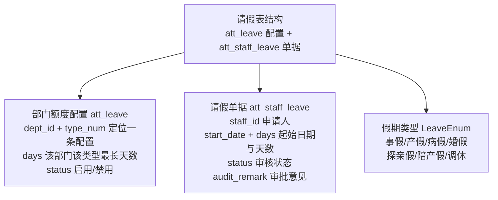
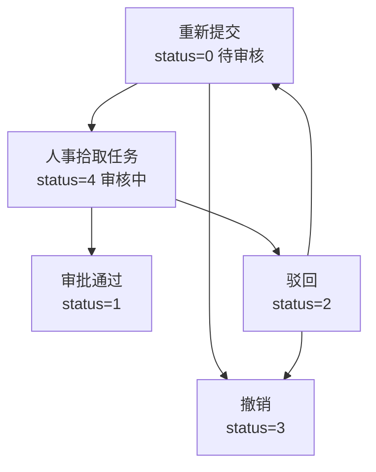

# 数智人事系统（十四）：请假额度配置与单据两层校验

系统支持多种请假类型，每个部门对每种类型的最长天数规定不同，调休还要和加班记录对账。本期把请假这两张表设计清楚：如何分工、类型与状态枚举怎么定义、提交前要做哪些校验。

## 动手前提

需完成第 11 期（CRUD 范式与员工模块实现）。调休余额一节涉及加班记录表 `att_staff_overtime`，不了解结构可先照跑，第 17 期详细展开加班模块。

## 本期目标

- **两张表分工**：`att_leave` 存部门假期额度配置，`att_staff_leave` 存请假单据
- **类型与状态枚举**：`LeaveEnum` 维护假期类型（当前配置了事假、调休等常用类型），`AuditStatusEnum` 五个审核状态构成单据状态机
- **提交校验**：归属校验、在途单据去重、部门额度上限与调休余额折算
- **撤销与记录查询**：待审核/被驳回可撤销，单据按状态控制可见性

## 两张表：额度配置与单据分离

请假涉及两类数据，各自建表：

```sql
-- db/mysql/hrm.sql:160 部门假期额度配置
CREATE TABLE `att_leave`  (
  `id` int UNSIGNED NOT NULL AUTO_INCREMENT,
  `dept_id` int NULL DEFAULT NULL COMMENT '部门id',
  `days` int UNSIGNED NULL DEFAULT NULL COMMENT '休假天数',
  `type_num` tinyint UNSIGNED NULL DEFAULT NULL COMMENT '休假类型',
  `status` tinyint UNSIGNED NULL DEFAULT 1 COMMENT '0禁用，1正常，默认1',
  ...
);

-- db/mysql/hrm.sql:272 请假单据
CREATE TABLE `att_staff_leave`  (
  `id` int UNSIGNED NOT NULL AUTO_INCREMENT,
  `staff_id` int NULL DEFAULT NULL COMMENT '员工id',
  `days` int NULL DEFAULT NULL COMMENT '请假的天数',
  `type_num` tinyint NULL DEFAULT NULL COMMENT '请假类型',
  `start_date` date NULL DEFAULT NULL COMMENT '请假的开始日期',
  `status` tinyint UNSIGNED NULL DEFAULT 0 COMMENT '0待审核，1审核通过，2驳回，3撤销，4审核中',
  `audit_remark` varchar(200) NULL DEFAULT NULL COMMENT '审批意见',
  ...
  KEY `idx_staff_leave_staff_status` (`staff_id`, `status`),
  KEY `idx_staff_leave_staff_time` (`staff_id`, `create_time`)
);
```

设计要点：

- `att_leave` 以 `(dept_id, type_num)` 标识一条配置，记录“设计部的事假最多 3 天”，`status=0` 可禁用某类型而不删除配置；
- `att_staff_leave` 只存起始日期与天数，不存结束日期——结束日期由天数推算；
- 单据表两个索引分别用于“查某人在途单据”与“按时间倒序拉取请假记录”。

两张表都通过 `LeaveEnum` 关联假期类型，目前枚举中定义了 7 种常用类型，后续业务扩展时可直接在枚举和额度表中扩充：

```java
// hrm-server/src/main/java/com/qiujie/leave/enums/LeaveEnum.java:16
public enum LeaveEnum implements BaseEnum<Integer> {
    PERSONAL_LEAVE(0, "事假"),
    MATERNITY_LEAVE(1, "产假"),
    SICK_LEAVE(2, "病假"),
    MARRIAGE_LEAVE(3, "婚假"),
    HOME_LEAVE(4, "探亲假"),
    PATERNITY_LEAVE(5, "陪产假"),
    TIME_OFF(6, "调休");
    ...
}
```

`@EnumValue` 让落库存数字，`@JsonValue` 让接口输出中文——与第 5 期定义的枚举约定一致，前端拿到的 `typeNum` 直接是“调休”这样的中文标签。



## 审核状态机

单据状态由 `AuditStatusEnum`（`hrm-server/src/main/java/com/qiujie/leave/enums/AuditStatusEnum.java:19`）五个值构成，流转如下：



- 提交即进入待审核；人事在审批列表拾取任务后进入审核中，拾取是认领动作，防止多人重复处理同一单（拾取/归还的任务操作细节随流程引擎在下期展开）；
- 驳回不是终点：被驳回的单据在“请假记录”里可通过“查看”修改后重新提交，复用原单据与原流程实例，不新建记录；
- 撤销仅对待审核与被驳回的单据开放，撤销时同步终止流程实例。

## 额度校验：部门上限与调休余额

### 部门额度维护

管理员在部门管理的设置弹窗里维护各部门假期额度（`hrm-admin/src/views/system/department/index.vue:102`）：选择假期类型后按 `(dept_id, type_num)` 回显已有配置，保存走 `LeaveService.setLeave`（`hrm-server/src/main/java/com/qiujie/leave/service/LeaveService.java:80`），先按联合条件 update，无记录再 insert：

```java
public ResponseDTO setLeave(Leave leave) {
    QueryWrapper<Leave> queryWrapper = new QueryWrapper<>();
    queryWrapper.eq("dept_id", leave.getDeptId()).eq("type_num", leave.getTypeNum());
    if (update(leave, queryWrapper) || save(leave)) {
        return Response.success();
    }
    return Response.error();
}
```

弹窗中选中事假后回显该部门已配置的最长天数 8 天与启用状态，状态开关对应 `att_leave.status`，置为禁用则该类型在员工的请假下拉框中不可选：


### 提交表单校验

请假入口在顶部导航下拉菜单，表单校验器 `checkDays`（`hrm-admin/src/components/Header.vue:322`）承担两道校验：

```javascript
const checkDays = (rule, value, callback) => {
  const leaveType = this.leaveTypeList.find(item => item.typeNum === this.leaveForm.formData.typeNum)
  if (value > leaveType.days) {
    callback(new Error('部门规定，' + leaveType.typeNum + '休假天数不超过' + leaveType.days + '天!'))
  } else {
    if (this.leaveForm.formData.typeNum === '调休') {
      let count = 0
      for (let i = 0; i < value; i++) {
        if (this.isWorkday(moment(this.leaveForm.formData.startDate).add(i, 'days'))) {
          count++
        }
      }
      // 如果所需调休余额超出了调休余额，就提示错误
      if (count > this.timeOffDays) {
        callback(new Error('所需调休天数为' + count + '，而你仅仅只有' + this.timeOffDays + '天的调休余额！'))
      }
    }
    callback()
  }
}
```

- **部门上限**：`leaveTypeList` 来自 `GET /leave/dept/{deptId}`，按员工所属部门拉取额度配置，请假天数超过配置的 `days` 直接拦截，禁用的类型在下拉框中不可选；
- **调休余额折算**：调休消耗的是工作日而非自然日。请假 3 天若为周五至周日，周六、周日不计，实际只扣 1 天调休；校验器从起始日期逐日遍历，按工作日口径折算所需天数，再与余额比较。工作日的判定是补班的周末计入、周末与法定节假日剔除，两份清单由前端通过 `GET /leave/date-config` 从后端配置拉取；
- **调休余额来源**：`timeOffDays` 由 `GET /staff-overtime/time/off/{id}` 返回（`hrm-server/src/main/java/com/qiujie/overtime/service/StaffOvertimeService.java:271`），本质是加班记录中标记为调休状态且未逻辑删除的条数。

部门上限校验的实际拦截效果：事假填 10 天，超过该部门配置的 8 天上限，提交被拦截：


调休余额校验的实际拦截效果：起始日期选 2026-10-19（周一）、请假 3 天，按工作日折算需 3 天，超过 2 天的调休余额：


## 后端提交：`apply` 的三道校验

前端校验拦的是表单填写错误，后端 `StaffLeaveService.apply`（`hrm-server/src/main/java/com/qiujie/leave/service/StaffLeaveService.java:247`）独立完成自己的校验与落库：

```java
// 验证请假归属
if (!staffLeave.getStaffId().equals(currentStaffId)) {
    log.warn("Unauthorized leave application: currentStaffId={}, targetStaffId={}",
             currentStaffId, staffLeave.getStaffId());
    return Response.error(BusinessStatusEnum.FORBIDDEN);
}

// 检查是否有待审核的请假
List<StaffLeave> staffLeaveList = this.staffLeaveMapper.selectList(new QueryWrapper<StaffLeave>().eq("staff_id", staffLeave.getStaffId())
        .and(i -> i
                .eq("status", AuditStatusEnum.UNAUDITED).or()
                .eq("status", AuditStatusEnum.REJECT).or()
                .eq("status", AuditStatusEnum.AUDITING))
);
if (!staffLeaveList.isEmpty()) {
    return Response.error("你有待审核、被驳回、正在审核中的请假申请！");
}

// 保存请假记录
if (!save(staffLeave)) {
    return Response.error("提交失败！");
}
```

- **归属校验**：表单里的 `staffId` 必须与当前登录人一致，防止替他人代提；
- **在途去重**：待审核、被驳回、审核中都算未完结，同一人同时只允许一张在途单据。被驳回的单据要先走“查看”重新提交或撤销，不能绕过它新开一张——否则驳回流程失去意义；
- **失败回滚**：落库后启动审批流程，流程启动异常时删除刚保存的单据（`StaffLeaveService.java:313-318`），不留无流程挂靠的孤儿记录。

流程如何启动、`businessKey` 如何关联单据、考勤与调休的审批联动如何实现，是第 15、16 期的内容。

## 记录查询与撤销

“请假记录”页签调用 `GET /staff-leave/staff`，按 `create_time` 倒序分页（`StaffLeaveMapper.java:23`），前端按状态决定操作按钮：待审核/被驳回显示撤销，撤销/通过显示删除（逻辑删除），被驳回显示查看（重新提交）。

列表的实际效果：待审核单据显示撤销按钮，已撤销与审核通过的单据显示删除按钮：


撤销 `cancel`（`hrm-server/src/main/java/com/qiujie/leave/service/StaffLeaveService.java:435`）在将状态置为撤销的同时终止流程实例：

```java
@Transactional
public ResponseDTO cancel(StaffLeave staffLeave) {
    staffLeave.setStatus(AuditStatusEnum.CANCEL);
    if (!updateById(staffLeave)) {
        return Response.error();
    }
    ProcessInstance instance = this.runtimeService.createProcessInstanceQuery()
            .processDefinitionKey("leave")
            .processInstanceBusinessKey(staffLeave.getId().toString()).singleResult();
    if (instance != null) {
        runtimeService.deleteProcessInstance(instance.getProcessInstanceId(), staffLeave.getStatus().getMessage());
        return Response.success();
    }
    return Response.error();
}
```

人事侧的审批列表则是另一条查询路径：`StaffLeaveMapper.listStaffLeaveVO`（`hrm-server/src/main/java/com/qiujie/leave/mapper/StaffLeaveMapper.java:54`）只查 `status in (0,4)` 的在途单据，且单据 id 必须出现在当前用户的待办任务业务键集合内——流程实例查不到的单据不会出现在审批列表。

## 动手验证

以管理员员工 1（所属部门 12，种子数据配置事假上限 8 天、调休上限 3 天，已有调休余额 2 天）验证：

- **提交一张超限单据**：在顶部导航菜单选择请假，类型选“事假”，天数填 10 天，前端校验拦截并提示“部门规定，事假休假天数不超过8天!”；绕过前端直接调 apply 接口提交同样的单据，服务端 `checkQuota` 也会返回同一提示；
- **提交正常单据**：
  ```bash
  curl -s -X POST "http://localhost:8888/staff-leave/apply" \
    -H "Content-Type: application/json" \
    -d '{"staffId":1,"typeNum":"事假","startDate":"2026-10-19","days":3}' \
    -b cookies.txt
  ```
- **重复提交被拦截**：不撤销上一张，再次调用 apply，服务端返回“你有待审核、被驳回、正在审核中的请假申请！”；
- **查库确认状态**：
  ```sql
  SELECT id, staff_id, type_num, start_date, days, status FROM att_staff_leave WHERE staff_id = 1 ORDER BY id DESC LIMIT 1;
  ```
  新单据 `status=0`。

## 小结

请假这两张表的设计要点：

- **配置与单据分表**：`att_leave` 按部门×类型存额度上限，`att_staff_leave` 存单据，只存起始日期与天数；
- **状态机五态**：待审核、审核中、通过、驳回、撤销，驳回可重新提交复用原单，撤销同步终止流程；
- **校验分两层**：前端拦部门上限与调休余额（按工作日折算），后端 `apply` 复核同样的两道额度校验，并拦归属与在途去重；
- **审批列表按在途过滤**：只查未完结单据，且与流程待办任务的业务键取交集。

单据提交后就交给了审批流程。下一期进入流程引擎：BPMN 流程定义、单据 id 作为业务键关联流程实例，以及 Flowable 如何用表前缀复用主数据源、把引擎表留在 `hrm_flowable` 库。

**GitHub**：https://github.com/quuuuj/hrm
