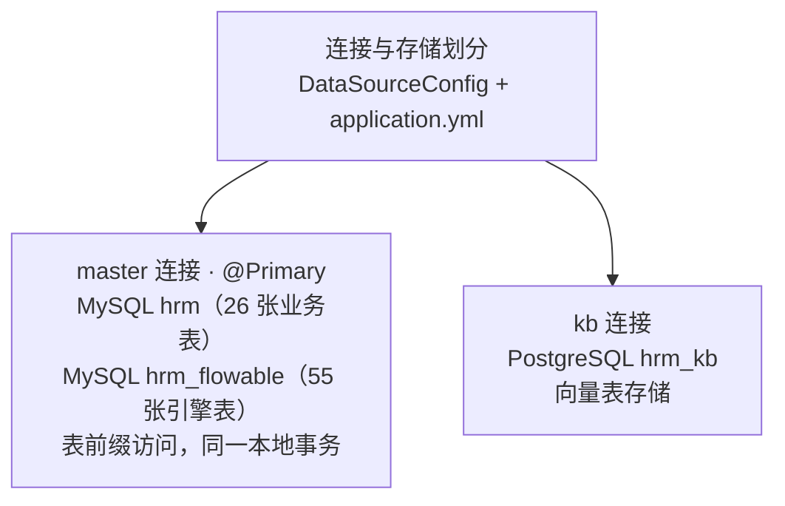
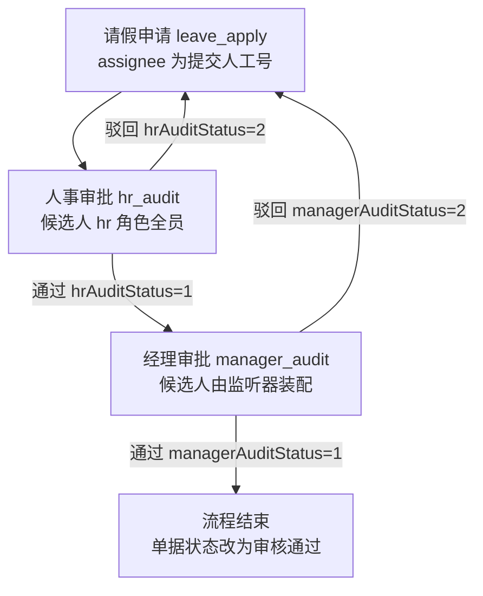

# 数智人事系统（十五）：基于Flowable流程引擎实现请假审批

请假单提交后要经过两级审批：先人事，后经理；任一环节驳回，单据退回申请人修改后重新提交；审批人还要先从待办列表拾取任务，才能批准或驳回。这套流转用状态字段加条件判断也能实现，但节点次序、候选审批人、回退路径都得在代码里逐条维护。本期把它交给流程引擎 Flowable：流转规则写进一份 BPMN 定义文件，代码只负责启动流程、查询待办、完成任务。

## 动手前提

需完成第 14 期（请假表设计与校验）。hrm_flowable 库的表由第 2 期 compose 初始化时导入 `db/mysql/hrm_flowable.sql` 建成，下文把这些表统称“引擎表”。

## 本期目标

- 配置 Flowable 表前缀，把引擎表留在 hrm_flowable 库并复用主数据源
- 编写 `leave.bpmn20.xml` 描述两级审批：三个用户任务、两条驳回边
- 提交请假时用单据 id 作为业务键（businessKey）启动流程实例
- 实现拾取、归还、完成、撤销四个审批动作，分别调用引擎的 `claim`、`setAssignee`、`complete`、`deleteProcessInstance` API

## 独立建库与表前缀

Flowable 运行需要 55 张引擎表（`ACT_` 前缀 49 张、`FLW_` 前缀 6 张），记录流程定义、运行时数据与历史。这些表不混进业务库：引擎版本升级会调整自己的表结构，独立成库后与业务表互不影响。

两个库位于同一个 MySQL 实例上。引擎配置表前缀 `hrm_flowable.` 后，Flowable 生成的 SQL 以 `hrm_flowable.ACT_*` 的形式执行在业务主连接上。审批动作里更新单据、启动流程、完成任务因此落在同一个本地事务中，任一步失败，业务表与引擎表一起回滚。

数据源只声明业务主库与知识库，Flowable 只配置表前缀：

```yaml
spring:
  datasource:
    master:
      jdbc-url: jdbc:mysql://localhost:3306/hrm?useUnicode=true&characterEncoding=utf-8&serverTimezone=Asia/Shanghai
      username: root
      password: 123456
      driver-class-name: com.mysql.cj.jdbc.Driver
      type: com.zaxxer.hikari.HikariDataSource
    kb:
      jdbc-url: jdbc:postgresql://localhost:5432/hrm_kb
      username: hrm
      password: 123456
      driver-class-name: org.postgresql.Driver
      type: com.zaxxer.hikari.HikariDataSource
flowable:
  # 表前缀即库名（hrm_flowable.ACT_*），复用 master 数据源
  table-prefix: hrm_flowable.
  database-schema-update: false
```

`database-schema-update` 必须关闭：引擎的建表与升级脚本不会套用表前缀，开启后会在错误的库执行；表结构统一由 `db/mysql/hrm_flowable.sql` 初始化。dmn、form、app、content 四个用不到的引擎模块关闭（`hrm-server/src/main/resources/application.yml:53`）。

两个 DataSource 由 `DataSourceConfig` 装配（`hrm-server/src/main/java/com/qiujie/config/DataSourceConfig.java:28`）：

```java
@Primary
@Bean
@ConfigurationProperties(prefix = "spring.datasource.master")
public DataSource masterDataSource() {
    return DataSourceBuilder.create().build();
}
```

两处配置需要显式声明：

- **表前缀**：`engineConfigurationConfigurer`（`DataSourceConfig.java:57`）调用 `config.setDatabaseTablePrefix(...)`，让引擎 SQL 访问 `hrm_flowable.ACT_*`。MySQL 下不能改用 `flowable.database-schema`：Connector/J 默认 `databaseTerm=CATALOG`，schema 参数不会生效；也不要把 `tablePrefixIsSchema` 设为 true，它会破坏前缀拼接；
- **事务管理器**：项目里有 master 与 kb 两个数据源，标有 `@Transactional` 的方法用哪个事务管理器是不确定的，为主数据源显式声明带 `@Primary` 的 `DataSourceTransactionManager`（`DataSourceConfig.java:38`）。Flowable 复用 master 连接与该事务管理器，提交请假时保存单据、启动流程、完成首个节点在同一事务里，失败一起回滚。

`pom.xml` 里 `flowable-spring-boot-starter` 排除了自带的 mybatis 与 commons-io 依赖，避免与已有依赖重复引入。



## BPMN 流程定义

BPMN 是流程定义的 XML 描述格式：节点、连线、分支条件都写在文件里。`hrm-server/src/main/resources/processes/leave.bpmn20.xml` 放在 `processes/` 目录下，应用启动时自动部署；修改后重启会部署新版本，已启动的实例仍按各自启动时的版本执行。去掉末尾的画布布局段（BPMNDiagram）后，按流转顺序整理如下（自动生成的 UUID 型 id 只保留前缀）：

```xml
<process id="leave" name="请假流程" isExecutable="true">
  <startEvent id="sid-a0962612-..."/>
  <userTask id="leave_apply" name="请假申请" activiti:assignee="${staff}"/>
  <sequenceFlow sourceRef="sid-a0962612-..." targetRef="leave_apply"/>
  <userTask id="hr_audit" name="人事审批" activiti:candidateUsers="${hr}"/>
  <sequenceFlow sourceRef="leave_apply" targetRef="hr_audit"/>
  <userTask id="manager_audit" name="经理审批" activiti:candidateUsers="${manager}"/>
  <!-- 人事通过 → 经理审批 -->
  <sequenceFlow sourceRef="hr_audit" targetRef="manager_audit">
    <extensionElements>
      <activiti:executionListener event="take" delegateExpression="${hrApproveListener}"/>
    </extensionElements>
    <conditionExpression>${hrAuditStatus == 1}</conditionExpression>
  </sequenceFlow>
  <!-- 经理通过 → 结束 -->
  <sequenceFlow sourceRef="manager_audit" targetRef="sid-152bed44-...">
    <extensionElements>
      <activiti:executionListener event="take" delegateExpression="${managerApproveListener}"/>
    </extensionElements>
    <conditionExpression>${managerAuditStatus == 1}</conditionExpression>
  </sequenceFlow>
  <!-- 人事驳回 → 退回申请 -->
  <sequenceFlow sourceRef="hr_audit" targetRef="leave_apply">
    <conditionExpression>${hrAuditStatus == 2}</conditionExpression>
  </sequenceFlow>
  <!-- 经理驳回 → 退回申请 -->
  <sequenceFlow sourceRef="manager_audit" targetRef="leave_apply">
    <conditionExpression>${managerAuditStatus == 2}</conditionExpression>
  </sequenceFlow>
  <endEvent id="sid-152bed44-..."/>
</process>
```

设计要点：

- **三个用户任务**：`leave_apply` 的 assignee 是提交人工号 `${staff}`，提交后自动完成；`hr_audit` 与 `manager_audit` 不设 assignee，只配候选人列表（candidateUsers）。候选任务是角色内所有人的共同待办，谁拾取就归谁；
- **条件表达式读流程变量**：`hrAuditStatus`、`managerAuditStatus` 的值就是 `AuditStatusEnum` 的数字（1 通过、2 驳回），引擎按条件选择出边；
- **通过分支边附带执行监听器**：流程沿边前进时触发 `take` 事件，人事通过后装配经理候选人、经理通过后做审批联动，具体逻辑下期展开；
- **`${hrApproveListener}` 是 Spring bean 名**：`delegateExpression` 按 bean 名解析，对应 `HrApproveListener` 组件注册的默认名。



## 业务键：单据与流程实例的关联

提交请假的 `apply` 方法在保存单据后启动流程，用单据自增 id 作为 businessKey（业务键，流程实例与业务单据的关联字段，`hrm-server/src/main/java/com/qiujie/leave/service/StaffLeaveService.java:347`）：

```java
try {
    // 启动流程实例
    Map<String, Object> map = new HashMap<>();
    map.put("staff", code);
    ProcessInstance instance = this.runtimeService.startProcessInstanceByKey("leave", String.valueOf(staffLeave.getId()), map);
    // ...完成 leave_apply 节点、装配人事候选人，见下文
} catch (Exception e) {
    // 与保存请假记录同一事务，抛出后一起回滚
    throw new ServiceException(BusinessStatusEnum.ERROR.getCode(), "流程启动失败，请稍后再试");
}
```

`startProcessInstanceByKey` 的第二个参数就是业务键。之后流程实例与任务的查询都按「流程定义 + 业务键」定位，代码不保存实例 id。`staff` 变量在启动时写入流程作用域，`leave_apply` 节点的 assignee 表达式由它解析。

「请假申请」本身是一个流程节点：员工点提交，这个节点随启动自动完成，同时把人事候选人写进变量（`StaffLeaveService.java:353`）：

```java
Task task = this.taskService.createTaskQuery().processDefinitionKey("leave")
        .processInstanceBusinessKey(String.valueOf(staffLeave.getId()))
        .taskAssignee(code).singleResult();
if (task == null) {
    throw new IllegalStateException("Leave apply task not found after process start: businessKey=" + staffLeave.getId());
}
Map<String, Object> hrVariables = new HashMap<>();
hrVariables.put("hr", hrStaffList.stream().map(Staff::getCode).collect(Collectors.joining(",")));
taskService.complete(task.getId(), hrVariables);
```

`hrStaffList` 在保存单据前就已查询并校验，查不到人事审批人直接返回错误，不会留下已保存却无法流转的单据。`hr` 变量存放所有 hr 角色员工的工号，多个工号用逗号连接；`hr_audit` 的 candidateUsers 表达式读取该变量，得到候选人列表。经理候选人不在这里装配——人事通过后才需要，装配动作位于人事的通过分支边上。

保存单据、启动流程、完成首个节点在同一 `@Transactional` 方法里，任何一步抛出异常，事务整体回滚，刚保存的单据与已启动的流程实例一起消失。

## 审批动作与流程 API

### 拾取与归还

候选任务不属于具体某人，hr 或 manager 角色下的所有人都能看到。拾取（claim）把它认领到自己名下，归还（revert）则放回候选池（`StaffLeaveService.java:384`、`StaffLeaveService.java:432`）：

```java
// 拾取
this.taskService.claim(task.getId(), code);
// 归还
this.taskService.setAssignee(task.getId(), null);
```

拾取时单据状态改为审核中，归还时改回待审核。拾取用 `taskCandidateUser(code)` 查询，只有候选人才能拾取；归还用 `taskAssignee(code)` 查询，只能归还自己名下的任务。

### 完成：批准与驳回

批准与驳回共用 complete 接口，两者只差前端提交的 status：批准传 1，驳回传 2（`StaffLeaveService.java:476`）：

```java
Map<String, Object> map = new HashMap<>();
if (Objects.equals(task.getTaskDefinitionKey(), "hr_audit")) {
    map.put("hrAuditStatus", staffLeave.getStatus().getCode());
} else if (Objects.equals(task.getTaskDefinitionKey(), "manager_audit")) {
    map.put("managerAuditStatus", staffLeave.getStatus().getCode());
}
taskService.complete(task.getId(), map);
```

- 按任务的 `taskDefinitionKey` 决定写哪个流程变量，变量名与 BPMN 里的条件表达式对应；
- 批准传 `AuditStatusEnum.APPROVE`（1），驳回传 `REJECT`（2），引擎据此选择出边；
- 人事通过后单据状态改回待审核（0），交由经理继续处理，这一步由通过分支边上的监听器完成，下期展开；
- 被驳回的单据在「请假记录」里修改后重新提交，也走这个接口：此时任务停在 `leave_apply`（assignee 是员工本人），map 为空，完成后回到 `hr_audit` 重新走人事审批。

### 撤销

撤销在更新单据状态的同时终止流程实例（`StaffLeaveService.java:543`）：

```java
ProcessInstance instance = this.runtimeService.createProcessInstanceQuery()
        .processDefinitionKey("leave")
        .processInstanceBusinessKey(staffLeave.getId().toString()).singleResult();
if (instance != null) {
    runtimeService.deleteProcessInstance(instance.getProcessInstanceId(), staffLeave.getStatus().getMessage());
}
```

## 审批列表

查人事审批列表时，先查当前用户的候选与已认领任务，再用业务键换成单据 id 集合（`StaffLeaveService.java:192`）：

```java
List<Task> taskList = this.taskService.createTaskQuery().processDefinitionKey("leave").taskCandidateOrAssigned(code).list();
```

`listStaffLeaveVO`（`hrm-server/src/main/java/com/qiujie/leave/mapper/StaffLeaveMapper.java:35`）在单据表上按 `status in (0,4)` 与 id 集合过滤，id 集合为空时条件退化为 `1 != 1`，返回空列表。也就是说，审批列表展示的就是当前登录人名下的流程待办；流程实例结束或撤销后，单据自然从列表消失。

员工提交后，任务停在人事环节，列表里只有「拾取」一个操作：


拾取后单据变为审核中，操作列换成批准、驳回与归还：


## 动手验证

以员工 1（admin，同时具备 hr 与 manager 角色）走一遍两级审批，每一步都可以查引擎表核对：

- **提交后**，任务停在人事环节。候选任务没有 assignee：

```sql
SELECT NAME_, TASK_DEF_KEY_, ASSIGNEE_ FROM hrm_flowable.ACT_RU_TASK;
-- 人事审批  hr_audit  NULL
```

- **拾取后**，任务归属到拾取人，单据进入审核中：

```sql
SELECT NAME_, ASSIGNEE_ FROM hrm_flowable.ACT_RU_TASK;
-- 人事审批  admin
SELECT id, status FROM hrm.att_staff_leave;
-- 77  4
```

- **人事批准后**，任务流转到经理环节，`manager` 变量由监听器装配，单据状态回到待审核（0），等待经理处理：

```sql
SELECT NAME_, TASK_DEF_KEY_ FROM hrm_flowable.ACT_RU_TASK;
-- 经理审批  manager_audit
SELECT NAME_, TEXT_ FROM hrm_flowable.ACT_RU_VARIABLE WHERE NAME_ = 'manager';
-- manager  staff_29,staff_6,staff_2,admin
```

- **经理批准后**，流程实例结束，单据状态改为审核通过：

```sql
SELECT BUSINESS_KEY_, END_TIME_ FROM hrm_flowable.ACT_HI_PROCINST WHERE BUSINESS_KEY_ = '77';
-- 77  2026-10-15 15:39:15
```

员工侧「请假记录」中，单据状态已经是审核通过：


## 小坑提醒

- `delegateExpression` 按 Spring bean 名解析。监听器类重命名后，BPMN 里的 `${hrApproveListener}` 不会跟着变，编译期没有任何提示，要到流程走到那条边才在运行时报错。改类名时要同步检查 BPMN 文件。
- 项目里有 master 与 kb 两个数据源，主数据源的事务管理器要显式声明并加 `@Primary`；依赖 Spring Boot 自动配置的话，标注 `@Transactional` 的方法可能落到错误的事务管理器上，保存单据与启动流程不再是一个事务。
- 引擎表的前缀写法只用于 SQL 访问，不能同时打开 `database-schema-update`。引擎的建表脚本不套用表前缀，开启后会在业务库里建引擎表；表结构统一由 `db/mysql/hrm_flowable.sql` 初始化。

## 小结

- **引擎独立建库、前缀访问**：55 张引擎表在 hrm_flowable，`DataSourceConfig` 配置表前缀与主数据源事务管理器，引擎复用主连接；`database-schema-update` 关闭，表结构由 `hrm_flowable.sql` 初始化；
- **BPMN 描述流转**：三个用户任务（申请、人事、经理），两条通过分支边带条件表达式，两条驳回边都退回申请环节，通过分支边附带执行监听器；
- **业务键关联单据**：单据 id 作为 businessKey，实例与任务查询都走「流程定义 + 业务键」；
- **列表展示流程待办**：当前用户的候选与已认领任务 → 业务键 → 在途单据。

下期看通过分支边上的两个监听器：人事通过后如何装配经理候选人，经理通过后如何写考勤、扣调休、通知申请人，以及通知链路为什么拆成消息构造与落库推送两段。

**GitHub**：https://github.com/quuuuj/hrm
