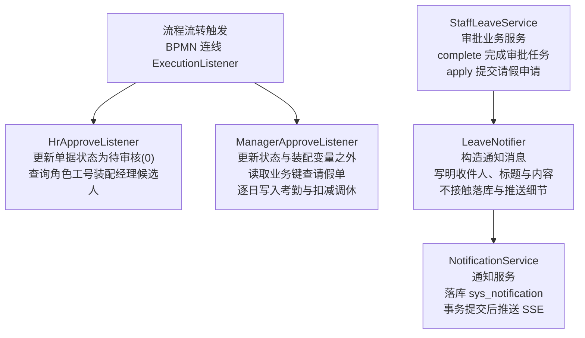
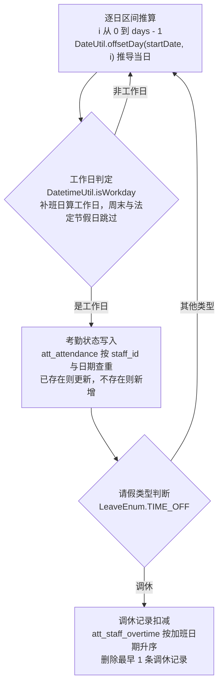

# 数智人事系统（十六）：审批通过后的考勤写入与站内通知

请假单经过经理审批通过后，系统需要把请假日期折算并记入员工考勤，若请假类型是调休，还要扣减此前累计的加班工时；审批流转推进期间，申请人与各级审批人还需要收到站内实时通知。本期介绍审批通过后写入考勤、扣减调休与发送站内通知的具体实现：执行监听器只负责流程流转与状态装配，考勤写入与调休扣减只出现在经理通过监听器中，通知统一由 `NotificationService` 落库后推送。

## 前置准备

需完成第 15 期（请假审批的 Flowable 流程实现）。本期涉及的考勤表 `att_attendance` 在第 13 期已建立，加班记录表 `att_staff_overtime` 在第 14 期与第 2 期初始化时已导入。

## 本期目标

- 划清流程控制与业务数据更新的归属：通过分支边上的 `ExecutionListener` 只承担流程控制，考勤写入与调休扣减只写在经理通过监听器里
- 实现 `ManagerApproveListener.notify`：经理批准后逐日遍历请假区间，识别补班日并跳过非工作日，写入考勤并按加班日期升序扣减最早的调休记录
- 打通站内通知链路：`LeaveNotifier` 构造通知消息，`NotificationService` 落库后经事务同步回调推送 SSE
- 对齐通知触发点：提交、人事通过、审批终态三个节点分别向对应人群发出站内通知

## 流程控制与业务数据更新

在 `leave.bpmn20.xml` 中，人事通过分支与经理通过分支分别配置了 `HrApproveListener` 与 `ManagerApproveListener`（委托表达式 `${hrApproveListener}`、`${managerApproveListener}`，按 Bean 名称解析）。这两个类实现了 Flowable 的 `ExecutionListener` 接口，配置在连线而非用户任务节点上，是因为人事节点与经理节点均有两条分支（批准与驳回）。配置在连线上，只有当条件表达式成立、流程实际流经通过分支时，监听器才会触发执行；驳回时流程走驳回分支。

审批流转过程中涉及两类工作：

- **流程控制**：将单据状态更新为待审核（0）、解析并装配下一节点的审批候选人员工号；
- **业务数据更新**：审批全部通过后，写入考勤数据、扣减加班调休记录，以及发出站内通知。

这两类工作的归属是：两个监听器只读取执行上下文、提取业务键、更新本单据状态、装配流程变量；经理通过监听器额外执行考勤写入与调休扣减，因为这组逐日推算的逻辑只有这一个调用方，为它单独立一个类反而增加一层间接；通知不放在监听器中触发，而是由业务服务在审批动作前后调用 `LeaveNotifier` 构造通知消息。



## 两个执行监听器

两个执行监听器配置在 BPMN 的转移边（`sequenceFlow`）上，配置为 `event="take"`：

```xml
<!-- hrm-server/src/main/resources/processes/leave.bpmn20.xml:8 -->
<sequenceFlow id="sid-6a2c08f6-c31a-4b5d-a0c5-8883cab86f80" sourceRef="hr_audit" targetRef="manager_audit">
  <extensionElements>
    <activiti:executionListener event="take" delegateExpression="${hrApproveListener}"/>
  </extensionElements>
  <conditionExpression>${hrAuditStatus == 1}</conditionExpression>
</sequenceFlow>
```

### 人事通过监听器

人事通过后，单据进入经理审批阶段。`HrApproveListener` 处理两项任务：将单据状态设回待审核（0），并装配经理候选人（`hrm-server/src/main/java/com/qiujie/leave/approval/HrApproveListener.java:40`）：

```java
@Override
@Transactional
public void notify(DelegateExecution execution) {
    UpdateWrapper<StaffLeave> updateWrapper = new UpdateWrapper<>();
    updateWrapper.set("status", AuditStatusEnum.UNAUDITED).eq("id", Integer.valueOf(execution.getProcessInstanceBusinessKey()));
    if (!this.staffLeaveService.update(updateWrapper)) {
        throw new ServiceException(BusinessStatusEnum.ERROR);
    }
    String managerCodes = staffMapper.queryByRole("manager").stream()
            .map(Staff::getCode).collect(Collectors.joining(","));
    Map<String, Object> variables = new HashMap<>();
    variables.put("manager", managerCodes);
    runtimeService.setVariables(execution.getId(), variables);
}
```

单据状态在拾取时被改为审核中（4），人事批准后重置为待审核（0），以便经理端待办列表能够正常过滤显示。候选人装配就在监听器内完成：`staffMapper.queryByRole("manager")` 查出经理角色的所有在职员工，工号以逗号拼接成字符串写入流程变量 `manager`，经理节点的候选人配置 `activiti:candidateUsers="${manager}"` 即可生效。

### 经理通过监听器：写入考勤与扣减调休

经理通过分支上的 `ManagerApproveListener` 负责审批通过后的考勤写入与调休扣减，方法整体标有 `@Transactional`（`hrm-server/src/main/java/com/qiujie/leave/approval/ManagerApproveListener.java:51`）。它先通过流程实例的业务键（`businessKey`）查出请假单实体，再逐日处理请假区间：

```java
@Override
@Transactional
public void notify(DelegateExecution execution) {
    StaffLeave staffLeave = staffLeaveService.getOne(new QueryWrapper<StaffLeave>()
            .eq("id", Integer.valueOf(execution.getProcessInstanceBusinessKey())));
    for (int i = 0; i < staffLeave.getDays(); i++) {
        Date attendanceDate = DateUtil.offsetDay(staffLeave.getStartDate(), i).toSqlDate();
        if (!datetimeUtil.isWorkday(attendanceDate)) {
            continue;
        }
        Attendance attendance = new Attendance()
                .setAttendanceDate(attendanceDate)
                .setStaffId(staffLeave.getStaffId());
        if (staffLeave.getTypeNum() == LeaveEnum.TIME_OFF) {
            attendance.setStatus(AttendanceStatusEnum.TIME_OFF);
            staffOvertimeMapper.delete(new QueryWrapper<StaffOvertime>()
                    .eq("staff_id", staffLeave.getStaffId())
                    .eq("status", OvertimeStatusEnum.TIME_OFF)
                    .orderByAsc("overtime_date").last("limit 1"));
        } else {
            attendance.setStatus(AttendanceStatusEnum.LEAVE);
        }
        Attendance existing = attendanceService.getOne(new QueryWrapper<Attendance>()
                .eq("staff_id", attendance.getStaffId())
                .eq("attendance_date", attendance.getAttendanceDate()));
        if (existing != null) {
            attendance.setId(existing.getId());
            if (!attendanceService.updateById(attendance)) {
                throw new ServiceException(BusinessStatusEnum.ERROR);
            }
        } else {
            if (!attendanceService.save(attendance)) {
                throw new ServiceException(BusinessStatusEnum.ERROR);
            }
        }
    }
}
```

更新步骤的执行流程如下：



#### 逐日推算与工作日判定

请假单只存储起始日期（`startDate`）和请假总天数（`days`）。方法从 0 到 `days - 1` 循环，利用 `DateUtil.offsetDay` 逐日推导具体日期。

推导出的日期由 `datetimeUtil.isWorkday(attendanceDate)` 进行校验（`hrm-server/src/main/java/com/qiujie/util/DatetimeUtil.java:60`）：

```java
public boolean isWorkday(Date date) {
    String str = DateUtil.format(date, "yyyy-MM-dd");
    if (holidayConfig.getMakeupWorkdays() != null && holidayConfig.getMakeupWorkdays().contains(str)) {
        return true;
    }
    return !DateUtil.isWeekend(date) && !isHoliday(date);
}
```

- 若日期配置在补班列表（`makeupWorkdays`）中，判定为工作日；
- 既非周末也非法定节假日，判定为工作日；
- 其余情况均判定为非工作日，直接通过 `continue` 跳过。

跳过非工作日的依据是：休息日员工原本就无需考勤出勤，如果在考勤表中为休息日插入休假状态记录，月度考勤统计就会多计请假天数。

#### 区分调休与普通休假

针对不同请假类型，考勤记录的状态取值不同：

- **调休（`LeaveEnum.TIME_OFF`）**：考勤状态标记为调休（`AttendanceStatusEnum.TIME_OFF`）。同时，从加班记录表 `att_staff_overtime` 中扣减该员工此前累计的加班：查询条件限定 `status = OvertimeStatusEnum.TIME_OFF`（状态为调休），按照加班日期升序排列，删除最早的一条记录；
- **其他类型（事假、年假等）**：考勤状态标记为休假（`AttendanceStatusEnum.LEAVE`）。

#### 考勤记录防重与更新

对于每个有效工作日，先通过 `(staff_id, attendance_date)` 查询考勤表。若已有记录（例如员工当天上午打卡后下午临时请假），则保留原记录主键调用 `updateById` 覆盖状态；若尚无记录，则调用 `save` 插入新记录。这与第 13 期的打卡逻辑保持一致。

该方法标有 `@Transactional`，运行在当前审批事务内：引擎表与业务表通过同一主连接写入，考勤写入、调休扣减或流程推进任一步抛出未捕获的运行时异常，整个审批操作一起回滚。

## LeaveNotifier 构造通知消息

审批过程中的站内通知由 `LeaveNotifier` 负责（`hrm-server/src/main/java/com/qiujie/leave/approval/LeaveNotifier.java:39`）。它是一个普通 Spring 组件，负责将请假业务语义转换并构造为通知消息：

```java
public void onLeaveSubmitted(StaffLeave leave, List<Integer> hrIds) {
    String desc = leave.getDays() + "天请假，等待审批";
    notificationService.send(NotificationMessage.to(leave.getStaffId(), "LEAVE_SUBMITTED",
            NotificationCategoryEnum.INFO, "请假申请已提交", desc, BIZ_TYPE, bizId(leave)));

    if (hrIds != null && !hrIds.isEmpty()) {
        notificationService.send(NotificationMessage.to(hrIds, "LEAVE_PENDING",
                NotificationCategoryEnum.INFO, "新的请假申请",
                "员工提交了" + leave.getDays() + "天请假", BIZ_TYPE, bizId(leave)));
    }
}
```

`NotificationMessage` 携带收件人列表、事件类型（`LEAVE_SUBMITTED` 等）、展示类别（`NotificationCategoryEnum` 的 INFO/SUCCESS/WARNING/ERROR）、标题、内容、业务类型与业务主键。通知的受众由业务服务解析，落库与推送则由 `NotificationService` 统一处理。

通知在审批链路上有三个触发点：

- **提交申请时**：`StaffLeaveService.apply` 启动流程后调用 `onLeaveSubmitted`，向申请人推送“请假申请已提交”，同时向人事角色推送待审通知；
- **人事通过时**：`complete` 里 `taskService.complete` 推进流程后调用 `onManagerPending`，向经理角色推送待办提醒；
- **审批终态时**：人事驳回、经理通过或驳回，调用 `onLeaveCompleted`，按结果向申请人推送“请假已通过”或“请假已拒绝”，通过为成功（SUCCESS）、拒绝为错误（ERROR）类别。

`complete` 中的通知调用截取如下（`hrm-server/src/main/java/com/qiujie/leave/service/StaffLeaveService.java:525`）：

```java
if (hrStage && approved) {
    // HR 通过后流程进入经理审批：通知经理待办，申请人结果等经理审批结束再发
    leaveNotifier.onManagerPending(persisted, managerIds);
} else {
    // HR 驳回、经理通过/驳回：流程结束或回到申请人，通知申请人结果
    leaveNotifier.onLeaveCompleted(persisted);
}
```

## 站内通知服务：落库、事务与 SSE

`LeaveNotifier` 之下是通用的 `NotificationService`（`hrm-server/src/main/java/com/qiujie/notification/service/NotificationService.java:52`）：

```java
private void sendToOne(Integer staffId, NotificationMessage message, boolean skipIfExists) {
    try {
        if (skipIfExists && exists(staffId, message.getBizType(), message.getBizId(), message.getType())) {
            return;
        }
        Notification notification = new Notification();
        notification.setStaffId(staffId);
        notification.setType(message.getType());
        notification.setCategory(message.getCategory() == null
                ? NotificationCategoryEnum.INFO : message.getCategory());
        notification.setTitle(truncate(message.getTitle(), TITLE_MAX_LENGTH));
        notification.setBody(truncate(message.getBody(), BODY_MAX_LENGTH));
        notification.setBizType(message.getBizType());
        notification.setBizId(message.getBizId());
        notification.setReadFlag(0);
        this.save(notification);

        pushAfterCommit(staffId, notification);
    } catch (Exception e) {
        log.warn("Failed to send notification: staffId={}, type={}, bizType={}, bizId={}",
                staffId, message.getType(), message.getBizType(), message.getBizId(), e);
    }
}
```

链路有三个设计点：

- **先落库再推送**：通知写入 `sys_notification` 表，离线用户登录后在通知列表里仍能看到；SSE 只负责在线用户的实时提醒，由通用 `SseService` 按员工 id 定向推送；
- **事务提交后再推**：`pushAfterCommit` 检测当前是否存在活动事务，有则注册 `afterCommit` 回调、事务提交后才推送，避免业务已经回滚、用户却收到了根本没生效的通知；无事务则立即推送；
- **异常不向外抛出**：落库失败与推送失败均只记录警告日志。实时通知属于非核心路径，网络抖动不应阻断审批主事务，单个收件人失败也不影响其余收件人。

通知保留期由 `notification.retention-days` 配置（默认 30 天），`NotificationCleanupJob` 按期物理删除过期通知。

## 效果验证

在本地数据库中验证考勤写入与调休扣减的结果。以员工 1 提交一条从周四开始、跨度 3 天的调休申请（2026-10-22 至 2026-10-24）为例：

- **提交后**：申请人与人事角色应各收到一条未读通知（演示账号 admin 既是申请人，也在人事角色中，两条通知落在同一员工下）：

```sql
SELECT staff_id, type, title, read_flag FROM hrm.sys_notification
WHERE biz_type = 'LEAVE' AND staff_id = 1 ORDER BY id DESC;
-- 1   LEAVE_PENDING    新的请假申请     0
-- 1   LEAVE_SUBMITTED  请假申请已提交   0
```


- **人事审批通过后**：查询流程实例变量表，验证经理候选人工号已注入；同时经理收到待办通知：

```sql
SELECT NAME_, TEXT_ FROM hrm_flowable.ACT_RU_VARIABLE WHERE NAME_ = 'manager';
-- manager  staff_29,staff_6,admin
```

- **经理审批通过后**：查询业务库考勤表与加班记录表：

```sql
-- 查看考勤生成记录
SELECT staff_id, attendance_date, status FROM hrm.att_attendance 
WHERE staff_id = 1 AND attendance_date >= '2026-10-22' 
ORDER BY attendance_date ASC;
```


结果显示周四（22 日）与周五（23 日）写入了调休考勤记录，周六（24 日）被判定为非工作日跳过；若类型为调休，检查 `att_staff_overtime` 表，每个工作日各删除最早的一条调休加班记录，本次两个工作日共扣减两条。申请人收到“请假已通过”通知，在线时页面右上角的通知铃铛会实时弹出；演示账号 admin 同时具备经理角色，面板中还会出现一条“请假待您审批”。


## 小坑提醒

- 工作日判定必须与第 14 期的提交校验使用同一个 `DatetimeUtil.isWorkday` 方法。若两处口径不一致，可能出现前端校验扣减了 2 天额度，审批通过后却写入了 3 天考勤的情况。
- 装配通知所需的审批人 id 必须在 `taskService.complete` 推进流程之前查好。查询放在 `complete` 之后，任务上下文已经变化；放在之前，查询失败时流程尚未流转，异常会连同业务表与引擎表一起回滚，不会出现流程已进入经理审批、通知数据却缺失的中间状态。
- 通知的落库与推送必须整体捕获异常。任何一步未捕获而向上抛出，都会连带回滚已经完成的审批任务，破坏主流程稳定性。

## 小结

- **流程控制与业务数据更新分开**：监听器只负责流程流转与状态装配，考勤写入与调休扣减只有经理通过监听器这一个调用方，通知交给 `NotificationService`；
- **逐日推算与提交校验同口径**：考勤写入与额度校验共用 `DatetimeUtil.isWorkday`，识别补班日并过滤非工作日；
- **消息构造与投递分离**：`LeaveNotifier` 只构造 `NotificationMessage`，落库、截断、事务同步与 SSE 推送由 `NotificationService` 统一处理；
- **通知不威胁主事务**：先落库保证离线可见，事务提交后推送、回滚后不送达，异常只告警不阻断审批。

下期进入业务核算阶段，解析加班与薪资两块计算：加班记录如何折算时长、判定类型并计发加班费，以及月度薪资如何汇总构成并扣除考勤与社保。

**GitHub**：https://github.com/quuuuj/hrm
