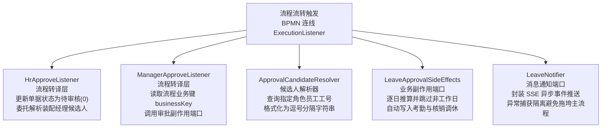
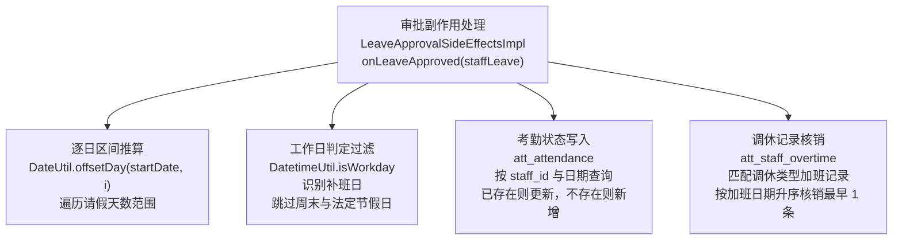

# 数智人事系统（十六）：监听器分层与审批副作用端口

请假单经过经理审批通过后，流程在引擎层面已经走向结束，但人事业务并没有完结：系统需要把请假日期折算并记入员工考勤，若请假类型是调休，还要扣减此前累计的加班工时；审批流转推进期间，申请人与审批人还需要收到站内实时通知。如果把这些逻辑全部写在 Flowable 的监听器里，监听器就会掺杂大量跨模块业务代码。本期介绍监听器分层与副作用端口设计：执行监听器仅负责流程转译，跨模块的数据更新与通知分发下沉到独立端口。

## 动手前提

需完成第 15 期（请假审批的 Flowable 流程实现）。本期涉及的考勤表 `att_attendance` 在第 13 期已建立，加班记录表 `att_staff_overtime` 在第 14 期与第 2 期初始化时已导入。

## 本期目标

- 明确流程转译层与业务副作用的边界：通过分支边上的 `ExecutionListener` 响应流转事件
- 实现 `ApprovalCandidateResolver`：查询指定角色工号并装配经理审批节点候选人
- 定义 `LeaveApprovalSideEffects` 端口：在经理批准后逐日遍历请假区间，跳过周末与法定节假日，自动写入考勤并核销调休记录
- 定义 `LeaveNotifier` 端口：封装 SSE 事件推送，与主业务流程保持异常隔离

## 流程转译层与业务副作用

在 `leave.bpmn20.xml` 中，人事通过分支与经理通过分支分别配置了 `hrApproveListener` 与 `managerApproveListener`。这两个类实现了 Flowable 的 `ExecutionListener` 接口。

作为引擎与业务代码之间的交界点，执行监听器最容易出现职责膨胀。审批流转过程包含两类动作：

- **流程控制动作**：将单据状态更新为待审核（0）、解析并装配下一节点的审批候选人员工号；
- **业务副作用（Side Effects）**：审批终审通过后，跨模块更新考勤数据、核销加班调休记录，以及分发站内实时通知。

如果直接把考勤查询与更新、加班记录核销、节假日过滤判定全部堆在监听器中，会造成监听器与考勤、加班、通知等多个模块产生紧耦合；后续测试考勤与调休核算时，还必须依赖 Flowable 的 `DelegateExecution` 上下文。

因此系统采用分层结构：监听器作为“流程转译层”，仅负责读取执行上下文、提取业务键、更新本单据状态，随后将候选人查询委托给 `ApprovalCandidateResolver`，将业务变更委托给 `LeaveApprovalSideEffects`，将通知推送委托给 `LeaveNotifier`。



## 流程转译层：执行监听器

两个执行监听器配置在 BPMN 的转移边（`sequenceFlow`）上，配置为 `event="take"`：

```xml
<!-- hrm-server/src/main/resources/processes/leave.bpmn20.xml:8 -->
<sequenceFlow id="sid-6a2c08f6-c31a-4b5d-a0c5-8883cab86f80" sourceRef="hr_audit" targetRef="manager_audit">
  <extensionElements>
    <activiti:executionListener event="take" delegateExpression="${hrApproveListener}"/>
  </extensionElements>
  <conditionExpression>${hrAuditStatus == 1}</conditionExpression>
</sequenceFlow>
```

监听器挂在连线而非用户任务节点上，是因为人事节点与经理节点均有两条分支（批准与驳回）。配置在连线上，只有当条件表达式 `${hrAuditStatus == 1}` 成立、流程实际流经通过分支时，监听器才会触发执行；驳回时流程走驳回分支，不会触发任何通过逻辑。

### 人事通过监听器

人事通过后，单据进入经理审批阶段。`HrApproveListener` 处理两项任务：将单据状态设回待审核（0），并装配经理候选人（`hrm-server/src/main/java/com/qiujie/leave/approval/HrApproveListener.java:41`）：

```java
@Override
@Transactional
public void notify(DelegateExecution execution) {
    UpdateWrapper<StaffLeave> updateWrapper = new UpdateWrapper<>();
    updateWrapper.set("status", AuditStatusEnum.UNAUDITED).eq("id", Integer.valueOf(execution.getProcessInstanceBusinessKey()));
    if (!this.staffLeaveService.update(updateWrapper)) {
        throw new ServiceException(BusinessStatusEnum.ERROR);
    }
    Map<String, Object> variables = new HashMap<>();
    variables.put("manager", candidateResolver.codesOfRole("manager"));
    runtimeService.setVariables(execution.getId(), variables);
}
```

单据状态在拾取时被改为审核中（4），人事批准后重置为待审核（0），以便经理端待办列表能够正常过滤显示；经理工号集合由 `candidateResolver.codesOfRole("manager")` 获得，写入流程变量 `manager` 后，经理节点的候选人配置 `activiti:candidateUsers="${manager}"` 即可生效。

### 审批候选人解析器

`ApprovalCandidateResolver` 负责将系统角色转换为流程引擎识别的候选人变量格式（`hrm-server/src/main/java/com/qiujie/leave/approval/ApprovalCandidateResolver.java:18`）：

```java
@Component
public class ApprovalCandidateResolver {

    private final StaffMapper staffMapper;

    public ApprovalCandidateResolver(StaffMapper staffMapper) {
        this.staffMapper = staffMapper;
    }

    public String codesOfRole(String role) {
        List<Staff> staffList = staffMapper.queryByRole(role);
        return staffList.stream().map(Staff::getCode).collect(Collectors.joining(","));
    }
}
```

方法通过 `staffMapper.queryByRole(role)` 查询具备对应角色的所有在职员工，将其工号以逗号拼接成字符串返回。若没有该角色人员，则返回空字符串。

### 经理通过监听器

经理通过分支上的 `ManagerApproveListener` 更加单薄，仅提取业务键并调用端口（`hrm-server/src/main/java/com/qiujie/leave/approval/ManagerApproveListener.java:31`）：

```java
@Override
public void notify(DelegateExecution execution) {
    StaffLeave staffLeave = staffLeaveService.getOne(new QueryWrapper<StaffLeave>()
            .eq("id", Integer.valueOf(execution.getProcessInstanceBusinessKey())));
    sideEffects.onLeaveApproved(staffLeave);
}
```

方法通过流程实例的业务键（`businessKey`）查出请假单实体，直接交付给 `LeaveApprovalSideEffects`。

## 副作用端口：考勤写入与调休核销

审批终审通过后的业务逻辑定义在 `LeaveApprovalSideEffects` 接口中（`hrm-server/src/main/java/com/qiujie/leave/approval/LeaveApprovalSideEffects.java:12`）：

```java
public interface LeaveApprovalSideEffects {

    void onLeaveApproved(StaffLeave leave);
}
```

接口实现类 `LeaveApprovalSideEffectsImpl` 集中处理工作日判断、考勤记录维护以及调休记录核销：



核心方法包含三个处理步骤（`hrm-server/src/main/java/com/qiujie/leave/approval/LeaveApprovalSideEffectsImpl.java:50`）：

```java
@Override
@Transactional
public void onLeaveApproved(StaffLeave staffLeave) {
    for (int i = 0; i < staffLeave.getDays(); i++) {
        Date attendanceDate = DateUtil.offsetDay(staffLeave.getStartDate(), i).toSqlDate();
        if (!datetimeUtil.isWorkday(attendanceDate)) {
            continue;
        }
        Attendance attendance = new Attendance()
                .setAttendanceDate(attendanceDate)
                .setStaffId(staffLeave.getStaffId());
        if (staffLeave.getTypeNum() == LeaveEnum.TIME_OFF) {
            attendance.setStatus(AttendanceStatusEnum.TIME_OFF);
            staffOvertimeMapper.delete(new QueryWrapper<StaffOvertime>()
                    .eq("staff_id", staffLeave.getStaffId())
                    .eq("status", OvertimeStatusEnum.TIME_OFF)
                    .orderByAsc("overtime_date").last("limit 1"));
        } else {
            attendance.setStatus(AttendanceStatusEnum.LEAVE);
        }
        Attendance existing = attendanceService.getOne(new QueryWrapper<Attendance>()
                .eq("staff_id", attendance.getStaffId())
                .eq("attendance_date", attendance.getAttendanceDate()));
        if (existing != null) {
            attendance.setId(existing.getId());
            if (!attendanceService.updateById(attendance)) {
                throw new ServiceException(BusinessStatusEnum.ERROR);
            }
        } else {
            if (!attendanceService.save(attendance)) {
                throw new ServiceException(BusinessStatusEnum.ERROR);
            }
        }
    }
}
```

### 逐日推算与工作日跳过

请假单只存储起始日期（`startDate`）和请假总天数（`days`）。方法从 0 到 `days - 1` 循环，利用 `DateUtil.offsetDay` 逐日推导具体日期。

推导出的日期由 `datetimeUtil.isWorkday(attendanceDate)` 进行校验（`hrm-server/src/main/java/com/qiujie/util/DatetimeUtil.java:60`）：

```java
public boolean isWorkday(Date date) {
    String str = DateUtil.format(date, "yyyy-MM-dd");
    if (holidayConfig.getMakeupWorkdays() != null && holidayConfig.getMakeupWorkdays().contains(str)) {
        return true;
    }
    return !DateUtil.isWeekend(date) && !isHoliday(date);
}
```

- 若日期配置在补班列表（`makeupWorkdays`）中，判定为工作日；
- 既非周末也非法定节假日，判定为工作日；
- 其余情况均判定为非工作日，直接通过 `continue` 跳过。

跳过周末与节假日的依据是：休息日员工原本就无需考勤出勤，如果在考勤表中为休息日插入休假状态记录，月度考勤统计矩阵就会多计请假天数。

### 区分调休与普通休假

针对不同请假类型，考勤记录的状态取值不同：

- **调休（`LeaveEnum.TIME_OFF`）**：考勤状态标记为调休（`AttendanceStatusEnum.TIME_OFF`）。同时，从加班记录表 `att_staff_overtime` 中核销该员工此前累计的加班：查询条件限定 `status = OvertimeStatusEnum.TIME_OFF`（状态为调休），按照加班日期升序排列，删除最早的一条记录（先进先出核销）；
- **其他类型（事假、年假等）**：考勤状态标记为休假（`AttendanceStatusEnum.LEAVE`）。

### 考勤记录防重与更新

对于每个有效工作日，先通过 `(staff_id, attendance_date)` 查询考勤表。若已有记录（例如员工当天上午打卡后下午临时请假），则保留原记录主键调用 `updateById` 覆盖状态；若尚无记录，则调用 `save` 插入新记录。这与第 13 期的打卡逻辑保持一致。

## 通知端口：实时消息与异常隔离

审批过程中的实时消息推送由 `LeaveNotifier` 端口抽象（`hrm-server/src/main/java/com/qiujie/leave/approval/LeaveNotifier.java:14`）：

```java
public interface LeaveNotifier {

    void onLeaveSubmitted(StaffLeave leave, java.util.List<Integer> hrIds);

    void onLeaveCompleted(StaffLeave leave);
}
```

通知分为两个节点触发：

- **提交申请时**：调用 `onLeaveSubmitted`，向申请人推送“请假申请已提交”通知，同时向人事角色人员推送待审通知；
- **审批完成时**：在 `StaffLeaveService.complete` 完成审批任务后调用 `onLeaveCompleted`，向申请人推送“请假已通过”或“请假已拒绝”通知。

实现类 `LeaveNotifierImpl`（`hrm-server/src/main/java/com/qiujie/leave/approval/LeaveNotifierImpl.java:21`）依托 `SseService` 发送消息：

```java
@Override
public void onLeaveCompleted(StaffLeave leave) {
    try {
        boolean approved = AuditStatusEnum.APPROVE.equals(leave.getStatus());
        String type = approved ? "LEAVE_APPROVED" : "LEAVE_REJECTED";
        String title = "请假" + (approved ? "已通过" : "已拒绝");
        String body = leave.getDays() + "天请假" + (approved ? "已通过" : "已拒绝");
        sseService.emit(leave.getStaffId(), "notification", new NotificationEvent(type, title, body));
    } catch (Exception e) {
        log.warn("Failed to push leave completed notification", e);
    }
}
```

消息推送采用 `try-catch` 包裹。实时通知属于非核心路径，若网络出现抖动导致推流失败，代码仅记录警告日志，绝不抛出异常阻断审批主事务。

## 动手验证

在本地数据库中验证副作用执行结果。以员工 1 提交一条从周五开始、跨度 4 天的请假申请（例如 2026-10-16 至 2026-10-19）为例：

- **人事审批通过后**：查询流程实例变量表，验证经理候选人工号已注入：

```sql
SELECT NAME_, TEXT_ FROM hrm_flowable.ACT_RU_VARIABLE WHERE NAME_ = 'manager';
-- manager  staff_29,staff_6,staff_2,admin
```

- **经理审批通过后**：查询业务库考勤表与加班记录表：

```sql
-- 查看考勤生成记录
SELECT staff_id, attendance_date, status FROM hrm.att_attendance 
WHERE staff_id = 1 AND attendance_date >= '2026-10-16' 
ORDER BY attendance_date ASC;
```

结果显示周五（工作日）与下周一（工作日）写入了考勤记录，中间周六与周日被判定为非工作日跳过；若类型为调休，检查 `att_staff_overtime` 表，最早的一条调休加班记录已被删除。

## 小坑提醒

- 工作日判定必须与第 14 期的提交校验使用同一个 `DatetimeUtil.isWorkday` 方法。若两处口径不一致，可能出现前端校验扣减了 2 天额度，审批通过后却写入了 3 天考勤的情况。
- 监听器的 `notify` 方法运行在当前事务内。`LeaveApprovalSideEffectsImpl.onLeaveApproved` 标有 `@Transactional`，若考勤写入或加班核销抛出未捕获的运行时异常，整个审批操作会同步回滚，确保流程状态与业务表数据一致。
- 消息通知必须捕获所有异常。若在 `LeaveNotifier` 中未捕获网络异常，通知失败会导致已经完成的审批任务回滚，破坏主流程稳定性。

## 小结

- **职责边界清晰**：执行监听器仅处理流程流转事件，业务动作下沉到独立端口；
- **候选人解析器解耦**：`ApprovalCandidateResolver` 统一收敛角色到工号集合的转换，避免流程代码直接操作数据库角色关系；
- **副作用端口聚合变更**：`LeaveApprovalSideEffects` 统一封装工作日过滤、考勤状态更新与先进先出核销调休，保持高内聚；
- **通知端口隔离风险**：`LeaveNotifier` 封装 SSE 消息分发，异常兜底确保主事务安全。

下期进入业务核算阶段，解析纯静态计算类 `OvertimeCalculator` 如何完成加班费与调休额度的无依赖核算。

**GitHub**：https://github.com/quuuuj/hrm
